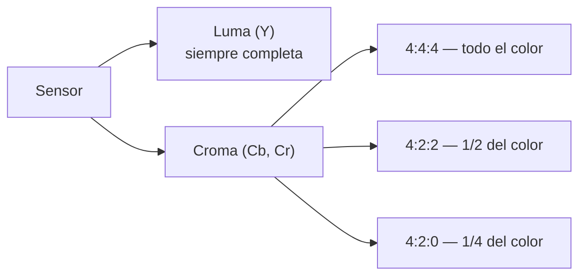

# Profundidad de bits y submuestreo de croma

Parte de: [[31-Video-Audio/01 Técnica de video/_Índice Técnica de video|Técnica de video]]

> [!info] Cómo avanzar
> `progreso`: **pendiente** → **viendo** (estudiando) → **visto** (contestaste la autoevaluación sin abrir las respuestas) → **dominado** (hiciste el laboratorio o lo aplicaste de verdad).

## Contenido

### Qué es
La **profundidad de bits** indica cuántos niveles de brillo puede guardar cada canal de color de un píxel: **8 bits = 256 niveles**, **10 bits = 1,024 niveles**. El **submuestreo de croma** indica cuánta información de **color** se guarda en relación con la de **brillo**: 4:4:4 (todo), 4:2:2 (la mitad horizontal) o 4:2:0 (un cuarto). Ambos determinan cuánto puedes "estirar" la imagen al corregir color sin que se rompa.

### Cómo funciona
**Bits.** Con 8 bits por canal tienes 256³ ≈ 16.7 millones de colores; con 10 bits, 1024³ ≈ 1,070 millones. La diferencia no se nota en un video recién grabado, sino **al corregirlo**: si estiras un cielo degradado de 8 bits aparecen **escalones** (*banding*) porque no hay niveles intermedios. El material [[Perfiles de color en video (estándar, Log y HLG)|Log]] comprime todo el rango dinámico en una imagen plana; al devolverle contraste lo estiras muchísimo, por eso **Log debe grabarse en 10 bits**.

**Croma.** El video se guarda como **luma** (Y, brillo) y dos señales de **croma** (Cb y Cr, color). Como el ojo es más sensible al brillo que al color, se ahorra espacio guardando menos color. La notación J:a:b describe un bloque de 4 píxeles de ancho y 2 filas:

| Esquema | Color guardado | Uso típico |
|---|---|---|
| 4:4:4 | Completo | Gráficos, VFX, grabadores externos |
| 4:2:2 | Mitad horizontal | Producción profesional, ProRes, XAVC S-I |
| 4:2:0 | Mitad horizontal y vertical | Celulares, entrega (YouTube, streaming) |

**¿4:2:2 da más nitidez?** No. La nitidez la da sobre todo la **luma**, que siempre está completa. 4:2:2 ayuda en **bordes de color** finos, en **chroma key** (pantalla verde) y al empujar colores en la corrección. Para un vlog visto en el celular, 4:2:0 de 10 bits suele ser más que suficiente.

### Ejemplo
- **[[Sony a6700]]**: XAVC S en 8 bits 4:2:0 o 10 bits 4:2:2; XAVC HS en 10 bits (4:2:0 o 4:2:2); XAVC S-I en 10 bits 4:2:2. Si grabas **S-Log3**, elige siempre una opción de 10 bits.
- **[[iPhone 15 Pro para foto y video]]**: HEVC en HDR es de 10 bits; ProRes es 4:2:2 de 10 bits (o más en las variantes altas).
- **[[DJI Osmo Pocket 4P]]**: el perfil **D-Log 2 es de 10 bits** según DJI (en la cámara principal a 1×).

Prueba práctica: graba un atardecer en 8 bits estándar y otro en 10 bits Log con la a6700. En [[DaVinci Resolve (versión gratuita)]] sube saturación y contraste de forma exagerada a ambos y observa el cielo: el de 8 bits mostrará bandas antes.

### Cuándo usarlo y cuándo no
- **10 bits**: siempre que grabes Log o HLG, o planees una corrección de color fuerte.
- **8 bits**: perfiles estándar listos para publicar, clips largos donde importa el espacio, o si tu PC no puede con 10 bits.
- **4:2:2**: chroma key, trabajos con mucho color, material para clientes. **4:2:0**: casi todo lo demás, y siempre en la entrega.

### Errores comunes
1. **Grabar Log en 8 bits**: es la receta del *banding* en cielos y paredes lisas.
2. **Creer que 4:2:2 mejora la nitidez general**: mejora los bordes de color, no la definición.
3. **Pagar el costo de 4:2:2 10 bits sin poder editarlo**: muchas GPU de consumo no decodifican HEVC 4:2:2 por hardware; usa proxies.
4. **Exportar en 10 bits para redes** esperando más calidad: las plataformas convierten a 8 bits 4:2:0 para la mayoría de los espectadores SDR.

### Para profundizar
- [Video chroma subsampling (RED 101)](https://www.red.com/red-101/video-chroma-subsampling)
- [Chroma subsampling (Frame.io Workflow Guide)](https://workflow.frame.io/guide/chroma-subsampling)
- [Especificaciones de la Sony a6700 (Sony)](https://www.sony.co.in/interchangeable-lens-cameras/products/ilce-6700/spec)

## Autoevaluación

Contesta primero en voz alta o en papel; luego despliega la respuesta.

> [!question]- ¿Qué diferencia hay entre video de 8 y de 10 bits?
> 8 bits: 256 niveles por canal (≈16.7 millones de colores). 10 bits: 1024 niveles por canal (≈1070 millones). Con 10 bits los degradados (cielos, paredes) aguantan mucho más la corrección sin hacer **bandas**.

> [!question]- ¿Qué significa 4:2:0 y 4:2:2?
> Cómo se guarda el color respecto al brillo. **4:2:2**: el color se guarda a la mitad de resolución horizontal. **4:2:0**: a la mitad horizontal y vertical. El brillo siempre va completo. 4:2:2 da bordes de color más limpios (útil en chroma key).

> [!question]- ¿Por qué el material Log debería grabarse en 10 bits?
> Log comprime mucho rango dinámico en una imagen "lavada"; al estirarla en edición necesitas muchos niveles intermedios. En 8 bits aparecen bandas y ruido de color. Apple Log en el iPhone se graba en ProRes (10 bits).

> [!question]- Error común: creer que 4:2:2 mejora la nitidez general. ¿Es así?
> No: la nitidez la da el canal de luminancia, que va completo en ambos. 4:2:2 mejora sobre todo los **bordes de color** y el recorte por color (chroma key), no el detalle.

## Práctica

- [[Lab 2 - Exposición de Apple Log con zebras y false color]]

