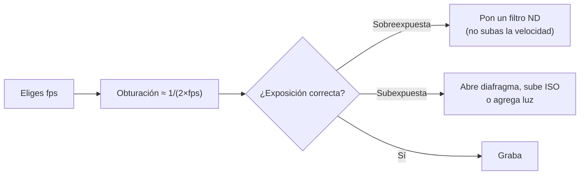

# Regla de los 180 grados del obturador

Parte de: [[31-Video-Audio/01 Técnica de video/_Índice Técnica de video|Técnica de video]]

> [!info] Cómo avanzar
> `progreso`: **pendiente** → **viendo** (estudiando) → **visto** (contestaste la autoevaluación sin abrir las respuestas) → **dominado** (hiciste el laboratorio o lo aplicaste de verdad).

## Contenido

### Qué es
La **regla de los 180°** dice que, en video, la velocidad de obturación debe ser aproximadamente **1 / (2 × fps)**. Con eso, el sensor está expuesto la **mitad** del tiempo de cada cuadro y el desenfoque de movimiento se ve natural, como el que el ojo está acostumbrado a ver en cine y televisión. No es una ley física, es una convención estética muy útil como punto de partida.

### Cómo funciona
El nombre viene de las cámaras de cine con **obturador rotatorio**: un disco con una abertura que gira una vez por cuadro. Si la abertura es de 180° (medio disco), la película se expone la mitad del tiempo de cada cuadro. En cámaras digitales se usa la equivalencia:

**ángulo = 360 × fps × tiempo de exposición**

| fps | Velocidad a 180° | Valor cercano en cámaras |
|---|---|---|
| 24 | 1/48 | 1/50 |
| 30 | 1/60 | 1/60 |
| 60 | 1/120 | 1/125 |
| 120 | 1/240 | 1/250 |

Ejemplos con la fórmula:
- 60 fps con 1/60 → 360 × 60 / 60 = **360°**: el doble de desenfoque, se ve "embarrado" o soñador.
- 24 fps con 1/96 → 360 × 24 / 96 = **90°**: menos desenfoque, movimiento más nítido y nervioso.
- Velocidades muy rápidas (1/1000 a 30 fps ≈ 11°) congelan cada cuadro y el movimiento se ve **a saltos** (efecto estroboscópico, típico de escenas de batalla).

**El problema de la luz.** Como la velocidad queda fija, ya no puedes usarla para controlar la exposición. Te quedan el diafragma, el ISO y la luz. Al mediodía, aun con el ISO mínimo, 1/60 suele quemar la imagen: la solución es un **filtro ND** ([[Filtros ND en video]]). En el iPhone es más crítico porque la **apertura es fija**.

**Flicker (parpadeo).** En México la red eléctrica es de 60 Hz y muchas lámparas parpadean 120 veces por segundo. Velocidades que "encajan" con ese parpadeo, como **1/60 o 1/120**, lo eliminan; 1/50 (la de 24 fps) a veces muestra bandas. Si grabas a 24 fps bajo lámparas LED baratas, prueba ángulos como 172.8° (equivale a 1/50 a 24 fps) o 144° y revisa la pantalla.

### Ejemplo
Grabas en el parque a 30 fps:
- **Con la [[Sony a6700]]**: modo M, 1/60, ISO base, diafragma f/4 y un ND variable hasta que el histograma quede bien. En el menú de la cámara puedes fijar la velocidad sin que cambie.
- **Con el [[iPhone 15 Pro para foto y video]]**: la app Cámara decide la obturación sola. Con [[Blackmagic Camera (app)]] (gratuita) fijas el **ángulo de obturación** en 180°, el ISO y el balance de blancos; si la imagen se quema, pones un ND de clip o de funda.
- **Con la [[DJI Osmo Pocket 4P]]**: en modo Pro puedes fijar obturación e ISO; para respetar 180° a pleno sol necesitarás los filtros ND del fabricante o aceptar una velocidad más alta.

### Cuándo usarlo y cuándo no
- **Úsala** como base en casi todo: entrevistas, vlogs, cortos, b-roll.
- **Rómpela a propósito** para efectos: velocidad rápida para acción nerviosa o para sacar cuadros congelados nítidos; velocidad lenta (360°) para escenas de sueño o con poca luz.
- **En cámara lenta** se aplica a la cadencia de grabación: 120 fps → 1/240, lo que exige mucha luz.

### Errores comunes
1. **Dejar la obturación en automático**: el celular sube a 1/2000 al sol y todo se ve entrecortado.
2. **Usar 1/1000 "para que se vea más nítido"**: cada cuadro sí es más nítido, pero el movimiento pierde fluidez.
3. **Olvidar el ND en exteriores** y terminar cerrando a f/16 (difracción) o subiendo la velocidad.
4. **Ignorar el flicker** bajo luz artificial: revisa siempre en pantalla antes de grabar.
5. **Cambiar fps y no la velocidad**: pasar de 30 a 60 fps manteniendo 1/60 te da 360° sin darte cuenta.

### Para profundizar
- [Shutter Angles & Creative Control (RED 101)](https://www.red.com/red-101/shutter-angle-tutorial)
- [What is the 180 degree shutter rule (StudioBinder)](https://www.studiobinder.com/blog/what-is-the-180-degree-shutter-rule/)
- [Blackmagic Camera en el App Store](https://apps.apple.com/gb/app/id6449580241)
- Relación con foto: [[Velocidad de obturación y movimiento]]

## Ejercicios

Resuélvelos en papel o en la herramienta; la solución está plegada.

> [!question]- Calcula la velocidad de obturación a 180° para 24, 30, 60 y 120 fps.
> 1/(2×fps): 24 → **1/48** (en cámaras que no la tienen, 1/50); 30 → **1/60**; 60 → **1/120** (o 1/125); 120 → **1/240** (o 1/250).

> [!question]- Grabas a 60 fps con 1/60. ¿Qué ángulo de obturación es?
> Ángulo = 360 × fps × tiempo de exposición = 360 × 60 × (1/60) = **360°** (el doble de desenfoque de lo normal).

> [!question]- Grabas a 24 fps con 1/96. ¿Qué ángulo es y cómo se verá?
> 360 × 24 / 96 = **90°**: menos desenfoque, movimiento algo más nítido y "nervioso".

## Autoevaluación

Contesta primero en voz alta o en papel; luego despliega la respuesta.

> [!question]- ¿Qué dice la regla de los 180°?
> Que la velocidad de obturación sea aproximadamente **1 / (2 × fps)**: el obturador queda abierto la mitad de cada cuadro. Así el desenfoque de movimiento se ve natural, como en el cine.

> [!question]- ¿Por qué en el iPhone necesitas una app como [[Blackmagic Camera (app)]] para aplicarla?
> La app Cámara de Apple ajusta la obturación de forma automática y no te deja fijarla. Blackmagic Camera permite fijar el **ángulo de obturación (180°)** o la velocidad (1/48, 1/60…) junto con ISO y balance de blancos.

> [!question]- Caso: grabas a 30 fps al mediodía y con 1/60 la imagen sale quemada aunque bajes el ISO al mínimo. ¿Qué haces?
> Mantener 1/60 y reducir la luz que entra con un **filtro ND**. Si no tienes ND, la alternativa es subir la velocidad (1/250, 1/500) aceptando un movimiento más "entrecortado". Con el iPhone no puedes cerrar el diafragma: la apertura es fija.

> [!question]- Error común: usar 1/1000 en tomas con movimiento "para que se vea más nítido". ¿Qué se nota?
> Cada cuadro queda congelado y el movimiento se ve **a saltos** (efecto estroboscópico, tipo escena de batalla). Úsalo solo si es un efecto buscado.

> [!question]- ¿Qué velocidad usas a 30 fps bajo lámparas que parpadean (flicker)?
> Una que coincida con la red eléctrica de México (60 Hz → la luz parpadea 120 veces por segundo): **1/60 o 1/120** suelen eliminar el parpadeo. En Blackmagic Camera puedes probar también ángulos como 172.8° o 180°, y revisar en pantalla.

## Práctica

- [[Lab 1 - Obturación a 180 grados y cámara lenta]]

