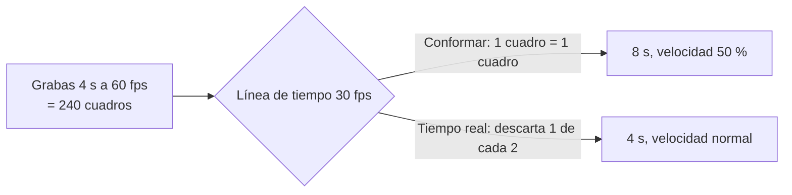

# Resolución y cuadros por segundo

Parte de: [[31-Video-Audio/01 Técnica de video/_Índice Técnica de video|Técnica de video]]

> [!info] Cómo avanzar
> `progreso`: **pendiente** → **viendo** (estudiando) → **visto** (contestaste la autoevaluación sin abrir las respuestas) → **dominado** (hiciste el laboratorio o lo aplicaste de verdad).

## Contenido

### Qué es
La **resolución** es cuántos píxeles tiene cada cuadro del video (ancho × alto). Los **cuadros por segundo** (fps, *frame rate* o cadencia) son cuántas imágenes se graban o reproducen cada segundo. Juntas definen cuánto detalle tiene la imagen y cómo se siente el movimiento. "4K a 30 fps" significa: cuadros de 3840 × 2160 píxeles (4K UHD, el "4K" de cámaras y celulares) y 30 imágenes por segundo.

### Cómo funciona
**Resolución.** Las más comunes:

| Nombre | Píxeles | Total de píxeles |
|---|---|---|
| 1080p (Full HD) | 1920 × 1080 | 2,073,600 |
| 4K UHD | 3840 × 2160 | 8,294,400 |

Un cuadro 4K UHD tiene exactamente **4 veces** los píxeles de un 1080p (el doble de ancho y el doble de alto). Esa sobra de píxeles es la que te permite **recortar**: estabilizar en posproducción, hacer un "zoom" sin perder calidad en una entrega 1080p o sacar un vertical 9:16 de una toma horizontal. Un recorte vertical de 1080 × 1920 necesita 1920 píxeles de *alto*; un clip 1080p horizontal solo tiene 1080, así que tendrías que escalarlo (pierde nitidez). Un clip 4K horizontal tiene 2160 de alto: el recorte cabe sin escalar.

**Cuadros por segundo.** Cada cadencia tiene su sensación:
- **24 fps**: la cadencia del cine; con la obturación correcta (ver [[Regla de los 180 grados del obturador]]) da un desenfoque de movimiento "cinematográfico".
- **30 fps**: la cadencia estándar de video en México y en redes; se ve un poco más fluida y "televisiva".
- **60 fps**: muy fluida, ideal para deporte, videojuegos o para ralentizar al 50 %.
- **120/240 fps**: alta cadencia para [[Cámara lenta (high frame rate)]].

México usa la norma de 60 Hz, por eso aquí lo natural es 30/60 fps; 25/50 fps son de regiones PAL (Europa) y pueden dar parpadeo con la luz eléctrica local.

**Cadencia de grabación vs. cadencia de la línea de tiempo.** Si un clip grabado a 60 fps se "conforma" a una línea de tiempo de 30 fps (cada cuadro grabado se reproduce como un cuadro), los 240 cuadros de un clip de 4 s tardan 240 / 30 = **8 s** en reproducirse: se ve al **50 %** de velocidad. Si en cambio la línea de tiempo *descarta* cuadros para respetar el tiempo real, el clip dura 4 s a velocidad normal.

### Ejemplo
Vas a grabar un video para YouTube sobre un paseo en bicicleta:
- **Proyecto a 30 fps** (o 24 si quieres look de cine). Elige una y no la cambies.
- **Tomas normales**: [[iPhone 15 Pro para foto y video]] en 4K a 30 fps (el iPhone graba 4K a 24, 25, 30 o 60 fps según su ficha técnica).
- **Tomas en cámara lenta** (la rueda, el salpicar del charco): 4K a 60 fps para quedarte en 50 %, o 1080p a 120/240 fps en el modo Cámara lenta para algo más extremo.
- Si usas la [[Sony a6700]], puedes grabar 4K hasta 60p con toda la anchura del sensor (y 4K a 120p con recorte); en la [[DJI Osmo Pocket 4P]] el 4K llega a 60 fps en modo normal y a 240 fps en modos de cámara lenta.

### Cuándo usarlo y cuándo no
- **4K** cuando quieras recortar, estabilizar o entregar a YouTube en máxima calidad. Cuesta más espacio y más proceso al editar (ver [[Proxies y rendimiento al editar]]).
- **1080p** para clips largos (pláticas, tutoriales) donde el espacio importa más que el detalle, o si tu PC sufre al editar.
- **60 fps de base** solo si todo el video pide fluidez (gaming, deporte). Para historias, 24 o 30.

### Errores comunes
1. **Mezclar 25 y 30 fps** en la misma línea de tiempo: el editor duplica o salta cuadros y el movimiento se ve "a tirones". Revisa que todas las cámaras estén en la misma familia (24/30/60).
2. **Cambiar la cadencia del proyecto a media edición**: en muchos editores no se puede o rompe los cortes. Decídela antes de importar.
3. **Grabar todo a 60 fps "por si acaso"** y entregar a 30 sin ralentizar: duplicas el peso sin ganar nada visible.
4. **Grabar 1080p y luego querer un vertical**: no hay píxeles suficientes; si sabes que habrá recortes, graba 4K.
5. **Olvidar la obturación**: subir fps sin ajustar la velocidad de obturación cambia el desenfoque de movimiento.

### Para profundizar
- [Especificaciones técnicas del iPhone 15 Pro (Apple)](https://support.apple.com/en-us/111829)
- [Recommended upload encoding settings (YouTube)](https://support.google.com/youtube/answer/1722171?hl=en)
- [Digital video concepts (MDN)](https://developer.mozilla.org/en-US/docs/Web/Media/Formats/Video_concepts)

## Ejercicios

Resuélvelos en papel o en la herramienta; la solución está plegada.

> [!question]- Un clip de 4 s grabado a 60 fps se reproduce en una línea de tiempo de 30 fps conformado a esa cadencia (cada cuadro grabado = un cuadro reproducido). ¿Cuánto dura y a qué velocidad se ve?
> 4 s × 60 = 240 cuadros. A 30 fps: 240 / 30 = **8 s**, es decir **50 %** de velocidad.

> [!question]- ¿Cuántos píxeles tiene un cuadro 4K UHD y cuántas veces es un cuadro 1080p?
> 3840 × 2160 = **8 294 400** píxeles. 1920 × 1080 = 2 073 600. Relación: **4 veces**.

> [!question]- Quieres sacar un recorte vertical 9:16 de 1080 × 1920 de un video horizontal. ¿Te alcanza un clip 1080p horizontal? ¿Y uno 4K?
> 1080p horizontal mide 1920 × **1080** de alto: para un recorte de 1920 de alto te faltan píxeles (tendrías que ampliar ~178 %). Un 4K horizontal mide 2160 de alto: 1920 cabe con margen, así que **4K sí alcanza** sin perder calidad.

## Autoevaluación

Contesta primero en voz alta o en papel; luego despliega la respuesta.

> [!question]- ¿Qué significan "4K" y "30 fps"?
> **4K** (UHD) es la resolución: 3840 × 2160 píxeles por cuadro. **30 fps** es la cadencia: cuántos cuadros (imágenes) se graban por segundo. Son independientes: puedes grabar 4K a 24, 30 o 60 fps, o 1080p a 120 fps.

> [!question]- ¿Qué sensación da grabar a 24, 30 y 60 fps?
> **24 fps**: aspecto "de cine", con algo de desenfoque de movimiento. **30 fps**: estándar de video en web y TV en México (NTSC). **60 fps**: movimiento muy fluido (deporte, videojuegos) o cámara lenta suave al reproducirlo a 24/30.

> [!question]- Caso: vas a grabar un video para YouTube con algunas tomas en cámara lenta. ¿Qué cadencia eliges para el proyecto y cuál para esas tomas?
> Proyecto a **24 o 30 fps** (uno solo, y que no cambie). Las tomas lentas, a **60 fps o más**, para luego reproducirlas a la cadencia del proyecto (60→30 da 50 % de velocidad).

> [!question]- Error común: mezclar en la misma línea de tiempo clips de 25 y 30 fps sin pensarlo. ¿Qué pasa?
> El editor tiene que inventar o saltarse cuadros para adaptarlos: aparecen tirones (judder) o cuadros repetidos. En México usa la familia NTSC (24/30/60, en realidad 23.976/29.97/59.94) y no grabes en 25/50 salvo que haya un motivo (por ejemplo, luces que parpadean).

## Práctica

- [[Lab 1 - Obturación a 180 grados y cámara lenta]]

