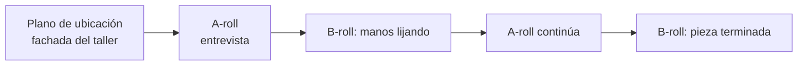

# B-roll y plano de ubicación

Parte de: [[31-Video-Audio/02 Lenguaje audiovisual/_Índice Lenguaje audiovisual|Lenguaje audiovisual]]

> [!info] Cómo avanzar
> `progreso`: **pendiente** → **viendo** (estudiando) → **visto** (contestaste la autoevaluación sin abrir las respuestas) → **dominado** (hiciste el laboratorio o lo aplicaste de verdad).

## Contenido

### Qué es
El **b-roll** es todo el material visual **de apoyo** que acompaña a la toma principal (*a-roll*: la entrevista, la persona hablando a cámara). Muestra **lo que se está diciendo**: si alguien habla de su taller, el b-roll son sus manos trabajando, las herramientas, la madera. El **plano de ubicación** (*establishing shot*) es un plano, normalmente general, que abre una escena para mostrar **dónde y cuándo** ocurre: la fachada del taller, la calle, el amanecer en la ciudad.

### Cómo funciona
**Para qué sirve el b-roll.**
- **Ilustrar**: "muestra, no cuentes" ([[Narrativa y storytelling en video]]).
- **Cubrir cortes**: si quitas una muletilla en la entrevista, el b-roll encima oculta el salto de imagen.
- **Ritmo**: rompe la monotonía de una cara hablando.
- **Transiciones**: conecta temas o lugares.

**Para qué sirve el plano de ubicación.** Orienta al espectador antes de entrar a la acción. Sin él, la primera toma cerrada deja preguntas ("¿dónde estamos?"). También sirve para marcar paso del tiempo (de día a noche) o volver a un lugar ya visto.

**Cómo grabar b-roll útil.**
- **Duración**: 8–15 s por toma. Un clip de 2 s no deja margen para cortar entradas y salidas, ni para ajustar al ritmo de la voz.
- **Variedad**: cada acción en general, medio y detalle ([[Tipos de plano]]), y algún movimiento suave ([[Movimientos de cámara]]).
- **Acciones completas**: que se vea el inicio y el fin (el cepillo entra, recorre, sale).
- **Sonido**: graba también el audio de cámara; el sonido de la sierra o la lija hace al b-roll creíble.

### Ejemplo
**Entrevista a una persona que habla de su taller de carpintería.** Lista de b-roll:
1. **Ubicación**: fachada o puerta del taller (general, fijo, 10 s) y el letrero.
2. **Ambiente**: el taller completo, polvo en la luz de la ventana (general).
3. **Manos**: midiendo, marcando con lápiz, cortando, lijando (medios y detalles).
4. **Herramientas**: el banco con formones, la sierra deteniéndose (detalle, travelling lento).
5. **Proceso**: una pieza de principio a fin.
6. **Resultado**: el mueble terminado (dolly in lento con la [[DJI Osmo Pocket 4P]]).
7. **Persona** trabajando sin mirar a cámara (medio, en mano).

Con la [[Sony a6700]] graba en la misma cadencia que la entrevista (o a 60 fps para usar a 50 %); con el [[iPhone 15 Pro para foto y video]] en 2×/3× para detalles. En edición, la técnica está en [[Uso del b-roll en la edición]].

### Cuándo usarlo y cuándo no
- **Sí**: entrevistas, documentales, YouTube, video de producto, cualquier video con narración.
- **Plano de ubicación**: al inicio de cada escena o cambio de lugar; puede omitirse si quieres desorientar a propósito o si el formato es muy corto (en un reel puede robar segundos valiosos).
- **No uses b-roll genérico** que no tenga relación con lo que se dice: distrae.

### Errores comunes
1. **Grabar b-roll de 2 s**: no hay margen para cortar ni ajustar al ritmo; graba 8–15 s.
2. **Todo en el mismo tamaño y ángulo**: se ve repetitivo.
3. **Olvidar el plano de ubicación** y empezar en primer plano.
4. **B-roll tembloroso** junto a una entrevista estable: se nota el contraste.
5. **Grabarlo al final, con prisa**: haz la lista de b-roll en la preproducción ([[Storyboard y lista de tomas]]).

### Para profundizar
- [Types of shots in films (Adobe)](https://www.adobe.com/creativecloud/video/discover/types-of-shots-in-films.html)
- [Filmmaking 101: Camera Shot Types (B&H Explora)](https://www.bhphotovideo.com/explora/video/tips-and-solutions/filmmaking-101-camera-shot-types)
- En edición: [[Uso del b-roll en la edición]]

## Autoevaluación

Contesta primero en voz alta o en papel; luego despliega la respuesta.

> [!question]- ¿Qué es el b-roll?
> Material de apoyo que se pone sobre la toma principal (a-roll, por ejemplo una entrevista): detalles, lugares, acciones que ilustran lo que se dice.

> [!question]- ¿Qué es un plano de ubicación (establishing shot)?
> Un plano general al inicio de una escena que dice dónde y cuándo ocurre (fachada, calle, paisaje).

> [!question]- Caso: la persona entrevistada habla de su taller de carpintería. ¿Qué b-roll grabas?
> Manos lijando, herramientas en la pared, viruta cayendo, fachada del taller, la persona trabajando en plano medio. Varios tamaños de plano y de 5 a 10 s cada toma.

> [!question]- Error común: grabar b-roll de 2 s. ¿Por qué es poco?
> Necesitas margen para entrar y salir del corte y para cámara lenta; graba 8–10 s por toma con algo de movimiento.

## Práctica

- [[Lab 3 - Escena de 60 segundos con 5 tipos de plano sin romper el eje]]

