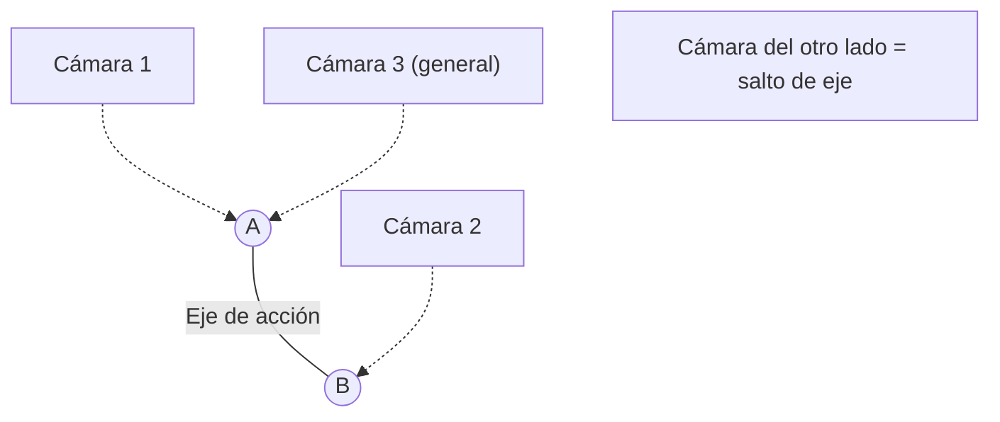

# Eje de 180 grados y continuidad

Parte de: [[31-Video-Audio/02 Lenguaje audiovisual/_Índice Lenguaje audiovisual|Lenguaje audiovisual]]

> [!info] Cómo avanzar
> `progreso`: **pendiente** → **viendo** (estudiando) → **visto** (contestaste la autoevaluación sin abrir las respuestas) → **dominado** (hiciste el laboratorio o lo aplicaste de verdad).

## Contenido

### Qué es
La **regla del eje de 180°** (no confundir con la del obturador) dice que, en una escena con dos personas o con un sujeto que se mueve, imaginas una **línea** que los une (o que sigue la dirección del movimiento) y **mantienes todas las cámaras de un solo lado** de esa línea. Así, cada personaje conserva su lado de la pantalla y el espectador no se desorienta. La **continuidad** es el conjunto de cuidados para que, al cortar entre tomas, todo parezca un mismo momento continuo.

### Cómo funciona
**El eje.** Si A está a la izquierda y B a la derecha en el plano general, en los planos individuales A debe mirar hacia la **derecha** de la pantalla y B hacia la **izquierda**. Si pones una cámara del otro lado de la línea, de repente A mira hacia la izquierda: parece que los dos miran en la misma dirección o que cambiaron de lugar.

Lo mismo con el movimiento: si un coche va de izquierda a derecha, en el siguiente plano debe seguir yendo de izquierda a derecha (dirección de pantalla) o parecerá que regresa.

**Cómo cruzar el eje sin confundir.**
- **Movimiento de cámara continuo** que cruza la línea en la misma toma (el espectador ve el cruce).
- Un **plano neutro** sobre el eje (de frente o desde atrás) entre los dos lados.
- Que un **personaje se mueva** y cree un nuevo eje.
- Un **inserto** o detalle que "resetee" la geografía, seguido de un plano general nuevo.

**Continuidad.** Además del eje, cuida que entre tomas se mantenga:
- **Objetos y vestuario**: el vaso lleno o vacío, la mano con la que se sostiene, la manga arremangada.
- **Acción**: si se levanta en el plano medio, se está levantando en el primer plano (corte en acción).
- **Luz y sonido**: misma hora aparente y mismo ambiente.
- **Mirada**: el personaje mira hacia donde está el otro.

### Ejemplo
**Entrevista o conversación a dos** con la [[Sony a6700]] y el [[iPhone 15 Pro para foto y video]]: coloca a las dos personas en ángulo (en "V"), traza mentalmente la línea entre sus caras y pon **ambas cámaras del mismo lado**, cada una apuntando a una persona de tres cuartos. Así uno mira a la derecha y el otro a la izquierda. Toma una foto del set desde el lugar del general para recordar la posición de objetos.

**Error típico de continuidad**: grabas la toma 1 con el café lleno y, tras tres repeticiones, la taza está a la mitad; al editar, la taza "se llena y se vacía". Solución: rellena entre tomas o haz que la persona no beba hasta el plano final.

Practica con [[Lab 3 - Escena de 60 segundos con 5 tipos de plano sin romper el eje]].

### Cuándo usarlo y cuándo no
- **Sí**: diálogos, entrevistas a dos, persecuciones, deportes, cualquier escena con geografía.
- **Romperla a propósito**: para desorientar o marcar un cambio de poder en la escena, pero sabiendo que lo haces.
- En vlogs y tutoriales de una sola persona a cámara, importa menos (no hay eje entre dos personajes), pero la dirección de movimiento sí.

### Errores comunes
1. **Cruzar el eje sin querer**: los personajes parecen cambiar de lugar o mirar al mismo lado.
2. **Cámara en medio que gira de uno a otro**: queda sobre el eje; las miradas no "se encuentran".
3. **Cambiar la dirección de pantalla** en una secuencia de viaje: parece que regresan.
4. **Objetos que cambian de lugar** entre tomas: toma fotos del set.
5. **Olvidar la continuidad de luz**: grabar una escena de 5 minutos a lo largo de 3 horas con sol cambiante.

### Para profundizar
- [What is continuity editing (StudioBinder)](https://www.studiobinder.com/blog/what-is-continuity-editing/)
- [What is screen direction in film (StudioBinder)](https://www.studiobinder.com/blog/what-is-screen-direction-in-film/)
- En edición: [[Tipos de corte (J-cut, L-cut, jump cut y match cut)]]

## Autoevaluación

Contesta primero en voz alta o en papel; luego despliega la respuesta.

> [!question]- ¿Qué es la regla del eje de 180°?
> Trazas una línea imaginaria entre dos personajes (o en la dirección del movimiento) y colocas todas las cámaras de un solo lado. Así cada personaje mantiene su lado de la pantalla y las miradas coinciden.

> [!question]- ¿Qué pasa si cruzas el eje sin querer?
> Los personajes parecen cambiar de lado y el espectador se desorienta; en un coche que va a la derecha, de repente va a la izquierda.

> [!question]- ¿Cómo puedes cruzar el eje sin confundir?
> Mostrando el cruce en pantalla (la cámara se mueve al otro lado en una toma continua), o cortando a un plano neutral (de frente, sobre el eje) antes de pasar del otro lado.

> [!question]- ¿Qué es la continuidad y da un error típico?
> Mantener coherentes entre tomas posición de objetos, vestuario, acciones y luz. Error típico: el vaso lleno en un plano y vacío en el siguiente. Toma fotos de referencia entre tomas.

## Práctica

- [[Lab 3 - Escena de 60 segundos con 5 tipos de plano sin romper el eje]]

