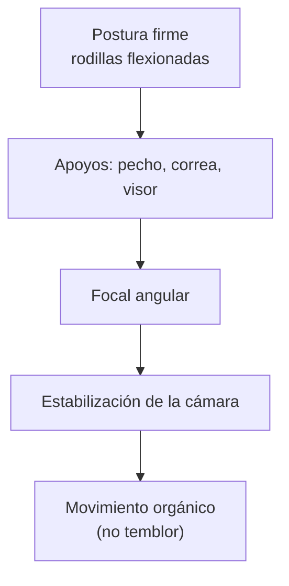

# Cámara en mano (movimiento de cámara)

Parte de: [[Movimientos de cámara]]

> [!info] Cómo avanzar
> `progreso`: **pendiente** → **viendo** (estudiando) → **visto** (contestaste la autoevaluación sin abrir las respuestas) → **dominado** (hiciste el laboratorio o lo aplicaste de verdad).

## Contenido

### Qué es
La **cámara en mano** es grabar sosteniendo la cámara sin tripié ni gimbal, dejando que se note un **movimiento orgánico** y leve. Más que un movimiento concreto es un **estilo**: aporta **cercanía, urgencia y realismo**, como si el espectador estuviera ahí. Se usa en documental, vlogs, escenas de acción y cine de autor.

### Cómo funciona
**Qué aporta.** El ligero vaivén le dice al espectador "esto está pasando ahora y alguien lo está viviendo". Por eso funciona en:
- Documental y reportaje: la cámara reacciona a lo que pasa.
- Vlogs: sensación de compañía, de estar con el creador.
- Momentos de tensión o caos (una discusión, una persecución).

**Controlado no es lo mismo que tembloroso.** La buena cámara en mano **respira**, no tiembla. La diferencia está en la técnica:
- **Postura**: pies separados al ancho de hombros, rodillas un poco flexionadas, codos pegados al torso.
- **Puntos de apoyo**: cámara contra el pecho, correa al cuello tensada hacia adelante, visor pegado al ojo (tres puntos: dos manos y la cara).
- **Respiración**: exhala lento durante las tomas importantes.
- **Gran angular**: el temblor se nota menos que con tele.
- **Peso**: una cámara un poco más pesada (o con jaula y empuñadura) se mueve menos que un teléfono solo.
- **Estabilización**: la óptica o la del sensor ayudan, pero no sustituyen la postura.

### Ejemplo
- **[[Sony a6700]]**: estabilización en **Activo** para caminar o **Estándar** para planos casi quietos; mira por el **visor** (tercer punto de apoyo) en lugar de la pantalla con los brazos estirados.
- **[[iPhone 15 Pro para foto y video]]**: dos manos, codos al cuerpo; el modo Acción quita casi todo el movimiento (más "gimbal" que "en mano"), así que para el look orgánico usa video normal.
- **[[DJI Osmo Pocket 4P]]**: por su gimbal da un resultado más flotante que "en mano"; si buscas realismo, su estabilización puede verse demasiado perfecta.

Ejercicio: graba la misma escena (alguien cocinando) tres veces: brazos estirados, con la técnica de apoyos y en tripié. Compara qué transmite cada una.

### Cuándo usarlo y cuándo no
- **Sí**: documental, vlogs, eventos, momentos espontáneos, escenas de tensión.
- **No**: entrevistas formales, tutoriales con pantalla o detalles finos, video de producto, time-lapses y planos largos fijos. Tampoco en planos con **tele**: el temblor se multiplica y marea.
- Si el resto del video es estable, un tramo en mano destaca; úsalo con intención.

### Errores comunes
1. **Confundir cámara en mano con imagen temblorosa sin control**: se controla con postura, apoyos, angular y estabilización.
2. **Brazos estirados** mirando la pantalla: cada latido se ve.
3. **Mezclar en mano con zoom**: amplifica el temblor; acércate físicamente.
4. **Estabilización digital fuerte con poca luz**: aparecen "jaloneos" de desenfoque (ver [[Estabilización (tripié, gimbal y estabilizador de cámara)]]).
5. **Corregir el encuadre a cada rato**: decide el encuadre y respira; reacciona solo cuando la acción lo pide.

### Para profundizar
- [Especificaciones de la Sony a6700 (Sony)](https://www.sony.co.in/interchangeable-lens-cameras/products/ilce-6700/spec)
- [Types of shots in films (Adobe)](https://www.adobe.com/creativecloud/video/discover/types-of-shots-in-films.html)
- Vuelve al panorama: [[Movimientos de cámara]]

## Autoevaluación

Contesta primero en voz alta o en papel; luego despliega la respuesta.

> [!question]- ¿Qué aporta la cámara en mano?
> Sensación documental, cercanía o urgencia; el leve movimiento se siente "humano".

> [!question]- ¿Cuándo no conviene?
> En tomas que deben verse estables y elegantes (producto, entrevista formal); ahí usa tripié o gimbal.

> [!question]- Error común: confundir cámara en mano con imagen temblorosa sin control. ¿Cómo se controla?
> Postura firme, codos al cuerpo, respiración tranquila y lentes angulares; el movimiento debe ser intencional y suave.

## Práctica

- [[Lab 4 - Movimientos de cámara con el iPhone]]

