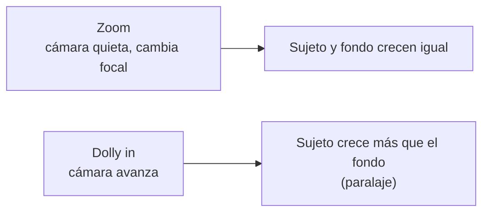

# Dolly in y dolly out

Parte de: [[Movimientos de cámara]]

> [!info] Cómo avanzar
> `progreso`: **pendiente** → **viendo** (estudiando) → **visto** (contestaste la autoevaluación sin abrir las respuestas) → **dominado** (hiciste el laboratorio o lo aplicaste de verdad).

## Contenido

### Qué es
El **dolly in** es acercar **físicamente** la cámara al sujeto durante la toma; el **dolly out** es alejarla. El nombre viene del carrito sobre rieles (*dolly*) que se usaba en cine. Se usa para **intensificar** (in: "acércate, esto importa") o para **soltar y cerrar** (out: "aléjate, terminó" o "mira dónde está ahora").

### Cómo funciona
**Dolly in vs. zoom.** Ambos agrandan al sujeto, pero no son lo mismo:
- **Zoom** (óptico o digital): cambia la focal desde el mismo lugar. Sujeto y fondo crecen **igual**; la perspectiva no cambia y se siente como "mirar con binoculares". El **zoom digital** del iPhone además **recorta** píxeles, así que pierde calidad.
- **Dolly in**: la cámara se mueve. El sujeto crece **más rápido** que el fondo, aparece paralaje y el espacio se siente. Es como caminar hacia alguien.

**El efecto vértigo** (*dolly zoom*): dolly in mientras haces zoom out (o al revés) para que el sujeto quede del mismo tamaño y el fondo se estire o comprima. Es muy dramático; úsalo con cuidado.

**Velocidad.** Un dolly lento es casi imperceptible pero crea tensión; uno rápido es enfático. Lo importante es que sea **constante**.

### Ejemplo
**Dolly in a un amigo que lee una carta** (momento emocional):
- **[[DJI Osmo Pocket 4P]]**: sostenla con las dos manos, empieza a 2 m en plano medio, 2 s quieto, avanza **despacio** con pasos cortos hasta un primer plano, 2 s quieto. El gimbal absorbe el temblor.
- **[[iPhone 15 Pro para foto y video]]**: lo mismo en un gimbal o con la caminata ninja; o sobre una superficie lisa (una mesa, un skate, una silla de oficina con ruedas) como dolly casero.
- **[[Sony a6700]]**: en un slider para detalles de producto (dolly in a un reloj), o a mano con estabilización Activa.

**Cómo se ensaya un dolly regular:**
1. Marca con cinta en el piso el punto de **inicio** y el de **final**.
2. Cuenta los pasos o los segundos (por ejemplo, 4 pasos en 4 s).
3. Haz 2–3 ensayos sin grabar, luego graba varias tomas.
4. Si usas un objeto con ruedas, empuja siempre con la misma fuerza; arrancar y frenar con suavidad.
5. En edición elige la más pareja; si hace falta, estabiliza con [[Estabilización en posproducción (Gyroflow)|Gyroflow]] o la estabilización de Resolve.

### Cuándo usarlo y cuándo no
- **Dolly in**: revelaciones, momentos emocionales, para dirigir la atención a un detalle, inicio de una explicación importante en un video de YouTube.
- **Dolly out**: finales, soledad, revelar el contexto ("estaba solo en un estadio vacío").
- **No**: en todas las tomas; pierde fuerza. Y no lo sustituyas con zoom digital si quieres sensación de espacio.

### Errores comunes
1. **Dolly irregular** (acelera y frena): se ensaya con marcas y conteo.
2. **Confundirlo con el zoom digital del iPhone**: el zoom no da paralaje y pierde calidad.
3. **Perder el foco**: al acercarte la distancia cambia; usa enfoque continuo o enfoca en el punto final.
4. **Terminar demasiado cerca** con gran angular: deforma la cara; termina en un primer plano razonable.
5. **No dejar pausa** al final: el corte se siente brusco.

### Para profundizar
- [Types of shots in films (Adobe)](https://www.adobe.com/creativecloud/video/discover/types-of-shots-in-films.html)
- [Comunicado de lanzamiento de la Osmo Pocket 4P (DJI)](https://www.mynewsdesk.com/uk/dji/pressreleases/osmo-pocket-4p-delivers-pro-filmmaking-capabilities-advancing-the-gimbal-camera-category-dji-pioneered-3459469)
- Vuelve al panorama: [[Movimientos de cámara]]

## Autoevaluación

Contesta primero en voz alta o en papel; luego despliega la respuesta.

> [!question]- ¿Qué es un dolly in?
> Acercar físicamente la cámara al sujeto (dolly out: alejarla). Se usa para intensificar un momento o revelar el entorno.

> [!question]- ¿Por qué no es lo mismo que el zoom digital del iPhone?
> El zoom digital recorta y pierde calidad, y no cambia la perspectiva; el dolly sí.

> [!question]- Error común: hacer el dolly de forma irregular. ¿Cómo se ensaya?
> Marca inicio y fin en el piso, cuenta los segundos y repite hasta que la velocidad sea constante.

## Práctica

- [[Lab 4 - Movimientos de cámara con el iPhone]]

