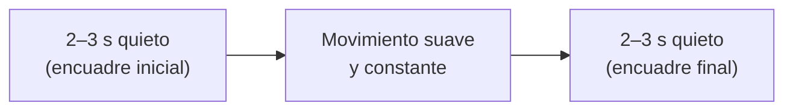

# Movimientos de cámara

Parte de: [[31-Video-Audio/02 Lenguaje audiovisual/_Índice Lenguaje audiovisual|Lenguaje audiovisual]]

> [!info] Cómo avanzar
> `progreso`: **pendiente** → **viendo** (estudiando) → **visto** (contestaste la autoevaluación sin abrir las respuestas) → **dominado** (hiciste el laboratorio o lo aplicaste de verdad).

## Contenido

### Qué es
Un **movimiento de cámara** es cualquier cambio de encuadre durante la toma producido por la cámara, no por el sujeto. Se dividen en dos familias: los que **giran** la cámara sobre su eje sin desplazarla (paneo y tilt) y los que la **desplazan** por el espacio (travelling, dolly, pedestal, grúa). La cámara en mano es un estilo que puede combinar ambos. Moverse con intención **guía la mirada, revela información y transmite emoción**; moverse sin motivo solo distrae.

### Cómo funciona
**Girar vs. desplazar.** Cuando la cámara solo gira, la relación entre objetos cercanos y lejanos **no cambia**: es como mover los ojos. Cuando la cámara se desplaza, aparece **paralaje**: lo cercano se mueve más rápido que lo lejano, y eso da sensación de **profundidad** y de estar "dentro" de la escena.

| Movimiento | Tipo | Qué hace | Nota |
|---|---|---|---|
| Paneo | Gira (horizontal) | Recorre o sigue lateralmente | [[Paneo (movimiento de cámara)]] |
| Tilt | Gira (vertical) | Revela altura, sigue arriba/abajo | [[Tilt (movimiento de cámara)]] |
| Travelling | Se desplaza | Acompaña al sujeto, paralaje | [[Travelling (movimiento de cámara)]] |
| Dolly in/out | Se desplaza (adelante/atrás) | Acerca o aleja con intención | [[Dolly in y dolly out]] |
| Cámara en mano | Estilo | Cercanía, urgencia, realismo | [[Cámara en mano (movimiento de cámara)]] |

**Zoom vs. dolly in.** El **zoom** cambia la focal: la imagen se "amplía", pero la perspectiva no cambia (fondo y sujeto crecen igual). El **dolly in** mueve la cámara hacia el sujeto: el sujeto crece más rápido que el fondo y el espacio se siente. Se ven distintos y comunican distinto.

**Regla práctica: inicio y final fijos.** Empieza **quieto 2–3 s**, haz el movimiento a velocidad constante y **termina quieto 2–3 s**. Así en edición puedes usar el movimiento completo o solo el plano fijo de inicio o final.



### Ejemplo
Con tu equipo:
- **[[DJI Osmo Pocket 4P]]**: su gimbal de 3 ejes hace paneos, tilts y travellings suaves casi sin esfuerzo; ActiveTrack sigue al sujeto en travellings.
- **[[iPhone 15 Pro para foto y video]]**: la estabilización (y el modo Acción) ayudan en travellings a pie; para paneos limpios, mejor en tripié con cabeza fluida.
- **[[Sony a6700]]**: con su estabilizador en modo **Activo** y un lente estabilizado, travellings a pie razonables; para paneos, tripié de video.
Practica la secuencia de [[Lab 4 - Movimientos de cámara con el iPhone]].

### Cuándo usarlo y cuándo no
- **Muévete** para revelar algo, seguir al sujeto, mostrar la escala de un lugar o intensificar un momento.
- **Quédate fijo** en diálogos, entrevistas y cuando la acción ya tiene mucho movimiento.
- Combina: un movimiento por escena bien hecho vale más que diez improvisados.

### Errores comunes
1. **Mover la cámara sin motivo en todas las tomas**: se pierde el efecto y el espectador se marea; el movimiento deja de significar algo.
2. **Arrancar o frenar de golpe**: sin plano fijo al inicio y final, la toma es difícil de editar.
3. **Usar zoom digital pensando que es un dolly**: pierde calidad y no da profundidad.
4. **Velocidad irregular**: se nota más que la falta de movimiento; ensaya.
5. **Movimientos rápidos a 24/30 fps** con obturación lenta: el fondo se vuelve una mancha o vibra.

### Para profundizar
- [Pan shot (Adobe)](https://www.adobe.com/creativecloud/video/production/cinematography/camera-shots-and-angles/pan-shot)
- [Types of shots in films (Adobe)](https://www.adobe.com/creativecloud/video/discover/types-of-shots-in-films.html)
- Con dron: [[Movimientos cinematográficos con dron]]

## Subtemas

- [[Paneo (movimiento de cámara)]]
- [[Tilt (movimiento de cámara)]]
- [[Travelling (movimiento de cámara)]]
- [[Dolly in y dolly out]]
- [[Cámara en mano (movimiento de cámara)]]

## Autoevaluación

Contesta primero en voz alta o en papel; luego despliega la respuesta.

> [!question]- ¿Qué diferencia hay entre girar la cámara y desplazarla?
> Girar sobre su eje (paneo, tilt) cambia hacia dónde miras sin cambiar la perspectiva. Desplazarla (travelling, dolly) mueve el punto de vista y produce **paralaje**: los objetos cercanos se mueven más que los lejanos, lo que da profundidad.

> [!question]- ¿Qué diferencia hay entre hacer zoom y un dolly in?
> El zoom amplía la imagen desde el mismo lugar (la perspectiva no cambia). El dolly acerca físicamente la cámara (cambia la perspectiva y se siente más inmersivo).

> [!question]- Regla práctica: ¿cómo empiezas y terminas un movimiento?
> Graba unos 2 s **quieto** antes y después, y haz el movimiento a velocidad constante. Así tienes de dónde cortar.

> [!question]- Error común: mover la cámara sin motivo en todas las tomas. ¿Qué se pierde?
> El movimiento deja de significar algo y cansa. Muévete para revelar, seguir o acercarte a la emoción.

## Práctica

- [[Lab 4 - Movimientos de cámara con el iPhone]]

## Progreso de los subtemas

```base
filters:
  and:
    - file.inFolder("31-Video-Audio/02 Lenguaje audiovisual/Movimientos de cámara")
    - file.name != "Movimientos de cámara"
views:
  - type: table
    name: Progreso
    order:
      - file.name
      - progreso
      - nivel
```
