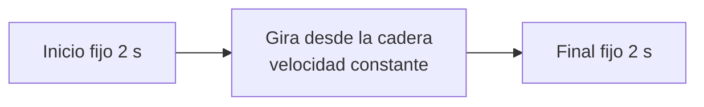

# Paneo (movimiento de cámara)

Parte de: [[Movimientos de cámara]]

> [!info] Cómo avanzar
> `progreso`: **pendiente** → **viendo** (estudiando) → **visto** (contestaste la autoevaluación sin abrir las respuestas) → **dominado** (hiciste el laboratorio o lo aplicaste de verdad).

## Contenido

### Qué es
El **paneo** (*pan*) es el giro **horizontal** de la cámara sobre su eje vertical, sin desplazarla: como cuando giras la cabeza de izquierda a derecha. Sirve para **recorrer** un espacio que no cabe en un solo encuadre, **seguir** a un sujeto que se mueve lateralmente o **conectar** dos elementos (de una persona a lo que está mirando).

### Cómo funciona
**Tipos de paneo.**
- **Descriptivo**: recorre un paisaje o un lugar lentamente.
- **De seguimiento**: acompaña a un coche o a una persona que camina; el sujeto se mantiene en el mismo lugar del cuadro.
- **De conexión**: va de A a B para relacionarlos (alguien mira por la ventana → paneo a lo que ve).
- **Barrido** (*whip pan*): giro rapidísimo que deja todo borroso; se usa como transición entre tomas.

**Por qué un paneo rápido se ve a tirones.** El video está hecho de cuadros discretos (24 o 30 por segundo). Si giras muy rápido, entre un cuadro y el siguiente el fondo salta demasiado y el ojo percibe **saltos** (*judder*) en lugar de un movimiento continuo, sobre todo con líneas verticales (edificios, árboles, postes). Se reduce:
- Haciendo el paneo **más lento**: una referencia práctica es que un objeto tarde al menos 5–7 s en cruzar el cuadro a 24/30 fps.
- Respetando la [[Regla de los 180 grados del obturador]]: el desenfoque de movimiento suaviza el salto; con obturación rápida empeora.
- Siguiendo a un sujeto: el ojo se fija en él y el fondo borroso molesta menos.
- Grabando a 60 fps si el paneo tiene que ser rápido.

### Ejemplo
**Sin tripié** (con el [[iPhone 15 Pro para foto y video]] o la [[Sony a6700]]):
1. Planta los pies apuntando hacia **donde termina** el paneo.
2. Gira el torso hacia donde **empieza** (quedas "enrollado").
3. Codos pegados al cuerpo, cámara cerca del pecho o con correa tensa.
4. Graba 2 s quieto, **desenróllate girando desde la cadera** a velocidad constante y termina quieto 2 s. Tu cuerpo termina en su postura natural, así que el final sale estable.

**Con tripié**: usa una cabeza de video (fluida) y ajusta la fricción para que el giro sea suave. Con la [[DJI Osmo Pocket 4P]], el gimbal hace paneos muy limpios: muévelo con el joystick o gira la muñeca despacio y deja que el gimbal suavice.

### Cuándo usarlo y cuándo no
- **Sí**: paisajes amplios, seguir a un sujeto lateral, revelar lo que alguien mira, transiciones con barrido.
- **No**: para "mostrar todo" un lugar que podrías resolver con dos o tres planos fijos mejor compuestos.
- En vertical (9:16) el paneo recorre poco espacio lateral; a veces un tilt o un travelling funciona mejor.

### Errores comunes
1. **Hacer el paneo con los brazos**: la cámara oscila y se inclina; gira desde la cadera.
2. **Ir y venir** (paneo de ida y vuelta "buscando"): decide inicio y final antes de grabar.
3. **Demasiado rápido** con edificios o postes: tirones visibles.
4. **Horizonte inclinado** a mitad del paneo: nivela el tripié antes o activa la cuadrícula.
5. **Sin pausas** al inicio y final: no hay de dónde cortar.

### Para profundizar
- [Pan shot (Adobe)](https://www.adobe.com/creativecloud/video/production/cinematography/camera-shots-and-angles/pan-shot)
- [Shutter Angles & Creative Control (RED 101)](https://www.red.com/red-101/shutter-angle-tutorial)
- Vuelve al panorama: [[Movimientos de cámara]]

## Autoevaluación

Contesta primero en voz alta o en papel; luego despliega la respuesta.

> [!question]- ¿Qué es un paneo?
> Girar la cámara horizontalmente (izquierda-derecha) sobre su eje, sin desplazarla.

> [!question]- ¿Por qué un paneo rápido se ve a tirones y cómo lo evitas?
> Con obturación a 180° y movimiento rápido aparece judder. Hazlo más lento, o muy rápido a propósito (whip pan) para transición.

> [!question]- Error común: hacer el paneo con los brazos. ¿Cómo se hace bien sin tripié?
> Fija los brazos pegados al cuerpo y gira desde la cadera, con los pies firmes.

## Práctica

- [[Lab 4 - Movimientos de cámara con el iPhone]]

