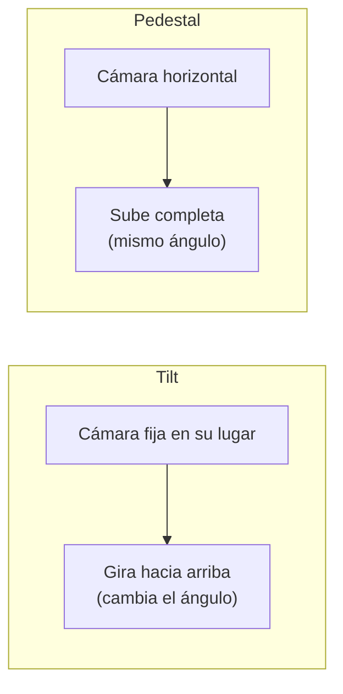

# Tilt (movimiento de cámara)

Parte de: [[Movimientos de cámara]]

> [!info] Cómo avanzar
> `progreso`: **pendiente** → **viendo** (estudiando) → **visto** (contestaste la autoevaluación sin abrir las respuestas) → **dominado** (hiciste el laboratorio o lo aplicaste de verdad).

## Contenido

### Qué es
El **tilt** es el giro **vertical** de la cámara sobre su eje horizontal, sin desplazarla: como cuando subes o bajas la mirada. "Tilt up" es hacia arriba y "tilt down" hacia abajo. Sirve para **revelar altura**, **presentar** a alguien de pies a cabeza o seguir algo que sube o baja.

### Cómo funciona
**Usos típicos.**
- **Revelar escala**: empezar en la base de un edificio, una cascada o un árbol y subir hasta la punta. La sensación de grandeza crece con el movimiento.
- **Presentar a un personaje**: de los zapatos a la cara (muy usado en cine para presentar a alguien con actitud).
- **Seguir** algo vertical: un cohete, un globo, una persona subiendo una escalera, la cerveza cayendo en el vaso.
- **Conectar**: de la persona mirando hacia arriba al cielo (o al dron) que ve.
- **Transición**: tilt up al cielo al final de una escena y tilt down desde el cielo en la siguiente.

**Tilt vs. pedestal.** En el **tilt** la cámara **gira** (cambia el ángulo; al final miras desde abajo hacia arriba). En el **pedestal** la cámara **sube o baja completa** manteniéndose horizontal (como un elevador): el ángulo no cambia y aparece paralaje. Un tilt hacia arriba termina en un contrapicado; un pedestal hacia arriba no ([[Ángulos de cámara]]).

**Técnica.** Igual que en el paneo: inicio fijo, velocidad constante, final fijo. Al inclinar mucho hacia arriba con gran angular, las líneas verticales convergen (los edificios "se caen hacia atrás"); a veces es el efecto que buscas, a veces no.

### Ejemplo
**Presentación de un amigo con su bici**:
- Con el [[iPhone 15 Pro para foto y video]] en tripié, a la altura de la cadera: empieza en la llanta delantera, 2 s quieto, tilt up lento hasta su cara, 2 s quieto.
- Con la [[DJI Osmo Pocket 4P]]: el gimbal hace el tilt suave con el joystick, incluso a mano.
- Con la [[Sony a6700]] en tripié de video: ajusta la fricción del eje vertical para que no "caiga" por el peso.

**Pedestal casero**: sostén el iPhone en el modo Acción y baja flexionando las rodillas manteniéndolo horizontal; compara con un tilt desde el mismo punto.

### Cuándo usarlo y cuándo no
- **Sí**: arquitectura, naturaleza vertical (árboles, cascadas), presentación de personajes, transiciones con cielo.
- **No**: cuando un plano fijo más abierto muestra lo mismo sin esperar.
- En video vertical el tilt es muy natural: el formato ya es alto.

### Errores comunes
1. **Confundir tilt con pedestal**: uno gira, el otro sube o baja; el efecto en la perspectiva es distinto.
2. **Tilt rápido** con muchas líneas horizontales (escalones, ventanas): tirones.
3. **Tripié flojo**: la cámara "se cae" al final del tilt; ajusta la fricción o el contrapeso.
4. **Sobreexponer al llegar al cielo**: la exposición cambia en el movimiento; fíjala (o protege las luces con zebras) antes de grabar.
5. **Tilt sin destino**: termina en algo interesante (cara, punta del edificio, logo).

### Para profundizar
- [Pan shot (Adobe)](https://www.adobe.com/creativecloud/video/production/cinematography/camera-shots-and-angles/pan-shot)
- [Types of shots in films (Adobe)](https://www.adobe.com/creativecloud/video/discover/types-of-shots-in-films.html)
- Vuelve al panorama: [[Movimientos de cámara]]

## Autoevaluación

Contesta primero en voz alta o en papel; luego despliega la respuesta.

> [!question]- ¿Qué es un tilt?
> Girar la cámara verticalmente (arriba-abajo) sobre su eje.

> [!question]- Da un uso típico de un tilt.
> Revelar la altura de un edificio o presentar a una persona de los pies a la cara.

> [!question]- Error común: confundir tilt con pedestal. ¿Cuál es la diferencia?
> El tilt gira la cámara; el **pedestal** la sube o baja completa manteniéndola nivelada.

## Práctica

- [[Lab 4 - Movimientos de cámara con el iPhone]]

