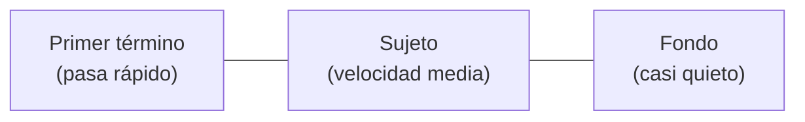

# Travelling (movimiento de cámara)

Parte de: [[Movimientos de cámara]]

> [!info] Cómo avanzar
> `progreso`: **pendiente** → **viendo** (estudiando) → **visto** (contestaste la autoevaluación sin abrir las respuestas) → **dominado** (hiciste el laboratorio o lo aplicaste de verdad).

## Contenido

### Qué es
El **travelling** es el movimiento en el que la cámara **se desplaza** físicamente por el espacio, normalmente de lado o siguiendo al sujeto, a diferencia del paneo o el tilt, donde solo gira. En cine se hacía sobre rieles o un carrito (*dolly*); hoy se logra caminando con un gimbal, con un slider, desde un coche o con un dron.

### Cómo funciona
**Por qué es atractivo: paralaje.** Al desplazarse, los objetos cercanos pasan más rápido que los lejanos. Ese contraste crea **profundidad** y la sensación de **estar dentro** de la escena. Un travelling lateral junto a una reja o unos árboles en primer término se ve mucho más "cinematográfico" que el mismo lugar en plano fijo.

**Tipos.**
- **Lateral**: la cámara avanza paralela al sujeto (alguien caminando por la banqueta).
- **De seguimiento**: detrás o delante del sujeto, acompañándolo.
- **Circular** (*orbit*): rodea al sujeto; muy dramático y usado con gimbal o dron.
- **Hacia adelante/atrás**: si es hacia el sujeto se suele llamar dolly in/out ([[Dolly in y dolly out]]).

**Elementos en primer término.** Para que el paralaje se note, pon algo cerca de la lente (plantas, postes, personas pasando) además del sujeto y el fondo.

### Ejemplo
**Travelling caminando con el iPhone** ([[iPhone 15 Pro para foto y video]]):
1. Activa el **modo Acción** (hasta 2.8K a 60 fps) si caminarás rápido o en terreno irregular; para algo más suave, video normal 4K con la estabilización estándar.
2. Usa la **"caminata ninja"**: rodillas flexionadas, pasos cortos, apoyando primero el talón y rodando al pie, como si caminaras sobre hielo. Las rodillas absorben el rebote.
3. Sostén el teléfono con las dos manos, codos pegados al cuerpo, o en un gimbal o palo selfie corto.
4. Usa **gran angular** (0.5× o 1×): cuanto más amplio, menos se notan los rebotes.
5. Graba a 60 fps si puedes; ralentizar un poco al 80 % suaviza aún más.

Con la [[DJI Osmo Pocket 4P]] el travelling es su especialidad: el gimbal de 3 ejes elimina casi todo el rebote y ActiveTrack mantiene al sujeto en cuadro, incluso en órbitas. Con la [[Sony a6700]], activa la estabilización **Activa** y usa un lente angular; si quieres más suavidad, estabiliza después con [[Estabilización en posproducción (Gyroflow)|Gyroflow]].

### Cuándo usarlo y cuándo no
- **Sí**: seguir a alguien que camina o corre, mostrar un lugar con profundidad, introducir un personaje, video de viaje y de producto (en slider).
- **No**: diálogos largos (cansa), espacios muy estrechos donde no puedes moverte con seguridad.
- Siempre con alguien que te guíe si caminas hacia atrás.

### Errores comunes
1. **Caminar normal con el iPhone**: cada paso se ve como un rebote. Usa la caminata ninja y gran angular.
2. **Zoom 3× caminando**: amplifica todo el temblor.
3. **Sin primer término**: el travelling pierde su gracia porque no se nota el paralaje.
4. **Velocidad desigual** entre cámara y sujeto: el sujeto se sale y entra del cuadro.
5. **Caminar hacia atrás sin guía**: riesgo de caerte; pide a alguien que te sostenga del hombro.

### Para profundizar
- [Especificaciones técnicas del iPhone 15 Pro (Apple)](https://support.apple.com/en-us/111829)
- [Types of shots in films (Adobe)](https://www.adobe.com/creativecloud/video/discover/types-of-shots-in-films.html)
- Vuelve al panorama: [[Movimientos de cámara]]

## Autoevaluación

Contesta primero en voz alta o en papel; luego despliega la respuesta.

> [!question]- ¿Qué es un travelling?
> Desplazar la cámara lateralmente o siguiendo al sujeto (en riel, gimbal, caminando).

> [!question]- ¿Qué lo hace atractivo?
> El **paralaje**: si hay objetos en primer plano entre la cámara y el sujeto, el movimiento da sensación de profundidad.

> [!question]- Error común caminando con el iPhone: ¿qué ayuda a que no rebote?
> Paso ninja (rodillas flexionadas, pasos de talón a punta), estabilización del teléfono activada y lente gran angular (1x o 0.5x), que disimula la vibración.

## Práctica

- [[Lab 4 - Movimientos de cámara con el iPhone]]

