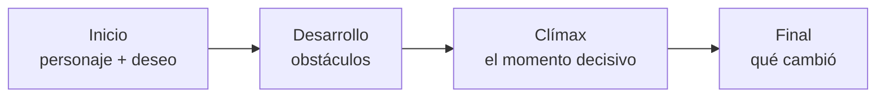

# Narrativa y storytelling en video

Parte de: [[31-Video-Audio/02 Lenguaje audiovisual/_Índice Lenguaje audiovisual|Lenguaje audiovisual]]

> [!info] Cómo avanzar
> `progreso`: **pendiente** → **viendo** (estudiando) → **visto** (contestaste la autoevaluación sin abrir las respuestas) → **dominado** (hiciste el laboratorio o lo aplicaste de verdad).

## Contenido

### Qué es
La **narrativa** es la forma de **ordenar** lo que muestras para que el espectador viva un cambio, no solo vea imágenes. Contar una historia (*storytelling*) es tomar a alguien que **quiere** algo, ponerle un **obstáculo** y mostrar **qué cambia**. Aplica igual a un corto, a un vlog de viaje, a un video de producto de 30 s o a un tutorial: siempre hay un "antes" y un "después".

### Cómo funciona
**Estructura mínima: inicio, desarrollo y final.**
1. **Inicio (planteamiento)**: quién es, dónde está y **qué quiere** o qué problema tiene. Debe llegar rápido (en redes, en los primeros segundos).
2. **Desarrollo (conflicto)**: intentos, obstáculos, sorpresas. Aquí está la tensión: ¿lo logrará?
3. **Final (resolución)**: lo logra o no, y **qué cambió** (la persona, la situación o lo que aprendimos).

**"Muestra, no cuentes".** En lugar de que alguien diga "estaba nervioso", muestras sus manos temblando y el pie golpeando el suelo. En lugar de "el lugar era hermoso", un plano general en hora dorada y la cara de asombro. El video es visual: si la imagen puede decirlo, la voz sobra o debe aportar otra cosa.

**Herramientas narrativas.**
- **Pregunta abierta**: plantea al inicio algo que solo se responde al final ("¿llegaremos a la cima antes del atardecer?").
- **Contraste**: antes/después, expectativa/realidad.
- **Detalles personales**: un objeto o hábito que haga única a la persona.
- **Sonido**: el silencio antes del momento clave pesa tanto como la música.

### Ejemplo
**Tu vlog de viaje se siente como una lista de lugares** ("aquí el museo, aquí la playa, aquí la comida"). Para convertirlo en historia:
1. **Define un deseo**: "quiero probar el mejor mole del pueblo" o "subir al mirador para ver el amanecer".
2. **Plantéalo al inicio** a cámara con la [[DJI Osmo Pocket 4P]] o el [[iPhone 15 Pro para foto y video]].
3. **Obstáculos reales**: el camión no pasa, llueve, el primer lugar está cerrado. Grábalos: son la parte interesante.
4. **Clímax**: el primer bocado o la salida del sol (cámara lenta, primer plano de tu reacción).
5. **Cierre**: qué te llevas; un plano general alejándote.
Los lugares siguen apareciendo, pero ahora son **pasos** hacia el objetivo, no una lista.

### Cuándo usarlo y cuándo no
- **Siempre** hay que tener al menos un hilo: incluso un tutorial tiene un problema (no sé hacerlo) y una resolución (ya funciona).
- En formatos muy cortos (reels) la estructura se comprime: gancho con la pregunta, desarrollo rápido, resolución ([[Creación de contenido (ganchos, retención y constancia)]]).
- En videos puramente estéticos (un time-lapse) la narrativa puede ser solo un arco de luz o de ritmo.

### Errores comunes
1. **Grabar "todo" y buscar la historia en la edición**: horas de material sin hilo. Conviene definir antes la idea en una frase y una lista de momentos clave ([[Preproducción (idea, guion y guion técnico)]]), dejando espacio para lo inesperado.
2. **Explicar con voz lo que ya se ve**: redundante y lento.
3. **Inicio lento**: presentaciones largas antes de plantear el problema; el espectador se va.
4. **Sin cambio al final**: si nada cambió, el espectador siente que no pasó nada.
5. **Cortar los obstáculos** porque "salieron mal": son lo que hace interesante la historia.

### Para profundizar
- [Manual para principiantes de DaVinci Resolve 20 (Blackmagic Design)](https://documents.blackmagicdesign.com/UserManuals/DaVinci-Resolve-20-Beginners-Guide.pdf)
- [What is continuity editing (StudioBinder)](https://www.studiobinder.com/blog/what-is-continuity-editing/)
- En edición: [[Ritmo y narrativa en el montaje]]

## Autoevaluación

Contesta primero en voz alta o en papel; luego despliega la respuesta.

> [!question]- ¿Cuál es la estructura mínima de una historia?
> Inicio (quién y qué quiere), conflicto o cambio (qué pasa), y cierre (cómo termina o qué se aprendió). Funciona igual en un reel de 30 s que en un corto.

> [!question]- ¿Qué significa "muestra, no cuentes"?
> En vez de decir "estaba nervioso", muestra manos inquietas, mirada al reloj. El video comunica con imagen y sonido, no solo con narración.

> [!question]- Caso: tu vlog de viaje se siente como una lista de lugares. ¿Cómo lo conviertes en historia?
> Plantea una pregunta o meta al inicio ("¿encontraré el mejor taco de la ciudad?"), muestra obstáculos y resuélvela al final.

> [!question]- Error común de principiante: grabar "todo" y buscar la historia en la edición. ¿Qué conviene?
> Definir antes la idea en una frase y una lista de tomas; luego se graba con propósito y la edición es más rápida.

## Práctica

- [[Lab 9 - Grabar un reel vertical de 30 segundos]]

