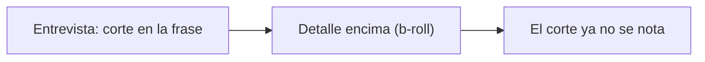

# Plano detalle (video)

Parte de: [[Tipos de plano]]

> [!info] Cómo avanzar
> `progreso`: **pendiente** → **viendo** (estudiando) → **visto** (contestaste la autoevaluación sin abrir las respuestas) → **dominado** (hiciste el laboratorio o lo aplicaste de verdad).

## Contenido

### Qué es
El **plano detalle** (también *insert*) encuadra **un objeto o una parte** de algo: unas manos atando un nudo, la pantalla de un teléfono, el café cayendo en la taza, un ojo. Su función es mostrar **información** que el plano más abierto no deja ver y dar **ritmo** a la edición.

### Cómo funciona
**Para qué te sirve al editar** (es de los planos más útiles):
- **Cubrir cortes**: en una entrevista, si quitas una frase, pones un detalle encima del corte y el salto desaparece.
- **Comprimir tiempo**: de "empieza a cocinar" a "la sopa está lista" con tres detalles en medio.
- **Explicar**: en un tutorial, el detalle de las manos o de la pantalla muestra exactamente qué se hace.
- **Ritmo**: varios detalles cortos aceleran una secuencia (montajes de preparación, de viaje).
- **Transiciones**: un detalle neutro (una puerta, un reloj) sirve de puente entre escenas.

**Cómo grabarlo bien.**
- **Estabilidad**: a poca distancia, cualquier temblor se multiplica; usa tripié, apoya la cámara o graba un poco más abierto y recorta.
- **Luz**: el objeto chico pide luz cuidada; una ventana lateral da textura.
- **Enfoque y distancia mínima**: cada lente tiene una distancia mínima de enfoque; si te acercas más, todo sale borroso.
- **Graba de más**: 5–10 s por detalle y varias versiones (desde arriba, de lado, con y sin movimiento).

### Ejemplo
**Tutorial de reparación de un teclado** (o de tu impresora 3D):
- **[[iPhone 15 Pro para foto y video]]**: si te acercas demasiado con la lente 1×, el iPhone **cambia automáticamente a la ultra gran angular** en modo macro (con su salto de encuadre y otra calidad). Para evitar el salto, aléjate un poco y usa 2×/3×, o desactiva el control de macro en Ajustes > Cámara; si quieres macro de verdad, úsalo a propósito (Apple lista **video macro** en las funciones del 15 Pro).
- **[[Sony a6700]]**: un lente macro o el zoom en su posición más larga cerca de la distancia mínima de enfoque; enfoque manual con *focus peaking*.
- **[[DJI Osmo Pocket 4P]]**: la tele de 60 mm permite detalles sin acercarte tanto.
Graba: el destornillador entrando, la tecla saliendo, el resorte en la palma, la tecla nueva entrando. Al editar, intercálalos con tu plano medio explicando.

### Cuándo usarlo y cuándo no
- **Sí**: tutoriales, video de producto ([[Video de producto]]), cocina, b-roll de entrevistas, montajes rápidos.
- **No** como único tipo de plano: sin un plano abierto, el espectador no sabe dónde está ni a quién pertenecen esas manos.
- Evita detalles "bonitos" sin relación con la historia: distraen.

### Errores comunes
1. **Acercarte demasiado con 1× en el iPhone**: salta a macro o queda fuera de foco; aléjate y usa 2×/3×.
2. **Detalles temblorosos**: a mano y muy cerca, el temblor se ve enorme.
3. **Planos de 2 s**: no hay margen para cortar; graba más.
4. **Mala luz**: un detalle oscuro y ruidoso se nota más que un plano general en las mismas condiciones.
5. **Olvidarlos en el rodaje**: luego no tienes con qué cubrir los cortes. Ponlos en tu [[Storyboard y lista de tomas|lista de tomas]].

### Para profundizar
- [Types of shots in films (Adobe)](https://www.adobe.com/creativecloud/video/discover/types-of-shots-in-films.html)
- [Especificaciones técnicas del iPhone 15 Pro (Apple)](https://support.apple.com/en-us/111829)
- En edición: [[Uso del b-roll en la edición]]

## Autoevaluación

Contesta primero en voz alta o en papel; luego despliega la respuesta.

> [!question]- ¿Qué es un plano detalle (insert)?
> Una toma muy cerrada de un objeto o parte del cuerpo: manos, una taza, una pantalla. Da información o textura.

> [!question]- ¿Para qué te sirve al editar?
> Para **tapar cortes** (insertas un detalle entre dos fragmentos de una entrevista) y para dar ritmo.

> [!question]- Error común con el iPhone en planos detalle: ¿qué pasa si te acercas demasiado con la lente 1x?
> No enfoca o el iPhone salta al modo macro (lente ultra gran angular) y cambia la imagen. Aléjate un poco o usa el 3x y bloquea el lente en Blackmagic Camera.

## Práctica

- [[Lab 3 - Escena de 60 segundos con 5 tipos de plano sin romper el eje]]

