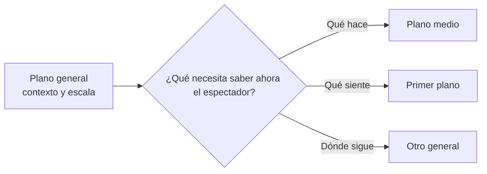

# Plano general (video)

Parte de: [[Tipos de plano]]

> [!info] Cómo avanzar
> `progreso`: **pendiente** → **viendo** (estudiando) → **visto** (contestaste la autoevaluación sin abrir las respuestas) → **dominado** (hiciste el laboratorio o lo aplicaste de verdad).

## Contenido

### Qué es
El **plano general** muestra el **lugar completo** y a las personas pequeñas dentro de él (de cuerpo entero o menores). Su trabajo es **ubicar**: dónde estamos, cuánta gente hay, a qué hora es, qué tan grande es el espacio. Es el plano del contexto, no de la emoción. Su variante para abrir una escena es el plano de ubicación ([[B-roll y plano de ubicación]]).

### Cómo funciona
El plano general funciona por **relación**: la persona contra el entorno. Puedes usarlo para:
- **Abrir** una escena o un cambio de lugar (el espectador necesita orientarse).
- **Mostrar escala**: alguien pequeño frente a una montaña o una ciudad comunica soledad, aventura o insignificancia.
- **Cerrar** una escena: alejarse da sensación de final.
- **Coreografía**: ver dónde está cada quien antes de cortar a planos más cerrados, para que la geografía quede clara ([[Eje de 180 grados y continuidad]]).

Como la información está repartida en todo el cuadro, el plano general necesita **composición** (líneas, capas, [[Regla de tercios y proporción áurea|tercios]]) y **tiempo en pantalla**: dale 3–6 s para que el ojo lo recorra.

**En vertical.** En un 9:16, un plano general horizontal recortado pierde los lados (justo donde estaba el contexto) y la persona queda diminuta en una pantalla de celular. Si el destino es vertical, compón el general **para vertical**: aprovecha la altura (edificios, árboles, escaleras) y deja al sujeto más grande.

### Ejemplo
Video de un día de campo:
- **[[DJI Mini 4K]]** o una loma: el general de la presa con la familia en la orilla.
- **[[iPhone 15 Pro para foto y video]] en 0.5×** (13 mm) para el general a ras de suelo con el mantel en primer término (capas).
- **[[Sony a6700]]** con zoom en su lado angular para el general del camino.
Graba cada general **estable** (tripié o apoyo) y con al menos 8–10 s de duración; en edición lo cortas.

Ejercicio: graba el mismo lugar en general con una persona al centro y luego con la persona en un tercio y una línea guía (camino, barandal). Compara cuál se lee más rápido.

### Cuándo usarlo y cuándo no
- **Sí**: inicio y cierre de escenas, cambios de lugar, para mostrar acción de varias personas, paisajes y viajes.
- **No**: para comunicar una emoción o un detalle; para eso el [[Primer plano (video)]] o el [[Plano detalle (video)]].
- En pantallas pequeñas y vertical úsalo poco y breve.

### Errores comunes
1. **Usarlo para que se entienda una emoción**: la cara es muy pequeña y la expresión no se lee; corta a un primer plano.
2. **Generales temblorosos** a mano: el temblor se nota más en planos abiertos con horizonte. Usa tripié o estabilización.
3. **Horizonte torcido**: activa la cuadrícula del celular o el nivel de la cámara.
4. **Sin punto de interés**: un general "bonito" sin sujeto ni línea guía se siente vacío.
5. **Abusar del gran angular cerca de personas**: deforma caras y cuerpos en los bordes.

### Para profundizar
- [Types of shots in films (Adobe)](https://www.adobe.com/creativecloud/video/discover/types-of-shots-in-films.html)
- [Filmmaking 101: Camera Shot Types (B&H Explora)](https://www.bhphotovideo.com/explora/video/tips-and-solutions/filmmaking-101-camera-shot-types)
- Vuelve al panorama: [[Tipos de plano]]

## Autoevaluación

Contesta primero en voz alta o en papel; luego despliega la respuesta.

> [!question]- ¿Qué muestra un plano general y cuándo se usa?
> El sujeto completo dentro de su entorno, o el entorno solo. Se usa para **ubicar** al espectador (dónde estamos) o para mostrar acciones amplias.

> [!question]- ¿Qué riesgo tiene un plano general en video vertical?
> En una pantalla de celular el sujeto se ve diminuto; en vertical suele durar menos y apoyarse en planos más cerrados.

> [!question]- Error común: usarlo para que se entienda una emoción. ¿Por qué falla?
> A esa distancia no se leen gestos; para emoción necesitas primer plano.

## Práctica

- [[Lab 3 - Escena de 60 segundos con 5 tipos de plano sin romper el eje]]

