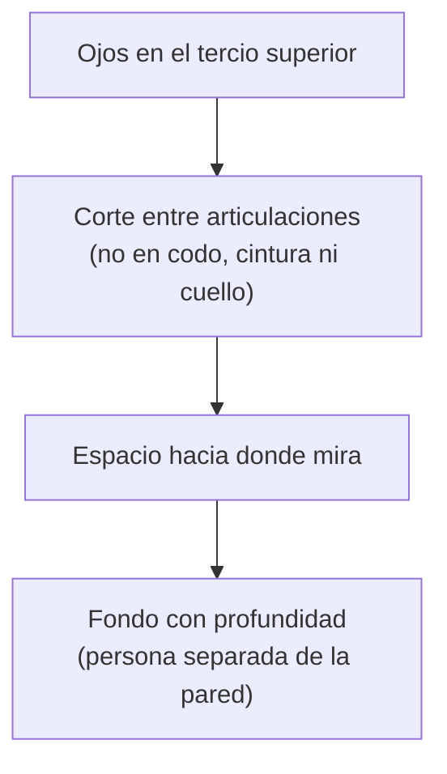

# Plano medio (video)

Parte de: [[Tipos de plano]]

> [!info] Cómo avanzar
> `progreso`: **pendiente** → **viendo** (estudiando) → **visto** (contestaste la autoevaluación sin abrir las respuestas) → **dominado** (hiciste el laboratorio o lo aplicaste de verdad).

## Contenido

### Qué es
El **plano medio** encuadra a la persona **de la cintura (o el pecho) hacia arriba**. Es lo bastante cercano para leer la expresión y lo bastante abierto para ver manos, gestos y algo del entorno. Por eso es el **plano de base** de entrevistas, vlogs, tutoriales y conversaciones: se parece a la distancia a la que miramos a alguien con quien platicamos.

### Cómo funciona
**Variantes.**
- **Plano medio** (cintura hacia arriba): más gesto y entorno.
- **Plano medio corto** (pecho hacia arriba): más cercanía, el estándar de muchas entrevistas y noticieros.

**Por qué funciona como base.** El espectador ve la cara y las manos (la persona "explica con el cuerpo") y entiende dónde está. Desde un plano medio puedes cortar a un primer plano para enfatizar o a un detalle para mostrar algo, y volver sin que se sienta raro.

**Dónde cortar el cuerpo.** El borde del encuadre no debe caer justo en una **articulación** (cuello, codos, cintura exacta, muñecas): se ve como si "amputaras" a la persona. Corta un poco **arriba o abajo** de ellas, por ejemplo a media altura del torso o a medio brazo.

**Aire y mirada.** Deja poco aire sobre la cabeza (los ojos cerca de la línea del tercio superior) y, si la persona mira a un lado, deja **espacio de mirada** hacia ese lado ([[Entrevista en video]]).

### Ejemplo
**Vlog o entrevista en tu estudio:**
- **[[Sony a6700]]** en tripié a la altura de los ojos, lente de 24–35 mm (equivalente a ~36–52 mm por el factor de recorte de APS-C), persona a 1.5–2 m y alejada 1–2 m de la pared para desenfocar el fondo.
- **[[iPhone 15 Pro para foto y video]]** en 2× (48 mm): menos deformación que 1× y buen fondo.
- **[[DJI Osmo Pocket 4P]]** en mano para vlog: brazo extendido da casi un plano medio corto con la cámara principal; ActiveTrack mantiene el encuadre si te mueves.
- Micrófono de solapa ([[DJI Mic Mini 2]]) fuera de cuadro o discreto en el pecho.

Ejercicio: graba a alguien en plano medio cortando en la cintura exacta, luego un poco arriba y luego un poco abajo; compara cuál se ve más natural.

### Cuándo usarlo y cuándo no
- **Sí**: base de entrevistas, vlogs, tutoriales a cámara, conversaciones, presentaciones de producto con la persona.
- **No como único plano**: si todo el video es plano medio fijo, se vuelve monótono; alterna con primeros planos y detalles ([[Tipos de plano]]).
- En vertical, el plano medio corto suele funcionar mejor que el medio largo.

### Errores comunes
1. **Cortar en articulaciones** (cuello, codos, cintura): se ve incómodo.
2. **Demasiado aire sobre la cabeza**: la persona parece "hundida" en el cuadro.
3. **Persona pegada a la pared**: sombras duras y fondo plano; sepárala.
4. **Cámara muy baja o muy alta**: cambia la lectura de la persona ([[Ángulos de cámara]]).
5. **Gran angular cerca**: nariz grande y cara deformada; usa 2× en el iPhone o una focal más larga.

### Para profundizar
- [Types of shots in films (Adobe)](https://www.adobe.com/creativecloud/video/discover/types-of-shots-in-films.html)
- [Shot size in filmmaking (Learn About Film)](https://learnaboutfilm.com/film-language/picture/shotsize/)
- Vuelve al panorama: [[Tipos de plano]]

## Autoevaluación

Contesta primero en voz alta o en papel; luego despliega la respuesta.

> [!question]- ¿Qué encuadra el plano medio?
> Al sujeto aproximadamente de la cintura hacia arriba. Muestra gestos de manos y expresión a la vez.

> [!question]- ¿Por qué es el plano de base en entrevistas y vlogs?
> Es natural (como ver a alguien a conversación) y deja espacio para manos y gráficos.

> [!question]- Error común al encuadrar un plano medio: ¿dónde no conviene cortar a la persona?
> En articulaciones (cuello, codos, cintura exacta, rodillas): se ve "amputado". Corta un poco arriba o abajo.

## Práctica

- [[Lab 3 - Escena de 60 segundos con 5 tipos de plano sin romper el eje]]

