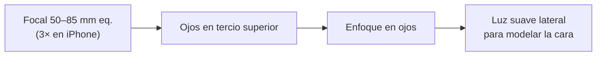

# Primer plano (video)

Parte de: [[Tipos de plano]]

> [!info] Cómo avanzar
> `progreso`: **pendiente** → **viendo** (estudiando) → **visto** (contestaste la autoevaluación sin abrir las respuestas) → **dominado** (hiciste el laboratorio o lo aplicaste de verdad).

## Contenido

### Qué es
El **primer plano** (*close-up*) encuadra el **rostro y los hombros**. Es el plano de la **emoción**: el espectador ve los ojos, la boca y los microgestos, y se siente cerca de la persona. Su versión extrema, el **primerísimo primer plano**, encuadra solo de la frente a la barbilla (o solo los ojos) para momentos muy intensos.

### Cómo funciona
**Qué comunica.** Al ocupar casi toda la pantalla, la cara se vuelve la información principal. Se usa para:
- Mostrar **reacciones** (alguien escucha una noticia).
- Subrayar la **frase clave** de una entrevista.
- Crear **intimidad** o tensión.

**Focal adecuada.** Acercarse con un gran angular deforma: la nariz crece y las orejas se alejan. Para caras conviene una focal **moderadamente larga** (equivalente a 50–85 mm o más) desde algo más lejos, que aplana y favorece el rostro.

**Aire sobre la cabeza.** En primer plano se deja **poco** aire: los **ojos** van cerca de la línea del tercio superior; si la cabeza queda muy abajo, sobra espacio vacío arriba. Incluso es válido cortar un poco la parte alta de la cabeza: lo importante son los ojos.

**Enfoque.** A poca distancia la profundidad de campo es corta: el enfoque debe ir a los **ojos** (el más cercano a cámara si hay que elegir).

### Ejemplo
- **[[iPhone 15 Pro para foto y video]]**: usa el **3× (77 mm)**, que da un primer plano favorecedor desde ~1–1.5 m; en poca luz su apertura f/2.8 mete menos luz, así que acerca una lámpara o usa 2× (48 mm, f/1.78) como alternativa.
- **[[Sony a6700]]**: un 50 mm en APS-C (≈75 mm equivalente) o el extremo largo de tu zoom; activa el AF de detección de ojos.
- **[[DJI Osmo Pocket 4P]]**: la cámara tele de 60 mm equivalente (f/1.8) está pensada justo para retratos y primeros planos con fondo desenfocado.
- Ilumina con luz suave a un lado (ver [[Iluminación de tres puntos]]) para que la cara tenga volumen.

Ejercicio: graba a la misma persona en primer plano con 1× desde 40 cm y con 3× desde 1.3 m. Compara la forma de la nariz y el fondo.

### Cuándo usarlo y cuándo no
- **Sí**: momentos emocionales, respuestas clave, reacciones, para cubrir un corte en entrevistas (cambio de tamaño).
- **No**: cuando importa lo que la persona hace con las manos o dónde está; ahí el [[Plano medio (video)]] o el [[Plano general (video)]].
- Reserva el primerísimo primer plano para pocos momentos; si lo usas siempre, pierde fuerza.

### Errores comunes
1. **Demasiado aire sobre la cabeza**: corrígelo subiendo los ojos al tercio superior o cerrando el encuadre.
2. **Gran angular muy cerca**: deforma; aléjate y usa más focal.
3. **Enfoque en la oreja o el pelo**: con poca profundidad de campo se nota mucho.
4. **Luz dura de frente**: aplana y marca imperfecciones; usa luz suave lateral ([[Luz dura y luz suave]]).
5. **Cámara muy cerca intimidando** al entrevistado: con focal larga puedes estar más lejos y la persona se relaja.

### Para profundizar
- [Types of shots in films (Adobe)](https://www.adobe.com/creativecloud/video/discover/types-of-shots-in-films.html)
- [Especificaciones técnicas del iPhone 15 Pro (Apple)](https://support.apple.com/en-us/111829)
- Vuelve al panorama: [[Tipos de plano]]

## Autoevaluación

Contesta primero en voz alta o en papel; luego despliega la respuesta.

> [!question]- ¿Qué encuadra un primer plano?
> La cara (y quizá el inicio de los hombros). Es el plano de la **emoción**.

> [!question]- ¿Qué focal conviene en el iPhone para un primer plano?
> El tele (3x en el 15 Pro): deforma menos la cara que acercarte mucho con la gran angular, que agranda la nariz.

> [!question]- Error común: dejar demasiado aire sobre la cabeza. ¿Cómo se corrige?
> Pon los ojos cerca del tercio superior; en primer plano es válido incluso cortar un poco la parte alta de la cabeza.

## Práctica

- [[Lab 3 - Escena de 60 segundos con 5 tipos de plano sin romper el eje]]

