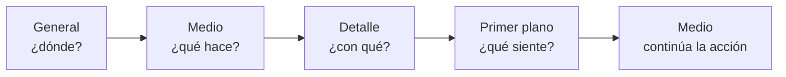

# Tipos de plano

Parte de: [[31-Video-Audio/02 Lenguaje audiovisual/_Índice Lenguaje audiovisual|Lenguaje audiovisual]]

> [!info] Cómo avanzar
> `progreso`: **pendiente** → **viendo** (estudiando) → **visto** (contestaste la autoevaluación sin abrir las respuestas) → **dominado** (hiciste el laboratorio o lo aplicaste de verdad).

## Contenido

### Qué es
Un **tipo de plano** (o tamaño de plano) se define por **cuánto del sujeto entra en el encuadre**, normalmente tomando como referencia el cuerpo humano: desde el lugar completo hasta un solo detalle. No depende de la lente que uses, sino del resultado en pantalla: un primer plano es un primer plano aunque lo hagas con gran angular cerca o con tele lejos. Elegir el tamaño de plano es elegir **qué información le das al espectador** y **qué tan cerca emocionalmente** lo pones.

### Cómo funciona
De lo más abierto a lo más cerrado:

| Plano | Qué muestra | Para qué sirve | Nota |
|---|---|---|---|
| General | Lugar completo, personas pequeñas | Ubicar, contexto, escala | [[Plano general (video)]] |
| Medio | De la cintura (o pecho) hacia arriba | Acciones, conversación, entrevistas | [[Plano medio (video)]] |
| Primer plano | Rostro y hombros | Emoción, reacción | [[Primer plano (video)]] |
| Detalle | Un objeto o parte (manos, ojos) | Información puntual, ritmo | [[Plano detalle (video)]] |

Hay escalas intermedias (plano entero, americano, primerísimo primer plano), pero con estos cuatro puedes contar casi cualquier cosa.

**Por qué alternar tamaños.** Al editar, cortar entre dos tomas del **mismo tamaño y ángulo** produce un "salto" (*jump cut*) que se ve como error. Cambiar de tamaño (general → medio → detalle) hace que el corte se sienta **motivado**: el espectador entiende que se acercó para ver algo. Además, los tamaños dan **ritmo**: planos generales largos relajan, detalles cortos aceleran.



### Ejemplo
**Alguien preparando café** (secuencia mínima de unos 20–30 s):
1. **General**: la cocina con la persona entrando (dónde estamos).
2. **Medio**: llena la cafetera (qué hace).
3. **Detalle**: el café molido cayendo, el agua hirviendo, la taza llenándose (cómo).
4. **Primer plano**: el primer sorbo y su gesto (qué siente).
5. **Medio o general** para cerrar: se sienta con su taza.

Con el [[iPhone 15 Pro para foto y video]] usa 0.5× o 1× para el general, 1×–2× para el medio y 3× para el primer plano. Con la [[Sony a6700]] y un zoom estándar cambias de focal sin moverte; con la [[DJI Osmo Pocket 4P]] tienes la cámara principal de 20 mm y la tele de 60 mm.

Regla de oro al grabar: **cada acción importante, en al menos dos tamaños**. Así al editar puedes cortar entre ellos sin saltos.

### Cuándo usarlo y cuándo no
- **Plano general** al iniciar una escena o al cambiar de lugar, y para cerrar.
- **Medio** como base de diálogos y explicaciones.
- **Primer plano** cuando la emoción es la información.
- **Detalle** para mostrar lo que el plano medio no deja ver y para cubrir cortes.
- No abuses de los extremos: puros detalles desorientan; puros generales alejan al espectador.

### Errores comunes
1. **Grabar todo en plano medio a la misma distancia**: al editar no hay a dónde cortar y cada corte es un salto visible.
2. **Saltar de general a detalle extremo** sin un paso intermedio: el espectador pierde la referencia.
3. **Planos demasiado cortos**: graba al menos 5–10 s por plano para tener de dónde elegir.
4. **No pensar en el formato final**: un general horizontal pierde casi todo en un vertical 9:16 ([[Video vertical (Reels, TikTok y Shorts)]]).

### Para profundizar
- [Types of shots in films (Adobe)](https://www.adobe.com/creativecloud/video/discover/types-of-shots-in-films.html)
- [Filmmaking 101: Camera Shot Types (B&H Explora)](https://www.bhphotovideo.com/explora/video/tips-and-solutions/filmmaking-101-camera-shot-types)
- [Shot size in filmmaking (Learn About Film)](https://learnaboutfilm.com/film-language/picture/shotsize/)

## Subtemas

- [[Plano general (video)]]
- [[Plano medio (video)]]
- [[Primer plano (video)]]
- [[Plano detalle (video)]]

## Autoevaluación

Contesta primero en voz alta o en papel; luego despliega la respuesta.

> [!question]- ¿Qué define un tipo de plano?
> Qué tanto ocupa el sujeto dentro del encuadre (desde el entorno completo hasta un detalle). Cada tamaño comunica algo: contexto, relación, emoción o información.

> [!question]- ¿Por qué se alternan tamaños de plano al editar?
> Para dar ritmo y guiar la atención: el general ubica, el medio muestra la acción y los gestos, el primer plano la emoción y el detalle lo importante. Cortar entre dos tomas casi iguales produce un salto molesto.

> [!question]- Caso: grabas a alguien preparando café. ¿Qué secuencia mínima de planos usarías?
> General de la cocina → medio de la persona moviendo cosas → detalle del café cayendo → primer plano oliendo la taza. Cuatro tamaños cuentan la acción completa.

> [!question]- Error común: grabar todo en plano medio a la misma distancia. ¿Qué problema tiene al editar?
> No hay variedad para cortar: cualquier corte entre tomas parecidas se ve como jump cut y no puedes acortar ni esconder errores.

## Práctica

- [[Lab 3 - Escena de 60 segundos con 5 tipos de plano sin romper el eje]]

## Progreso de los subtemas

```base
filters:
  and:
    - file.inFolder("31-Video-Audio/02 Lenguaje audiovisual/Tipos de plano")
    - file.name != "Tipos de plano"
views:
  - type: table
    name: Progreso
    order:
      - file.name
      - progreso
      - nivel
```
