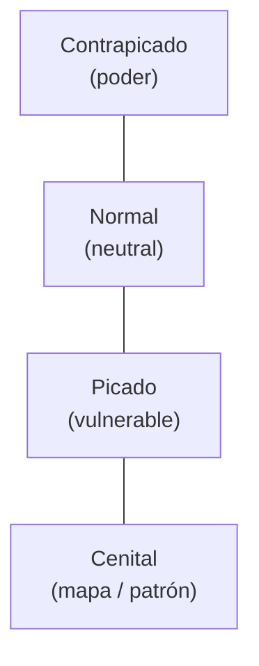

# Ángulos de cámara

Parte de: [[31-Video-Audio/02 Lenguaje audiovisual/_Índice Lenguaje audiovisual|Lenguaje audiovisual]]

> [!info] Cómo avanzar
> `progreso`: **pendiente** → **viendo** (estudiando) → **visto** (contestaste la autoevaluación sin abrir las respuestas) → **dominado** (hiciste el laboratorio o lo aplicaste de verdad).

## Contenido

### Qué es
El **ángulo de cámara** es la **altura e inclinación** desde la que miras al sujeto. A diferencia del tamaño de plano (qué tanto ves), el ángulo cambia **cómo** lo percibes: más fuerte, más débil, neutral o inestable. Es una de las herramientas más baratas para dar intención a una toma: solo tienes que subir o bajar la cámara.

### Cómo funciona
| Ángulo | Cámara | Efecto típico |
|---|---|---|
| **Normal** | A la altura de los ojos | Neutral, de igual a igual |
| **Picado** | Arriba, mirando hacia abajo | El sujeto se ve más pequeño, vulnerable o dominado |
| **Contrapicado** | Abajo, mirando hacia arriba | El sujeto se ve más grande, poderoso o amenazante |
| **Cenital** | Totalmente arriba (90°) | Mapa, patrón, distancia (mesas, recetas, dron) |
| **Nadir** | Totalmente abajo | Extrañeza, monumentalidad |
| **Holandés** | Inclinado sobre su eje | Inestabilidad, tensión, desorientación |

**Efecto, no ley.** Estos efectos dependen del contexto: un picado suave en un vlog puede ser simplemente "favorecedor" (adelgaza el rostro), y un contrapicado de un niño sobre su bici puede verse heroico y tierno a la vez.

**Plano holandés.** Inclinar la cámara para que el horizonte quede diagonal. Se usa en terror, persecuciones o para mostrar que algo está "mal". Si se usa sin motivo, solo parece un error de nivelación.

### Ejemplo
**Entrevista neutral**: pon la cámara a la **altura de los ojos** del entrevistado sentado (en tripié, con la [[Sony a6700]] o el [[iPhone 15 Pro para foto y video]] en un soporte). Si la pones más arriba o más abajo, el espectador interpreta algo que no quieres decir.

**Mini secuencia para practicar** (con tu [[DJI Osmo Pocket 4P]], que se baja o sube fácil con su gimbal):
1. Contrapicado de tu amigo subiendo una escalera (logro).
2. Normal cuando llega arriba (respiro).
3. Picado desde arriba mientras mira la ciudad (pequeño frente al paisaje).
4. Cenital con el [[DJI Mini 4K]] para cerrar (ver [[Composición aérea y cenital]]).

**Vlogs con el celular en la mano**: al sostener el teléfono a la altura del pecho, la cámara mira hacia arriba y sale un **contrapicado involuntario**: papada, fosas nasales y techo de fondo. Sube el brazo a la altura de los ojos o un poco más, o usa un palo selfie.

### Cuándo usarlo y cuándo no
- **Normal**: entrevistas, tutoriales, diálogos; casi siempre es la opción segura.
- **Picado/contrapicado**: cuando la relación de poder o la emoción importa.
- **Cenital**: cocina, manualidades, escritorio, mapas, dron.
- **Holandés**: solo con intención clara y de forma puntual.

### Errores comunes
1. **Contrapicado involuntario en vlogs**: el celular abajo deforma y favorece poco. Sube la cámara.
2. **Holandés sin intención**: parece que no sabías nivelar; usa la cuadrícula o el nivel.
3. **Cambiar de ángulo dentro de una entrevista** sin motivo: el entrevistado "cambia de estatus".
4. **Picado fuerte con gran angular**: cabeza enorme y pies diminutos, efecto caricatura.
5. **Olvidar el fondo**: en contrapicado entra techo o cielo; en picado, el suelo. Revisa qué queda detrás.

### Para profundizar
- [Types of camera shot angles in film (StudioBinder)](https://www.studiobinder.com/blog/types-of-camera-shot-angles-in-film/)
- [Types of shots in films (Adobe)](https://www.adobe.com/creativecloud/video/discover/types-of-shots-in-films.html)
- Relación con foto: [[Punto de vista y capas de profundidad]]

## Autoevaluación

Contesta primero en voz alta o en papel; luego despliega la respuesta.

> [!question]- ¿Qué comunican el picado y el contrapicado?
> **Picado** (cámara arriba mirando hacia abajo): el sujeto se ve pequeño o vulnerable. **Contrapicado** (desde abajo): poderoso o imponente.

> [!question]- ¿Qué es el plano holandés?
> Cámara inclinada (horizonte chueco a propósito). Transmite tensión o desorientación; si se abusa parece error.

> [!question]- Caso: entrevistas a alguien y quieres que se vea neutral. ¿A qué altura pones la cámara?
> A la **altura de los ojos**, ni arriba ni abajo.

> [!question]- Error común en vlogs con el celular en la mano: ¿qué ángulo sale sin querer y qué efecto tiene?
> Contrapicado desde la cintura: se ven papada y techo. Sube el teléfono a la altura de los ojos o usa un palo/tripié.

## Práctica

- [[Lab 3 - Escena de 60 segundos con 5 tipos de plano sin romper el eje]]

