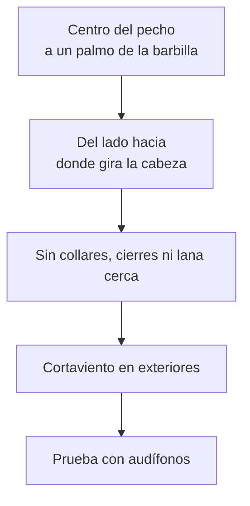

# Colocación del micrófono

Parte de: [[31-Video-Audio/03 Audio/_Índice Audio|Audio]]

> [!info] Cómo avanzar
> `progreso`: **pendiente** → **viendo** (estudiando) → **visto** (contestaste la autoevaluación sin abrir las respuestas) → **dominado** (hiciste el laboratorio o lo aplicaste de verdad).

## Contenido

### Qué es
La **colocación del micrófono** es decidir **dónde y cómo** va el micro respecto a la boca y a la ropa. Un buen micrófono mal colocado suena peor que uno sencillo bien colocado. Para el micrófono de solapa (como el [[DJI Mic Mini 2]]) las reglas son pocas pero estrictas: cerca de la boca, del lado correcto, lejos de lo que roza y protegido del viento.

### Cómo funciona
**Distancia.** El lavalier va en el **centro del pecho**, más o menos a un **puño o un palmo** debajo de la barbilla (unos 15–20 cm de la boca). Más abajo (en el abdomen) la voz pierde presencia; más arriba (en el cuello) suena retumbante y se oyen la respiración y la saliva.

**Lado hacia donde gira la cabeza.** Si la persona va a mirar hacia un lado (al entrevistador fuera de cuadro), coloca el micro **de ese lado** del pecho: cuando gira la cabeza, la boca sigue "apuntando" al micrófono. Si lo pones del lado contrario, cada vez que voltee la voz se aleja y suena apagada.

**Ropa y roces.** El enemigo del lavalier es el **roce**:
- Lejos de collares, gafetes, cierres, botones y cabello largo.
- Evita suéteres de lana y telas sintéticas que hacen "frrr" al moverse.
- Si lo ocultas bajo la ropa, fija tela y micro con cinta para que no se muevan entre sí (y acepta perder algo de brillo en la voz).
- Haz un "bucle" de seguridad con el cable (si lo hay) o asegura bien el transmisor para que no jale.

**Viento.** En exteriores, el viento golpea la cápsula y produce retumbos graves. Usa el **cortaviento** de pelo (*dead cat*) que viene con el sistema, coloca el micro a sotavento (protegido del viento por el cuerpo) y activa un filtro de graves si está disponible.

### Ejemplo
**Entrevista con el invitado mirando hacia ti, a su izquierda:**
- Pon el transmisor del Mic Mini 2 en el **lado izquierdo** de su pecho (su izquierda), a un palmo de la barbilla.
- Si trae collar, pídele que se lo quite o pásalo bajo la ropa; si trae suéter de lana, coloca el clip en la orilla de la camisa de abajo o en el cuello del suéter con el imán.
- Ajusta la ganancia ([[Ganancia y niveles de audio]]), pide que hable, gire la cabeza y se mueva un poco en la silla; escucha con audífonos si aparece roce.
- En el patio con viento: pon el cortaviento, gira a la persona para que su cuerpo tape el viento y prueba el nivel básico de reducción de ruido.

**Vlog caminando** con la [[DJI Osmo Pocket 4P]] o el [[iPhone 15 Pro para foto y video]]: el transmisor en el cuello de la camiseta, con cortaviento siempre, porque al caminar el aire golpea más.

### Cuándo usarlo y cuándo no
- **Visible** (en la solapa, con el logo discreto): entrevistas, YouTube, tutoriales; es aceptado y más fácil.
- **Oculto**: ficción o cuando no debe verse; exige más cuidado con roces.
- **Otra opción**: si la persona no puede llevar nada encima, un micro en pértiga o sobre la cámara cerca, fuera de cuadro.

### Errores comunes
1. **Colgar el transmisor junto a collares o bajo un suéter de lana**: golpeteos, roces y "frrr" constantes.
2. **Ponerlo del lado contrario** al que la persona mira: la voz se vuelve más lejana cada vez que gira.
3. **Muy cerca de la boca**: respiraciones, plosivas ("p", "b") y saliva.
4. **Sin cortaviento afuera**: retumbos que no se arreglan del todo en edición.
5. **No escuchar antes**: un roce constante arruina toda la entrevista.

### Para profundizar
- [Lavalier Mounting: Best Practices (RØDE)](https://rode.com/en-gb/about/news-info/lavalier-mounting-best-practices)
- [How to choose the best lavalier microphone (Shure)](https://www.shure.com/en-US/insights/how-to-choose-the-best-lavalier-microphone)
- [Especificaciones del DJI Mic Mini 2 (DJI)](https://www.dji.com/my/mic-mini-2/specs)

## Autoevaluación

Contesta primero en voz alta o en papel; luego despliega la respuesta.

> [!question]- ¿Dónde se coloca un micrófono de solapa?
> En el pecho, a un palmo de la boca aproximadamente (entre 15 y 25 cm), centrado o del lado hacia donde la persona voltea al hablar.

> [!question]- ¿Qué hacer con el viento en exteriores?
> Usar el **peluche/antiviento** del micrófono y, si se puede, darle la espalda al viento.

> [!question]- Caso: en la entrevista el invitado gira la cabeza hacia ti a la izquierda. ¿De qué lado pones el micrófono?
> Del lado **izquierdo** de su pecho, hacia donde habla, para que la voz no pierda presencia.

> [!question]- Error común: colgar el transmisor junto a collares o bajo un suéter de lana. ¿Qué ruidos aparecen?
> Golpes metálicos y roces. Retira accesorios cercanos y fija el micrófono sobre ropa lisa.

## Práctica

- [[Lab 5 - Prueba de audio con el micrófono del iPhone y el DJI Mic Mini 2]]
- [[Lab 6 - Entrevista a dos personas]]

