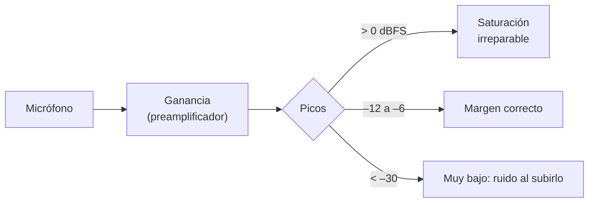

# Ganancia y niveles de audio

Parte de: [[31-Video-Audio/03 Audio/_Índice Audio|Audio]]

> [!info] Cómo avanzar
> `progreso`: **pendiente** → **viendo** (estudiando) → **visto** (contestaste la autoevaluación sin abrir las respuestas) → **dominado** (hiciste el laboratorio o lo aplicaste de verdad).

## Contenido

### Qué es
La **ganancia** es cuánto **amplifica** el equipo la señal del micrófono antes de grabarla. El **nivel** es qué tan fuerte queda esa señal en el archivo, medido en **dBFS** (*decibeles relativos a escala completa*): **0 dBFS** es el máximo posible y todo lo demás son números negativos. Si la señal intenta pasar de 0, se **satura** (*clipping*): la onda se recorta y suena distorsionada, sin remedio.

### Cómo funciona
**Decibeles en una frase.** Son una escala logarítmica: **+6 dB ≈ el doble de amplitud** (20·log₁₀(2) ≈ 6.02), y –6 dB, la mitad.
- Picos en –18 dBFS que quieres llevar a –6 dBFS → aplicas **+12 dB** de ganancia.
- Si tus picos están en –10 dBFS, tienes **10 dB de margen** (*headroom*) antes de saturar.

**Nivel objetivo para voz al grabar.** Una guía práctica muy usada es que la voz normal promedie alrededor de **–18 a –12 dBFS** con **picos por debajo de –6 dBFS**. Así queda margen para risas o gritos sin saturar y la señal está suficientemente por encima del ruido del equipo.

**Por qué no grabar muy bajo.** Todo preamplificador tiene un **piso de ruido** (soplido). Si grabas la voz a –40 dBFS y luego la subes 25 dB en edición, subes también ese ruido. Grabar al nivel correcto da la mejor relación señal/ruido.

**Limitador.** Es un "techo" automático que baja los picos que se acercan a 0 dBFS. Salva la toma en una carcajada, pero si actúa todo el tiempo aplasta la voz. Úsalo como red de seguridad, no como sustituto de una buena ganancia.

**Grabación al momento vs. loudness final.** Estos niveles son para **grabar**. Para publicar se trabaja con **loudness** (LUFS), que es otro concepto: ver [[Loudness (LUFS) por plataforma]].

### Ejemplo
**Configurar el [[DJI Mic Mini 2]] con la [[Sony a6700]]:**
1. Receptor a la entrada de micro de la cámara (3.5 mm). En la cámara, nivel de grabación **manual**.
2. Pide al invitado que hable como lo hará en la entrevista (no "probando, probando" en voz baja) y que se ría o diga una frase con énfasis.
3. Ajusta primero la ganancia del **receptor** (el Mic Mini 2 tiene **cinco niveles** y limitación automática) y luego el nivel de la cámara hasta que la voz ronde –12 dBFS con picos < –6.
4. Monitorea con audífonos en la salida de la a6700.
Evita subir mucho la ganancia en dos lugares a la vez (receptor al máximo y cámara al máximo): sumas ruido. Una sola etapa debe hacer la mayor parte del trabajo.

**Con el iPhone**: en [[Blackmagic Camera (app)]] tienes medidores VU o PPM y control de nivel; en la app Cámara de Apple no hay control manual de nivel.

**Caso: el entrevistado se ríe a carcajadas y satura.** Deja más margen (picos normales en –12 en lugar de –6), activa el limitador del receptor, y aleja un poco el micrófono si está muy cerca de la boca. Graba una toma de prueba con risa antes de empezar.

### Cuándo usarlo y cuándo no
- **Ganancia manual** siempre que puedas en entrevistas y contenido hablado: la automática (AGC) sube el ruido en los silencios y "bombea".
- **Automático** solo si no hay forma de monitorear (un vlog corriendo) y sabiendo que el resultado será menos limpio.
- Si tu equipo graba en **32 bits flotantes** (no es el caso del Mic Mini 2, que graba a 24 bits), la saturación casi desaparece, pero sigue importando la distancia al micro.

### Errores comunes
1. **Grabar muy bajo "para no saturar"** y subirlo en edición: aparece soplido y ruido de fondo.
2. **Ganancia al máximo en la cámara** y en el receptor: más ruido del que necesitas.
3. **Ajustar con voz de prueba suave**: en la toma real la persona habla más fuerte y satura.
4. **No escuchar con audífonos**: los medidores no te dicen si hay roce, zumbido o interferencia.
5. **Confundir nivel de grabación con loudness final**: son etapas distintas.

### Para profundizar
- [EBU R 128: recomendación de loudness (EBU, PDF)](https://tech.ebu.ch/docs/r/r128-2014.pdf)
- [Especificaciones del DJI Mic Mini 2 (DJI)](https://www.dji.com/my/mic-mini-2/specs)
- [Especificaciones de la Sony a6700 (Sony)](https://www.sony.co.in/interchangeable-lens-cameras/products/ilce-6700/spec)

## Ejercicios

Resuélvelos en papel o en la herramienta; la solución está plegada.

> [!question]- Una pista tiene picos en −18 dBFS. ¿Cuántos dB de ganancia aplicas para que los picos queden en −6 dBFS?
> −6 − (−18) = **+12 dB**.

> [!question]- Si duplicas la amplitud de una señal, ¿cuántos dB sube aproximadamente?
> 20 × log10(2) ≈ **+6 dB**.

> [!question]- ¿Cuántos dB de margen (headroom) tienes si tus picos están en −10 dBFS?
> **10 dB** hasta 0 dBFS.

## Autoevaluación

Contesta primero en voz alta o en papel; luego despliega la respuesta.

> [!question]- ¿Qué es la ganancia?
> La amplificación de la señal del micrófono antes de grabarse. Se ajusta para que la voz quede con buen nivel sin saturar.

> [!question]- ¿Qué nivel buscas en voz al grabar?
> Picos aproximadamente entre **−12 y −6 dBFS**. Nunca llegar a **0 dBFS**: ahí el audio digital se recorta (clipping) y no se arregla.

> [!question]- Caso: el entrevistado se ríe a carcajadas y satura. ¿Cómo lo previenes?
> Deja más margen (picos normales cerca de −12 dBFS) y, con el [[DJI Mic Mini 2]], aprovecha la grabación de **doble pista** de DJI Mimo (una pista a nivel más bajo de seguridad, según la configuración de la app).

> [!question]- Error común: grabar muy bajo "para no saturar" y subirlo en edición. ¿Qué pasa?
> Al subir el nivel también sube el ruido de fondo y el ruido propio del equipo. Graba con nivel sano; con 24 bits tienes margen, pero no infinito.

## Práctica

- [[Lab 5 - Prueba de audio con el micrófono del iPhone y el DJI Mic Mini 2]]

