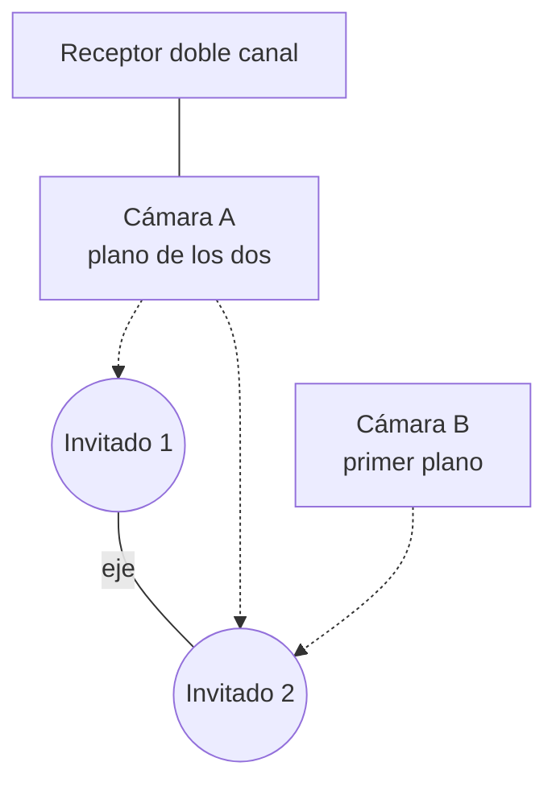

# Grabar entrevistas a dos personas

Parte de: [[31-Video-Audio/03 Audio/_Índice Audio|Audio]]

> [!info] Cómo avanzar
> `progreso`: **pendiente** → **viendo** (estudiando) → **visto** (contestaste la autoevaluación sin abrir las respuestas) → **dominado** (hiciste el laboratorio o lo aplicaste de verdad).

## Contenido

### Qué es
Una **entrevista a dos personas** (dos invitados conversando, o tú y un invitado a cámara) añade dos retos frente a la de una sola: **dos voces** que hay que grabar limpias y con control independiente, y **dos personas** que hay que encuadrar sin romper la geografía de la escena. Bien planeada, se resuelve con un micrófono por persona y las cámaras de un solo lado del eje.

### Cómo funciona
**Audio: un micrófono por persona.** Cada quien lleva su transmisor de solapa ([[Colocación del micrófono]]). Lo ideal es que cada voz quede en **su propio canal** (izquierdo y derecho, o dos pistas). Ventajas al editar:
- Bajas a uno cuando el otro habla y así no se oye la respiración o el eco del que calla.
- Limpias ruido o ecualizas cada voz por separado.
- Compensas si una persona habla mucho más fuerte que la otra.
- Si alguien tose sobre la frase del otro, lo silencias sin afectar la respuesta.

**Imagen: la disposición.** Siéntalos en **ángulo** (en "V", unos 90–120° entre ellos), no frente a frente en línea con la cámara. Traza el eje entre sus caras y coloca todas las cámaras **de un solo lado** ([[Eje de 180 grados y continuidad]]):
- **Cámara A**: plano general o medio de los dos (el "seguro").
- **Cámara B**: primer plano de quien más habla, o alternando.

### Ejemplo
**Con tu equipo:**
- **Audio**: un transmisor del [[DJI Mic Mini 2]] en cada persona. El receptor recibe los dos; con la configuración de doble canal/estéreo cada voz puede ir a un canal distinto (verifica en DJI Mimo cómo se configura en el Mic Mini 2; DJI menciona grabación de doble pista desde la app) (Pendiente de confirmar el modo exacto).
- **Cámara A**: [[Sony a6700]] en tripié con plano de los dos; el receptor a su entrada de 3.5 mm.
- **Cámara B**: [[iPhone 15 Pro para foto y video]] en primeros planos con [[Blackmagic Camera (app)]] para fijar exposición y obturación.
- **Sincronía**: un aplauso al inicio ([[Sincronizar audio y video]]).

**Caso: solo tienes un iPhone.** Opciones:
1. Plano medio o general de los dos con el iPhone fijo; toda la entrevista ahí.
2. Al terminar, una segunda pasada de **preguntas clave** a cada uno en primer plano (repiten su respuesta) para tener cortes.
3. Pedir prestado otro teléfono como segunda cámara y sincronizar con aplauso.
4. Grabar en 4K y recortar en edición para simular un segundo tamaño de plano.

Practica todo esto en [[Lab 6 - Entrevista a dos personas]].

### Cuándo usarlo y cuándo no
- **Doble canal** siempre que tengas dos transmisores: no cuesta nada y salva la edición.
- **Mezcla en un solo canal** solo si no hay edición (en vivo) o si el sistema no permite separar.
- **Dos cámaras** cuando la entrevista dure más de unos minutos o vayas a cortar mucho; con una cámara, planifica la segunda pasada.

### Errores comunes
1. **Invitados uno frente al otro con la cámara en medio girando**: la cámara queda sobre el eje, se rompe la continuidad y las miradas no conectan. Colócalos en "V" y la cámara de un solo lado.
2. **Los dos en el mismo canal**: no puedes nivelarlos por separado.
3. **Transmisores con distinta ganancia** sin razón: una voz queda mucho más alta.
4. **No probar los dos micros** antes: descubres en edición que uno tenía roce.
5. **Sin plano de seguridad** de los dos: si la cámara B falla, no tienes con qué cubrir.

### Para profundizar
- [Especificaciones del DJI Mic Mini 2 (DJI)](https://www.dji.com/my/mic-mini-2/specs)
- [Lavalier Mounting: Best Practices (RØDE)](https://rode.com/en-gb/about/news-info/lavalier-mounting-best-practices)
- [What is screen direction in film (StudioBinder)](https://www.studiobinder.com/blog/what-is-screen-direction-in-film/)

## Autoevaluación

Contesta primero en voz alta o en papel; luego despliega la respuesta.

> [!question]- ¿Cómo se distribuyen los micrófonos en una entrevista a dos personas con el [[DJI Mic Mini 2]]?
> Un transmisor en cada persona. Con el receptor en modo estéreo/doble canal cada voz puede quedar en un canal distinto (verifica en DJI Mimo cómo lo configuras), lo que permite ajustar niveles por separado al editar.

> [!question]- ¿Qué ventaja tiene grabar cada voz en su canal?
> Puedes bajar a uno cuando el otro habla, limpiar ruido por separado y corregir si uno habla mucho más fuerte.

> [!question]- Caso: solo tienes un iPhone. ¿Cómo grabas dos ángulos?
> Plano medio o general de ambos con el iPhone fijo y, si te alcanza, una segunda pasada de preguntas clave a cada uno en primer plano; o pide prestado otro teléfono como segunda cámara y sincroniza con aplauso.

> [!question]- Error común: colocar a los dos invitados uno frente al otro y la cámara en medio, girando. ¿Qué problema tiene?
> Se rompe la continuidad y el eje. Mejor colócalos en ángulo (en V) y la cámara de un solo lado del eje.

## Práctica

- [[Lab 6 - Entrevista a dos personas]]

