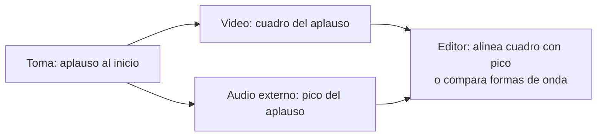

# Sincronizar audio y video

Parte de: [[31-Video-Audio/03 Audio/_Índice Audio|Audio]]

> [!info] Cómo avanzar
> `progreso`: **pendiente** → **viendo** (estudiando) → **visto** (contestaste la autoevaluación sin abrir las respuestas) → **dominado** (hiciste el laboratorio o lo aplicaste de verdad).

## Contenido

### Qué es
**Sincronizar** es alinear en la línea de tiempo el audio y el video que se grabaron en **dispositivos distintos** (o en pistas distintas) para que los labios coincidan con la voz. Hace falta cuando el sonido bueno no quedó dentro del archivo de video: por ejemplo, la voz en una grabadora o en otro teléfono, o cuando tienes dos cámaras y quieres usar el audio de una con la imagen de la otra.

### Cómo funciona
**Por qué se desfasa.** Cada aparato empieza a grabar en un momento distinto y tiene su propio reloj. Si el audio está en un archivo aparte, el editor no sabe dónde va. Incluso dentro de una misma toma larga, relojes distintos pueden "derivar" unos cuadros con el tiempo.

**Referencias de sincronía.**
- **Claqueta o aplauso**: al inicio de cada toma, un golpe seco frente a la cámara. En la imagen se ve el **cuadro exacto** en que las manos se juntan; en el audio aparece un **pico** muy marcado. Alineas el cuadro con el pico y listo.
- **Forma de onda**: si la cámara también grabó audio (aunque sea malo), el editor puede comparar las dos ondas y alinearlas automáticamente.
- **Timecode**: equipos profesionales comparten un reloj; en tu nivel no lo necesitas.

**DaVinci Resolve lo hace automático.** En la página **Media** (o en el *Media Pool*), seleccionas los clips de video y los de audio y usas **Auto Sync Audio** basado en **forma de onda** (*waveform*) o en timecode. Resolve encuentra la coincidencia y une cada audio a su video. Por eso conviene que la cámara **siempre grabe su audio interno**, aunque sea de referencia. Detalles en [[DaVinci Resolve (versión gratuita)]].

### Ejemplo
**Escenario 1: el [[DJI Mic Mini 2]] conectado al iPhone o a la cámara.** El receptor manda el audio **directo** al [[iPhone 15 Pro para foto y video]] (por USB-C) o a la [[Sony a6700]] (por 3.5 mm): la voz queda grabada **dentro del archivo de video**. **No hace falta sincronizar**: ya está alineada. Como el transmisor del Mic Mini 2 no graba internamente, este es su uso normal.

**Escenario 2: dos cámaras.** Sony con el receptor (audio bueno) y el iPhone en primeros planos (audio malo). Aplauso al inicio de cada toma, ambos graban su audio, y en Resolve usas Auto Sync por forma de onda o alineas a mano el pico del aplauso. Con varias cámaras puedes armar además un clip multicámara.

**Escenario 3: voz en una grabadora o en otro teléfono** dentro del bolsillo del invitado. Mismo procedimiento: aplauso + forma de onda.

### Cuándo usarlo y cuándo no
- **Sincronizar**: siempre que el audio principal esté en otro archivo o en otro dispositivo.
- **No hace falta**: si el micro entra directo a la cámara que graba la imagen.
- **Aplauso**: haz uno por toma, aunque pienses usar sincronía automática; si falla, es tu respaldo.

### Errores comunes
1. **No grabar audio en la cámara**: sin forma de onda de referencia, la sincronía automática no funciona.
2. **Aplaudir fuera de cuadro** o tapado: no se ve el cuadro exacto.
3. **Sincronizar "a ojo" con los labios**: unos cuadros de error se notan; usa la onda.
4. **Cadencias o frecuencias distintas** (audio a 44.1 kHz y proyecto a 48 kHz) sin revisar: puede aparecer deriva en tomas largas; graba todo a 48 kHz.
5. **Olvidar desactivar el audio de referencia** al exportar: suenan dos voces con eco.

### Para profundizar
- [Manual para editores de DaVinci Resolve 20 (Blackmagic Design)](https://documents.blackmagicdesign.com/ae/UserManuals/DaVinci-Resolve-20-Editors-Guide.pdf)
- [Especificaciones del DJI Mic Mini 2 (DJI)](https://www.dji.com/my/mic-mini-2/specs)
- [Blackmagic Camera en el App Store](https://apps.apple.com/gb/app/id6449580241)

## Autoevaluación

Contesta primero en voz alta o en papel; luego despliega la respuesta.

> [!question]- ¿Por qué hay que sincronizar audio y video a veces?
> Cuando el audio se graba en un dispositivo distinto de la cámara (grabadora o segundo celular) o si usas dos cámaras.

> [!question]- ¿Para qué sirve el aplauso o claqueta al inicio?
> Crea un pico de sonido y un cuadro visible al mismo tiempo; en edición alineas el pico de la onda con el cuadro del aplauso.

> [!question]- ¿Qué función hace esto automático en DaVinci Resolve?
> Sincronizar por **forma de onda** (auto sync audio based on waveform): compara el audio de referencia de la cámara con el audio externo.

> [!question]- Si el [[DJI Mic Mini 2]] va conectado directo al iPhone, ¿hace falta sincronizar?
> No: el audio queda dentro del mismo archivo de video. Solo sincronizas si usas otra cámara o grabas audio aparte (por ejemplo, en otro celular con DJI Mimo).

## Práctica

- [[Lab 6 - Entrevista a dos personas]]

