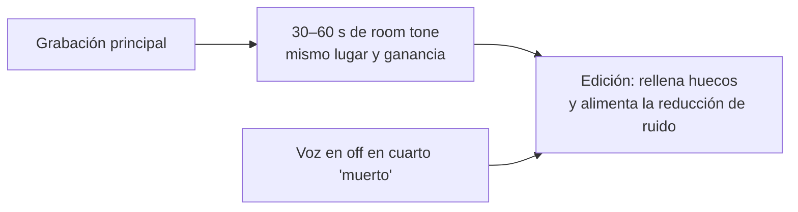

# Sonido ambiente y voz en off

Parte de: [[31-Video-Audio/03 Audio/_Índice Audio|Audio]]

> [!info] Cómo avanzar
> `progreso`: **pendiente** → **viendo** (estudiando) → **visto** (contestaste la autoevaluación sin abrir las respuestas) → **dominado** (hiciste el laboratorio o lo aplicaste de verdad).

## Contenido

### Qué es
El **sonido ambiente** o **room tone** es la grabación del "silencio" de un lugar: unos segundos sin que nadie hable, con el zumbido del refrigerador, el tráfico lejano o el aire acondicionado. Cada lugar tiene el suyo. La **voz en off** (*voice-over*) es la narración que se escucha sobre las imágenes sin que el narrador aparezca hablando en ese momento.

### Cómo funciona
**Room tone.** Cuando cortas una frase en la edición o quitas una muletilla, el hueco puede quedar en **silencio digital** total. El oído lo nota de inmediato: el ambiente "desaparece" un instante. La solución es rellenar el hueco con el room tone de ese mismo lugar, para que el fondo sea continuo. También sirve para que la reducción de ruido tenga una muestra del ruido a quitar ([[Limpieza de ruido en audio]]).

Cómo grabarlo: al terminar la entrevista, pide a todos **quedarse quietos y callados 30–60 s**, con los mismos micrófonos, la misma ganancia y el mismo lugar.

**Voz en off.** Se graba por separado, con calma, y se monta sobre b-roll. Para que suene bien en casa:
- **Lugar "muerto"**: un cuarto con muchas cosas suaves (clóset con ropa, recámara con cortinas, cobijas). Absorben el eco.
- **Distancia constante**: el micro a 15–20 cm de la boca, un poco de lado para evitar las plosivas.
- **Silencio**: apaga ventiladores y refrigeradores si se oyen; graba de noche si hay tráfico.
- **Ritmo y energía**: lee de pie, sonríe en las partes positivas y marca las pausas. Graba cada párrafo dos o tres veces.
- **Guion medido**: a ~140 palabras por minuto, un minuto de narración son ~140 palabras ([[Preproducción (idea, guion y guion técnico)]]).

### Ejemplo
**Vlog con un hueco de silencio total**: en [[DaVinci Resolve (versión gratuita)]] copia un tramo del room tone que grabaste en ese lugar y ponlo en una pista debajo del hueco, con fundidos cortos al entrar y salir. Si no grabaste room tone, busca en el mismo clip un tramo sin voz (antes de que empiece a hablar) y duplícalo.

**Voz en off con tu equipo**: transmisor del [[DJI Mic Mini 2]] sujeto a una prenda o a un soporte a un palmo de la boca, receptor en el [[iPhone 15 Pro para foto y video]] o en la PC (por USB-C). Graba en tu clóset con la puerta casi cerrada. Edita y limpia en Resolve (Fairlight) o en [[Audacity]]. Compara una toma en la sala vacía con otra en el clóset: la diferencia en eco es enorme.

### Cuándo usarlo y cuándo no
- **Room tone**: siempre que haya diálogo que vayas a editar. Son 30 s que te ahorran problemas.
- **Voz en off**: tutoriales, documentales, videos de viaje, video de producto; cuando la imagen necesita contexto o la persona no puede hablar a cámara.
- **No abuses de la voz en off** para describir lo que ya se ve ("aquí estoy caminando"); aporta lo que la imagen no muestra ([[Narrativa y storytelling en video]]).

### Errores comunes
1. **Grabar la voz en off en el baño "porque suena más fuerte"**: los azulejos rebotan el sonido y la voz queda con eco y "cuarto de baño"; es lo contrario a lo que buscas.
2. **No grabar room tone**: luego no puedes rellenar los cortes sin que se note.
3. **Grabar room tone con otra ganancia** o en otro momento: no coincide con el fondo.
4. **Cambiar la distancia al micro** entre tomas de la voz en off: el tono cambia entre párrafos.
5. **Leer monótono**: la voz en off necesita energía y pausas; ensaya antes.

### Para profundizar
- [Lavalier Mounting: Best Practices (RØDE)](https://rode.com/en-gb/about/news-info/lavalier-mounting-best-practices)
- [Manual para principiantes de DaVinci Resolve 20 (Blackmagic Design)](https://documents.blackmagicdesign.com/UserManuals/DaVinci-Resolve-20-Beginners-Guide.pdf)
- En posproducción: [[Ecualización y compresión de voz]] y [[Mezcla de voz y música]]

## Autoevaluación

Contesta primero en voz alta o en papel; luego despliega la respuesta.

> [!question]- ¿Qué es el room tone o sonido ambiente?
> 30–60 s del silencio del lugar (nadie habla). Sirve para rellenar huecos al editar y que no se note un corte "al vacío".

> [!question]- ¿Qué es una voz en off y cómo se graba bien en casa?
> Narración que no se ve en pantalla. Graba en un cuarto con cosas blandas (cama, ropa, cortinas) que eviten eco, a un palmo del micrófono y con el celular en modo avión.

> [!question]- Caso: en tu vlog cortaste una frase y se nota un hueco con silencio total. ¿Cómo lo arreglas?
> Pones room tone debajo del hueco (o en una pista continua bajo todo el diálogo).

> [!question]- Error común: grabar la voz en off en el baño "porque suena más fuerte". ¿Qué pasa?
> Suena con eco (reverberación) imposible de quitar bien; el lugar ideal es el más "muerto" (absorbente).

## Práctica

- [[Lab 5 - Prueba de audio con el micrófono del iPhone y el DJI Mic Mini 2]]

