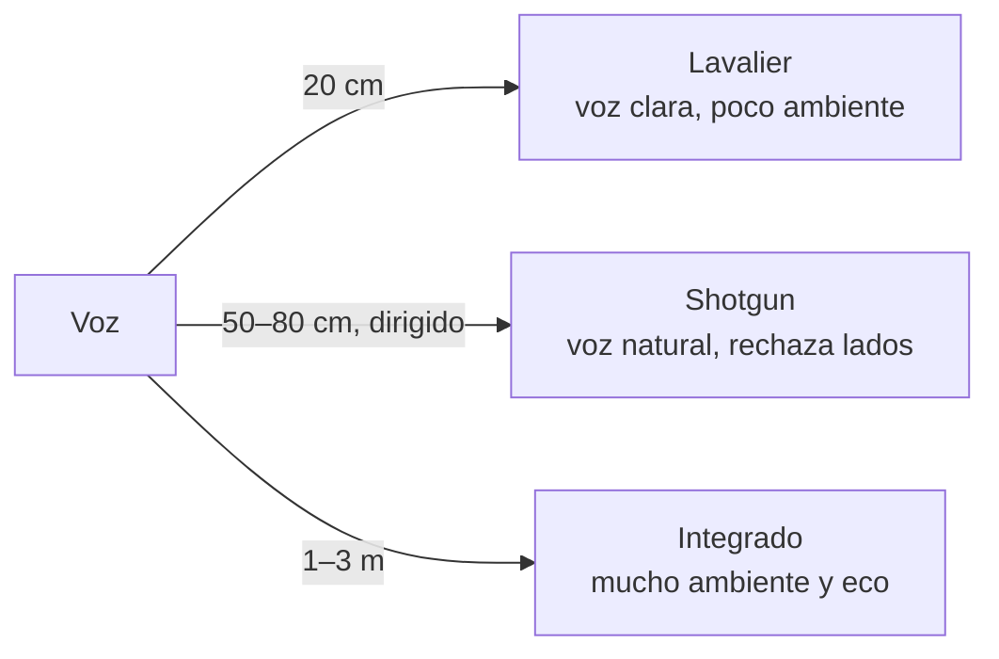

# Tipos de micrófono (lavalier, shotgun y de cámara)

Parte de: [[31-Video-Audio/03 Audio/_Índice Audio|Audio]]

> [!info] Cómo avanzar
> `progreso`: **pendiente** → **viendo** (estudiando) → **visto** (contestaste la autoevaluación sin abrir las respuestas) → **dominado** (hiciste el laboratorio o lo aplicaste de verdad).

## Contenido

### Qué es
En video se usan sobre todo tres tipos de micrófono, que se diferencian por **dónde van** y **qué captan**:
- **Lavalier (de solapa)**: diminuto, va en la ropa a unos 15–20 cm de la boca. Capta la voz de **una persona** muy de cerca.
- **Shotgun (de cañón)**: largo y **muy direccional**; capta lo que tiene enfrente y rechaza los lados. Va sobre la cámara o en una pértiga (*boom*) justo fuera de cuadro.
- **Integrado (de cámara o del celular)**: el que trae el equipo. Capta **todo el ambiente** y está lejos del sujeto.

El principio que manda en audio es simple: **la distancia a la boca** importa más que el precio del micrófono.

### Cómo funciona
**Patrón polar.** Es el "mapa" de qué direcciones capta un micrófono:
- **Omnidireccional**: capta igual en todas direcciones. Muchos lavalier lo son: no importa tanto hacia dónde apunten, pero al ir tan cerca de la boca la voz domina sobre el ruido.
- **Cardioide/supercardioide**: capta más de frente y menos de atrás.
- **Lobular (shotgun)**: muy estrecho al frente; rechaza los lados, ideal cuando no puedes acercarte.

**Relación voz/ruido.** Cada vez que duplicas la distancia, la voz que llega baja unos 6 dB, mientras el ruido ambiente sigue igual. El micrófono del celular a 2 m oye casi tanto la calle como a la persona; un lavalier a 20 cm oye sobre todo la voz.

| Tipo | Ventaja | Desventaja |
|---|---|---|
| Lavalier | Voz clara en cualquier lugar, invisible | Roce de ropa, cable o transmisor, una persona por micro |
| Shotgun | Sonido natural, no toca al sujeto | Necesita operador o estar cerca; sufre en interiores con eco |
| Integrado | Siempre disponible | Lejos de la voz, capta todo |

### Ejemplo
**Tu [[DJI Mic Mini 2]]** es un sistema **inalámbrico de transmisor tipo solapa**: cada transmisor (unos 11 g) tiene su micrófono **omnidireccional** integrado y se sujeta a la ropa con clip o imán; manda la señal a un receptor (en la cámara, en el celular por USB-C o directo a equipos DJI compatibles con OsmoAudio). Graba a 48 kHz/24 bits según DJI, tiene **dos niveles de reducción de ruido** y **cinco niveles de ganancia**. El transmisor **no graba internamente**, así que lo que llega al receptor es lo único que tienes.

**Caso: entrevista en una calle ruidosa.** Elige el **lavalier** (el Mic Mini 2) en el pecho del entrevistado: al estar tan cerca, la voz domina. Activa la reducción de ruido en nivel básico y prueba antes; el nivel fuerte puede dejar la voz "metálica". Un shotgun sobre la cámara a 2 m seguiría oyendo coches y gente.

Con la [[Sony a6700]], el receptor va a la entrada de **3.5 mm** y puedes monitorear por la salida de audífonos. Con el [[iPhone 15 Pro para foto y video]], el receptor móvil USB-C. Con la [[DJI Osmo Pocket 4P]], DJI anuncia compatibilidad con micrófonos OsmoAudio; confirma la conexión directa del Mic Mini 2 con el 4P (Pendiente de confirmar).

### Cuándo usarlo y cuándo no
- **Lavalier**: entrevistas, vlogs, tutoriales, cualquier persona que habla y se mueve.
- **Shotgun**: ficción (no quieres micros visibles), varias personas cerca, ambiente natural de una escena.
- **Integrado**: ambiente, sonido de referencia para sincronizar, emergencias.
- Combinarlos es lo ideal: lavalier para la voz y el integrado como ambiente y respaldo.

### Errores comunes
1. **Tapar el lavalier con ropa**: se escucha apagado, sin agudos, y con roces.
2. **Confiar en el micrófono integrado** para diálogo a más de un metro.
3. **Shotgun en un cuarto pequeño con eco**: el rebote entra por los lados igual.
4. **No llevar *windscreen*** (peludito) en exteriores.
5. **No monitorear**: sin audífonos no sabes si hay roces o interferencia.

### Para profundizar
- [How to choose the best lavalier microphone (Shure)](https://www.shure.com/en-US/insights/how-to-choose-the-best-lavalier-microphone)
- [Lavalier Mounting: Best Practices (RØDE)](https://rode.com/en-gb/about/news-info/lavalier-mounting-best-practices)
- [Especificaciones del DJI Mic Mini 2 (DJI)](https://www.dji.com/my/mic-mini-2/specs)

## Autoevaluación

Contesta primero en voz alta o en papel; luego despliega la respuesta.

> [!question]- ¿Qué diferencia hay entre un lavalier, un shotgun y el micrófono integrado?
> **Lavalier** (solapa): pequeño, cerca de la boca, ideal para voz. **Shotgun**: muy direccional, va en la cámara o en una caña apuntando a la boca. **Integrado** (cámara o celular): capta todo el entorno y queda lejos de la voz.

> [!question]- ¿Qué tipo es tu [[DJI Mic Mini 2]]?
> Un sistema **inalámbrico** de transmisores pequeños que se sujetan a la ropa (con clip o imán), similar a un lavalier, que envía la señal a un receptor conectado a la cámara o al teléfono.

> [!question]- Caso: grabas una entrevista en una calle ruidosa. ¿Qué micrófono eliges?
> El de solapa/inalámbrico cerca de la boca: la voz queda mucho más fuerte que el ruido. El del celular a 2 m captaría sobre todo la calle.

> [!question]- Error común: tapar el micrófono de solapa con ropa. ¿Qué se escucha?
> Roces y sonido apagado. Déjalo libre o fíjalo bien con cinta para que la tela no lo frote.

## Práctica

- [[Lab 5 - Prueba de audio con el micrófono del iPhone y el DJI Mic Mini 2]]

