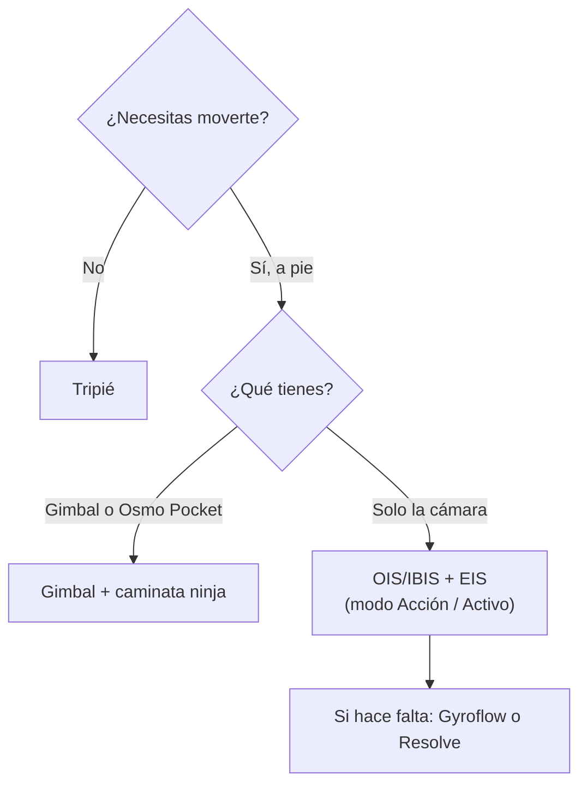

# Estabilización (tripié, gimbal y estabilizador de cámara)

Parte de: [[31-Video-Audio/04 Producción/_Índice Producción|Producción]]

> [!info] Cómo avanzar
> `progreso`: **pendiente** → **viendo** (estudiando) → **visto** (contestaste la autoevaluación sin abrir las respuestas) → **dominado** (hiciste el laboratorio o lo aplicaste de verdad).

## Contenido

### Qué es
**Estabilizar** es reducir los movimientos no deseados de la cámara. Hay tres niveles, que se pueden combinar:
- **Estabilización en el equipo**: óptica (OIS, la lente o el sensor se mueven para compensar) y electrónica (EIS, la cámara recorta y desplaza la imagen digitalmente).
- **Soportes mecánicos**: el **tripié** (cero movimiento) y el **gimbal** (motores en 3 ejes que mantienen la cámara nivelada mientras tú te mueves).
- **Estabilización en posproducción**: el editor analiza el clip y lo corrige recortando (ver [[Estabilización en posproducción (Gyroflow)]]).

### Cómo funciona
**Óptica (OIS / IBIS).** Un mecanismo mueve un elemento de la lente o el **sensor** completo (IBIS, *in-body image stabilization*) para contrarrestar temblores pequeños y rápidos. No recorta la imagen, pero tiene un rango limitado: corrige el pulso, no los pasos al caminar.

**Electrónica (EIS).** La cámara graba una zona más grande de lo que entrega y mueve el recorte para compensar. Corrige movimientos más grandes, a cambio de **recortar** el encuadre (más "zoom") y, con poca luz, de un artefacto típico: el **desenfoque de movimiento dentro del cuadro** no se puede quitar, así que la imagen se ve estable pero con "jaloneos" borrosos (*motion blur* que parpadea) o una sensación gelatinosa.

**Gimbal.** Motores y sensores mantienen la cámara en su ángulo aunque tu mano gire o se incline. Elimina rotaciones, pero **no** los rebotes verticales al caminar (por eso se combina con la caminata ninja). Da movimientos fluidos tipo grúa o dolly.

**Tripié.** Cero movimiento. Es insustituible para entrevistas, time-lapses, planos largos, poca luz y video de producto. Con una cabeza de video (fluida) también da paneos y tilts suaves ([[Tripiés y soportes]]).

### Ejemplo
Tu equipo:
- **[[iPhone 15 Pro para foto y video]]**: estabilización óptica por desplazamiento del sensor en la cámara principal, OIS en el tele y estabilización cinematográfica en video. El **modo Acción** (hasta 2.8K a 60 fps) es el que **más estabiliza al caminar o correr**, a cambio de recorte y de necesitar buena luz (con poca luz lo avisa).
- **[[Sony a6700]]**: IBIS de 5 ejes y modo de estabilización de video **Activo** (más fuerte, recorta un poco), **Estándar** u **Apagado**. En tripié, apágalo para evitar pequeñas derivas.
- **[[DJI Osmo Pocket 4P]]**: es una cámara con **gimbal de 3 ejes** integrado: la opción más estable para caminar y hacer travellings con tu kit.

**Caso de poca luz**: en una calle de noche con el iPhone en modo Acción verás la imagen estable pero con estelas borrosas que "saltan". Mejor: video normal, tripié o apoyo, y movimientos más lentos.

### Cuándo usarlo y cuándo no
| Situación | Mejor opción |
|---|---|
| Entrevista, producto, time-lapse, poca luz | Tripié |
| Caminar siguiendo a alguien | Gimbal (Osmo Pocket) o modo Acción |
| Cámara en mano "orgánica" | OIS/IBIS estándar, sin EIS fuerte |
| Toma que salió temblorosa | Estabilización en posproducción |

### Errores comunes
1. **Estabilización electrónica fuerte con poca luz**: aparecen "jaloneos" de desenfoque y efecto gelatina.
2. **IBIS encendido en tripié**: pequeñas derivas o vibraciones raras; apágalo.
3. **Confiar en el gimbal para quitar el rebote** de los pasos: sigue necesitando buena técnica al caminar.
4. **Tripié flojo o sin nivelar**: horizontes torcidos y vibraciones con el viento.
5. **Estabilizar dos veces** (EIS en cámara + fuerte en edición): recorte doble y artefactos.

### Para profundizar
- [Especificaciones técnicas del iPhone 15 Pro (Apple)](https://support.apple.com/en-us/111829)
- [Especificaciones de la Sony a6700 (Sony)](https://www.sony.co.in/interchangeable-lens-cameras/products/ilce-6700/spec)
- [Comunicado de lanzamiento de la Osmo Pocket 4P (DJI)](https://www.mynewsdesk.com/uk/dji/pressreleases/osmo-pocket-4p-delivers-pro-filmmaking-capabilities-advancing-the-gimbal-camera-category-dji-pioneered-3459469)

## Autoevaluación

Contesta primero en voz alta o en papel; luego despliega la respuesta.

> [!question]- ¿Qué diferencia hay entre estabilización óptica/electrónica y un gimbal?
> La **óptica** (OIS) mueve el sensor o lente para compensar vibraciones pequeñas; la **electrónica** (EIS) recorta y mueve la imagen. Un **gimbal** usa motores en tres ejes para mantener la cámara nivelada en movimientos amplios.

> [!question]- ¿Qué modo del iPhone estabiliza más al caminar?
> El **Modo Acción** del iPhone 15 Pro estabiliza mucho al recortar la imagen (menos resolución y peor en poca luz).

> [!question]- ¿Cuándo es mejor un tripié que todo lo demás?
> En entrevistas, time-lapse, producto o tomas fijas: imagen totalmente quieta y repetible.

> [!question]- Error común: usar estabilización fuerte con poca luz. ¿Qué artefacto aparece?
> Desenfoque de movimiento que "flota" o tiembla aunque la imagen esté fija (la estabilización mueve la imagen, pero cada cuadro ya salió borroso). Con poca luz, mejor tripié.

## Práctica

- [[Lab 8 - Preproducción de un video de 2 minutos]]

