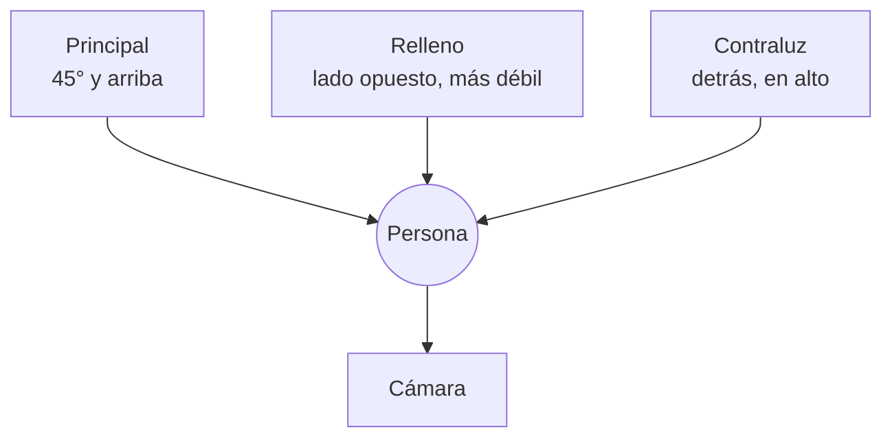

# Iluminación de tres puntos

Parte de: [[31-Video-Audio/04 Producción/_Índice Producción|Producción]]

> [!info] Cómo avanzar
> `progreso`: **pendiente** → **viendo** (estudiando) → **visto** (contestaste la autoevaluación sin abrir las respuestas) → **dominado** (hiciste el laboratorio o lo aplicaste de verdad).

## Contenido

### Qué es
La **iluminación de tres puntos** es el esquema básico para iluminar a una persona en video o foto con tres funciones de luz: una **principal** que define la imagen, un **relleno** que suaviza sus sombras y un **contraluz** que separa a la persona del fondo. No son necesariamente tres lámparas caras: son tres **trabajos** que puedes resolver con una ventana, una cartulina blanca y una lámpara de casa.

### Cómo funciona
| Luz | Dónde va | Qué hace |
|---|---|---|
| **Principal** (*key*) | A unos 30–45° a un lado de la cámara y un poco arriba de los ojos | Ilumina la cara y crea el modelado (luz y sombra) |
| **Relleno** (*fill*) | Del lado opuesto a la principal, más débil | Abre las sombras; controla el contraste |
| **Contraluz** (*back/rim*) | Detrás de la persona, del lado opuesto a la principal y en alto | Dibuja un borde de luz en pelo y hombros; separa del fondo |

**Contraste (relación principal/relleno).** Cuanto más débil el relleno, más dramática la imagen. Sin relleno, la mitad de la cara queda en sombra profunda: look de cine negro o de entrevista dramática. Con mucho relleno, imagen plana y luminosa, tipo comercial o tutorial.

**Luz suave.** Para caras conviene que la principal sea **grande y cercana** respecto a la persona (ventana, *softbox*, luz rebotada): sombras con transición suave ([[Luz dura y luz suave]]). Los esquemas clásicos de retrato (Rembrandt, mariposa, lateral) son variaciones de dónde pones la principal ([[Esquemas de iluminación de retrato]]).

**Temperatura de color.** Las tres luces deben tener **el mismo color** (o un contraste de color intencional). Mezclar luz de día (fría, ~5600 K) con focos cálidos (~2700–3000 K) hace que una mitad de la cara salga azulada y la otra naranja, y ningún balance de blancos corrige ambas ([[Balance de blancos y temperatura de color]]).

### Ejemplo
**Tres puntos en casa sin luces de estudio:**
1. **Principal**: una ventana grande a un lado (de día, sin sol directo; si entra sol, una cortina blanca lo difumina). Sienta a la persona a 45° de la ventana.
2. **Relleno**: una cartulina blanca, un unicel o una sábana blanca del otro lado, rebotando la luz de la ventana. Acércala o aléjala para controlar el contraste.
3. **Contraluz**: una lámpara de escritorio detrás de la persona, fuera de cuadro, apuntando a la nuca y hombros. Si es cálida y la ventana es fría, usa un foco LED de luz día o coloca la lámpara para que el color se vea como intencional.
4. Apaga las luces del techo: mezclan color y caen desde arriba (ojeras).

Graba con la [[Sony a6700]] o el [[iPhone 15 Pro para foto y video]] con balance de blancos **manual** en luz día. Si tienes una [[Luces LED portátiles|LED bicolor]], úsala como contraluz ajustada a 5600 K. Practica en [[Lab 7 - Iluminación de tres puntos con luz de casa]].

### Cuándo usarlo y cuándo no
- **Sí**: entrevistas, vlogs sentados, tutoriales a cámara, retratos en video.
- **Adapta**: en exteriores el sol puede ser la principal o el contraluz, y un reflector el relleno.
- **No te obsesiones** con tres luces en documental o cámara en mano: aprovecha la luz disponible y busca la mejor posición de la persona respecto a ella.

### Errores comunes
1. **Mezclar ventana fría con focos amarillos**: dominantes de color distintas en la misma cara.
2. **Principal de frente pegada a la cámara**: cara plana, sin volumen.
3. **Quitar el relleno sin querer** (o tenerlo demasiado lejos): sombras muy duras que no buscabas.
4. **Contraluz que entra a la lente**: destellos y pérdida de contraste; ponlo fuera de cuadro o con una bandera (cartón negro).
5. **Persona pegada a la pared**: la principal proyecta su sombra en el fondo; sepárala 1–2 m.

### Para profundizar
- [Three-point lighting (Wikipedia)](https://en.wikipedia.org/wiki/Three-point_lighting)
- [Manual para principiantes de DaVinci Resolve 20 (Blackmagic Design)](https://documents.blackmagicdesign.com/UserManuals/DaVinci-Resolve-20-Beginners-Guide.pdf)
- Relación con foto: [[Modificadores de luz (difusor, reflector y softbox)]]

## Autoevaluación

Contesta primero en voz alta o en papel; luego despliega la respuesta.

> [!question]- ¿Cuáles son las tres luces y qué hace cada una?
> **Principal (key)**: la más fuerte, a unos 45° del sujeto, define la forma. **Relleno (fill)**: del otro lado, más suave, aclara las sombras. **Contraluz (back)**: detrás, separa al sujeto del fondo con un borde de luz.

> [!question]- Caso: no tienes luces. ¿Cómo haces tres puntos en casa?
> Principal: una ventana a 45°. Relleno: una cartulina blanca o sábana del otro lado (rebota luz). Contraluz: una lámpara detrás, fuera de cuadro.

> [!question]- ¿Qué pasa si quitas el relleno?
> Más contraste: una mitad de la cara en sombra (look dramático). Es válido si es intencional.

> [!question]- Error común: mezclar luz de ventana (fría) con focos amarillos. ¿Qué pasa en la imagen?
> Colores mezclados en la cara que ningún balance de blancos arregla del todo. Usa fuentes de la misma temperatura.

## Práctica

- [[Lab 7 - Iluminación de tres puntos con luz de casa]]

