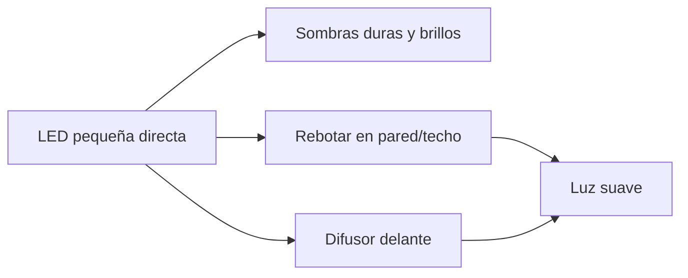

# Luz LED continua

Parte de: [[31-Video-Audio/04 Producción/_Índice Producción|Producción]]

> [!info] Cómo avanzar
> `progreso`: **pendiente** → **viendo** (estudiando) → **visto** (contestaste la autoevaluación sin abrir las respuestas) → **dominado** (hiciste el laboratorio o lo aplicaste de verdad).

## Contenido

### Qué es
Una **luz LED continua** es una lámpara que permanece **encendida todo el tiempo** (a diferencia del flash, que dispara un destello instantáneo). En video es la opción estándar: es ligera, se calienta poco, funciona con batería o corriente y muchas permiten ajustar **intensidad** y **temperatura de color**. Van desde paneles pequeños de bolsillo hasta lámparas grandes tipo COB con modificadores.

### Cómo funciona
**Por qué continua y no flash.** El video graba 24–60 cuadros por segundo: necesita luz **en cada cuadro**. Un flash solo ilumina una fracción de segundo. Además, con luz continua **ves el resultado** mientras ajustas: lo que ves en el monitor es lo que se graba.

**Calidad de color: CRI y TLCI.** No toda luz blanca es igual. Los LED baratos tienen huecos en su espectro y la piel puede verse verdosa, grisácea o magenta.
- **CRI** (*Color Rendering Index*): índice de 0 a 100 de qué tan fielmente reproduce los colores comparada con una luz de referencia. Para video busca **CRI 95 o más**.
- **TLCI** (*Television Lighting Consistency Index*): índice creado por la EBU pensando en cámaras de video (cómo "ve" la cámara la luz). También busca **95 o más**.

**Bicolor vs. RGB.**
- **Bicolor**: mezcla LED cálidos y fríos para ajustar la temperatura, típicamente de ~2700–3200 K a ~5600–6500 K (depende del modelo). Te permite **igualar la luz que ya hay** (ventana de día o lámparas cálidas de casa) en lugar de pelear con ella.
- **RGB(WW)**: además da colores para efectos y fondos.

**Tamaño aparente.** Un panel pequeño apuntado directo a la cara es una fuente **dura**: sombras marcadas, brillos en la piel y la persona entrecierra los ojos. Para suavizar, haz la fuente **más grande respecto al sujeto**:
- Rebótala en una pared o techo blanco.
- Pon un difusor (*softbox*, tela blanca, papel albanene) delante.
- Acércala con difusión (más cerca = más suave, relativamente).

**Parpadeo.** Algunas LED baratas regulan la intensidad con PWM y parpadean en video (bandas que se mueven), sobre todo con obturaciones rápidas o en cámara lenta. Prueba la luz a la intensidad que usarás, con la obturación de tu toma.

### Ejemplo
**Escritorio para tutoriales o YouTube:**
- Una LED bicolor con difusor a 45° de tu cara como principal, a **5600 K** si hay luz de ventana, o a **3200 K** si la habitación tiene focos cálidos.
- La pared blanca del otro lado como relleno natural.
- Una LED pequeña RGB en el fondo con un color suave para dar profundidad.
- Balance de blancos manual en la [[Sony a6700]] (o en [[Blackmagic Camera (app)]] para el iPhone) igual a la temperatura de las luces.
Más opciones de compra en [[Luces LED portátiles]].

### Cuándo usarlo y cuándo no
- **Sí**: interiores, entrevistas, video de producto, como relleno en exteriores, para cámara lenta en interiores (necesita mucha luz).
- **No hace falta**: exteriores con buena luz natural, o si una ventana bien aprovechada ya resuelve.
- **Flash**: solo para fotografía; no sirve para video.

### Errores comunes
1. **LED pequeña directa a la cara**: luz dura, brillos y ojos entrecerrados. Rebota o difumina.
2. **Comprar por potencia y no por CRI/TLCI**: la piel sale con dominantes raras.
3. **No igualar temperatura** con la luz ambiente: mezcla de colores.
4. **Bajar la intensidad al mínimo** en LED baratas: aparece parpadeo; aleja la luz en lugar de atenuarla tanto.
5. **Batería agotada a media toma**: lleva repuesto o corriente.

### Para profundizar
- [TLCI-2012 (EBU)](https://tech-qual.ebu.ch/tlci-2012)
- [Three-point lighting (Wikipedia)](https://en.wikipedia.org/wiki/Three-point_lighting)
- Relación con foto: [[Luz dura y luz suave]]

## Autoevaluación

Contesta primero en voz alta o en papel; luego despliega la respuesta.

> [!question]- ¿Por qué en video se usa luz continua y no flash?
> Porque la cámara graba todo el tiempo; necesitas luz constante que puedas ver y ajustar.

> [!question]- ¿Qué es el CRI/TLCI de una luz LED?
> Índices de qué tan fielmente reproduce colores (0–100). Para piel conviene 95 o más.

> [!question]- ¿Qué ventaja da una LED bicolor?
> Puedes ajustar su temperatura (p. ej. 3200 K a 5600 K) para igualarla a la luz del lugar.

> [!question]- Error común: poner una LED pequeña directa a la cara. ¿Qué resultado da y cómo lo suavizas?
> Luz dura, brillos y sombras marcadas. Rebótala en una pared blanca o pon un difusor; cuanto más grande la fuente respecto al sujeto, más suave.

## Práctica

- [[Lab 7 - Iluminación de tres puntos con luz de casa]]

