# Plan de rodaje

Parte de: [[31-Video-Audio/04 Producción/_Índice Producción|Producción]]

> [!info] Cómo avanzar
> `progreso`: **pendiente** → **viendo** (estudiando) → **visto** (contestaste la autoevaluación sin abrir las respuestas) → **dominado** (hiciste el laboratorio o lo aplicaste de verdad).

## Contenido

### Qué es
El **plan de rodaje** es el documento que organiza **cuándo, dónde, con qué y con quién** se graba cada toma. Toma la lista de tomas ([[Storyboard y lista de tomas]]) y la convierte en un horario realista. En producciones grandes se acompaña de la **hoja de llamado** (*call sheet*), que le dice a cada persona a qué hora y dónde presentarse.

### Cómo funciona
**Qué contiene un plan de rodaje:**
- **Fecha, horario y locaciones** (con dirección y cómo llegar).
- **Bloques de tomas** en orden de grabación, con duración estimada de cada uno.
- **Personas**: quién aparece en cada bloque y su contacto.
- **Equipo** por bloque: cámaras, lentes, micrófonos, luces, tripiés, baterías.
- **Hora del sol**: amanecer, atardecer, hora dorada y azul; y el pronóstico del clima.
- **Riesgos y plan B**: qué hacer si llueve, si una persona no llega o si falla un equipo.
- **Checklist técnica**: baterías, almacenamiento, audio, configuración.

**Por qué incluir la hora del sol.** La luz natural cambia rápido: la **hora dorada** dura poco y el sol de mediodía es duro. Si una escena exterior necesita cierta luz, su bloque se programa alrededor de esa hora y lo demás se acomoda. Además, para la continuidad, una escena debe grabarse con luz parecida en todas sus tomas ([[Eje de 180 grados y continuidad]]). Mira [[Hora dorada y hora azul]].

```mermaid
gantt
    title Ejemplo de plan de rodaje (sábado)
    dateFormat HH:mm
    axisFormat %H:%M
    section Exteriores
    Plano de ubicación (luz suave) :07:00, 45m
    Caminata y b-roll             :07:45, 75m
    section Interiores
    Entrevista (tres puntos)      :10:00, 120m
    Detalles y room tone          :12:00, 45m
    section Exteriores
    Cierre en hora dorada         :18:15, 45m
```

**Margen.** Todo tarda más de lo que crees: suma 25–50 % al tiempo estimado y deja un bloque libre para repetir tomas.

### Ejemplo
**Caso: vas a grabar 2 h de ProRes en el iPhone.** Antes de salir revisa:
1. **Espacio**: ProRes 422 HQ en 4K a ~30 fps ronda los 700 Mbps → 700 × 7200 s / 8 ≈ **630 GB** en 2 h. No cabe en el [[iPhone 15 Pro para foto y video]]: necesitas un **SSD externo** por USB‑C (exFAT, cable USB 3 de al menos 10 Gbit/s; para 4K60 Apple pide ≥ 220 MB/s de escritura) o grabar en HEVC ([[Bitrate y tamaño de archivo]]).
2. **Capacidad del modelo**: con 128 GB internos, ProRes interno solo llega a 1080p a 30/25 fps.
3. **Energía**: batería externa o corriente; ProRes y el SSD consumen.
4. **Temperatura**: grabar ProRes mucho tiempo calienta el teléfono; evita el sol directo.
5. **Audio**: receptor del [[DJI Mic Mini 2]] cargado, transmisores cargados (unas 11.5 h de transmisor según DJI), estuche de carga.
6. **Respaldo**: plan para descargar y respaldar el mismo día ([[Respaldo 3-2-1 de fotos y videos]]).

Con la [[Sony a6700]]: tarjetas formateadas y con velocidad suficiente, baterías cargadas, y considera que en 4K60 o 4K120 puede calentarse en tomas largas.

### Cuándo usarlo y cuándo no
- **Completo**: rodajes con varias personas, locaciones o luz natural crítica.
- **Simplificado** (una lista con horarios y checklist): vlogs, tutoriales, videos de producto en casa.
- Siempre al menos la **checklist técnica** de la noche anterior.

### Errores comunes
1. **No revisar audio y almacenamiento la noche anterior**: llegas con baterías vacías, tarjeta llena o el receptor sin emparejar, y pierdes la primera hora (o la toma única).
2. **Programar exteriores al mediodía** sin necesidad: luz dura y ojos entrecerrados.
3. **Sin margen**: el día se alarga y sacrificas el cierre.
4. **Olvidar permisos** de locación o de las personas ([[Permiso de modelo y fotografía en espacios públicos en México]]).
5. **No tener plan B** para lluvia o una persona que no llega.

### Para profundizar
- [Film production documents & templates (StudioBinder)](https://www.studiobinder.com/film-production-documents/)
- [Acerca de Apple ProRes en el iPhone (Apple)](https://support.apple.com/es-lamr/109041)
- [Especificaciones del DJI Mic Mini 2 (DJI)](https://www.dji.com/my/mic-mini-2/specs)

## Autoevaluación

Contesta primero en voz alta o en papel; luego despliega la respuesta.

> [!question]- ¿Qué contiene un plan de rodaje?
> Fecha, horarios, lugar, personas, orden de tomas, equipo a llevar (baterías, almacenamiento), y plan B (clima, permisos).

> [!question]- ¿Por qué incluir la hora del sol?
> La luz cambia mucho: planifica exteriores en hora dorada o con cielo nublado, y deja interiores para cuando la luz no sirve.

> [!question]- Caso: vas a grabar 2 h de ProRes en el iPhone. ¿Qué revisas antes?
> Espacio libre (ProRes 4K ocupa varios GB por minuto) o un SSD externo por USB-C, batería o power bank, y que el [[DJI Mic Mini 2]] esté cargado.

> [!question]- Error común: no revisar audio y almacenamiento la noche anterior. ¿Qué pasa en el rodaje?
> Llegas con baterías vacías o memoria llena y pierdes el tiempo o la toma.

## Práctica

- [[Lab 8 - Preproducción de un video de 2 minutos]]

