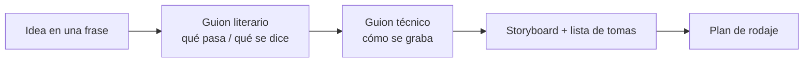

# Preproducción (idea, guion y guion técnico)

Parte de: [[31-Video-Audio/04 Producción/_Índice Producción|Producción]]

> [!info] Cómo avanzar
> `progreso`: **pendiente** → **viendo** (estudiando) → **visto** (contestaste la autoevaluación sin abrir las respuestas) → **dominado** (hiciste el laboratorio o lo aplicaste de verdad).

## Contenido

### Qué es
La **preproducción** es todo el trabajo **antes** de grabar: definir la idea, escribirla, decidir cómo se va a filmar y organizar el rodaje. Es la etapa más barata para corregir errores: cambiar una escena en papel cuesta minutos; descubrir en edición que te falta una toma cuesta otro día de grabación.

### Cómo funciona
**Etapas típicas** (en un video pequeño pueden durar una tarde):
1. **Idea**: qué quieres contar, para quién y para qué. Resúmela en **una frase** ("enseñar a cambiar la boquilla de la impresora en 3 minutos").
2. **Investigación**: datos, locaciones, permisos, referencias visuales.
3. **Guion literario**: *qué* pasa y *qué* se dice (escenas, diálogos, narración).
4. **Guion técnico**: *cómo* se graba cada parte (planos, movimientos, audio, luz).
5. **Storyboard y lista de tomas** ([[Storyboard y lista de tomas]]).
6. **Plan de rodaje** ([[Plan de rodaje]]): cuándo, dónde, con qué y con quién.

**Guion literario vs. guion técnico.**

| Guion literario | Guion técnico |
|---|---|
| Escena 2. Cocina, mañana. Ana prepara café, nerviosa. ANA (V.O.): "Hoy es el día." | 2.1 Plano general, cocina, fijo, 24 fps. 2.2 Detalle café cayendo, 60 fps. 2.3 Primer plano Ana, iPhone 3×. Audio: room tone + V.O. aparte |

Un formato muy práctico para YouTube y tutoriales es el de **dos columnas**: a la izquierda lo que se **ve** y a la derecha lo que se **oye**.

**Medir la narración.** A un ritmo natural de **~140 palabras por minuto** (varía según la persona; mide el tuyo):
- 420 palabras → 420 / 140 = **3 min**.
- Un reel de 30 s a ~150 palabras/min → 150 × 0.5 = **75 palabras** como máximo.
- Un video de 6 min a 140 palabras/min → **840 palabras** de narración.

### Ejemplo
**Tutorial de 3 minutos** ("cómo nivelar la cama de la Elegoo Centauri 2 Combo"):
- ¿Guion completo? **Sí, pero para la voz en off o los puntos clave**, no necesariamente palabra por palabra si hablas a cámara: una **escaleta** (lista de puntos en orden) con frases clave escritas, y el texto completo solo para el gancho inicial y el cierre.
- Guion técnico en dos columnas: "ve: plano medio tuyo / oye: gancho"; "ve: detalle de la pantalla de la impresora / oye: paso 1"; etc.
- Equipo: [[Sony a6700]] en tripié para el plano medio, [[iPhone 15 Pro para foto y video]] en 2× para detalles, [[DJI Mic Mini 2]] para la voz, [[OBS Studio]] si hay pantalla de PC.
- Duración: ~420 palabras para 3 min.
Practica el flujo completo en [[Lab 8 - Preproducción de un video de 2 minutos]].

### Cuándo usarlo y cuándo no
- **Guion completo**: narraciones, cortos de ficción, videos con voz en off, anuncios.
- **Escaleta**: vlogs, tutoriales hablados a cámara, entrevistas (lista de preguntas).
- **Mínimo indispensable siempre**: idea en una frase + lista de tomas. Incluso un reel de 15 s se beneficia.

### Errores comunes
1. **Saltarse la preproducción en un video corto**: llegas a editar y faltan tomas clave (el detalle, el plano de ubicación, el cierre), o sobra material sin hilo.
2. **Guion demasiado largo** para la duración: mide palabras por minuto.
3. **Escribir para leer, no para decir**: frases largas que nadie diría en voz alta; léelo en voz alta antes de grabar.
4. **No tener guion técnico**: en el set improvisas planos y olvidas coberturas.
5. **Idea difusa**: si no la puedes decir en una frase, el video tampoco la tendrá clara.

### Para profundizar
- [How to make a shot list (StudioBinder)](https://www.studiobinder.com/blog/how-to-make-a-shot-list/)
- [Film production documents & templates (StudioBinder)](https://www.studiobinder.com/film-production-documents/)
- Relacionado: [[Narrativa y storytelling en video]]

## Ejercicios

Resuélvelos en papel o en la herramienta; la solución está plegada.

> [!question]- Tu guion de voz en off tiene 420 palabras. A ~140 palabras por minuto, ¿cuánto dura?
> 420 / 140 = **3 min**.

> [!question]- Quieres un reel de 30 s narrado a ~150 palabras/min. ¿Cuántas palabras máximo?
> 150 × 0.5 = **75 palabras**.

> [!question]- Un video de 6 min a 140 palabras/min, ¿cuántas palabras de narración necesitas?
> 6 × 140 = **840 palabras**.

## Autoevaluación

Contesta primero en voz alta o en papel; luego despliega la respuesta.

> [!question]- ¿Qué etapas tiene la preproducción?
> Idea (una frase), guion (qué se dice y qué pasa), guion técnico (cómo se graba cada parte: plano, movimiento, audio), y logística (lugar, personas, equipo, permisos).

> [!question]- ¿Qué diferencia hay entre guion literario y guion técnico?
> El **literario** cuenta la historia (acciones y diálogos). El **técnico** añade, escena por escena, tipo de plano, ángulo, movimiento y notas de sonido/luz.

> [!question]- Caso: tu video será un tutorial de 3 min. ¿Escribes guion completo?
> Sí, al menos un esquema con frases clave: evita repetir y olvidar pasos. Unas 130–150 palabras por minuto de narración es una referencia razonable.

> [!question]- Error común: saltarte la preproducción en un video corto. ¿Qué consecuencia típica tiene?
> Falta de tomas clave al editar y tener que regrabar.

## Práctica

- [[Lab 8 - Preproducción de un video de 2 minutos]]

