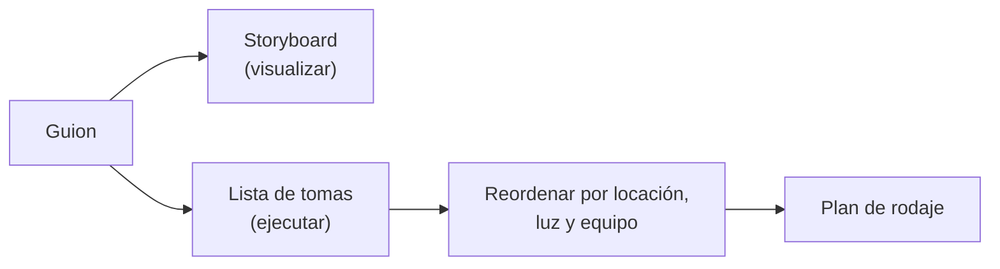

# Storyboard y lista de tomas

Parte de: [[31-Video-Audio/04 Producción/_Índice Producción|Producción]]

> [!info] Cómo avanzar
> `progreso`: **pendiente** → **viendo** (estudiando) → **visto** (contestaste la autoevaluación sin abrir las respuestas) → **dominado** (hiciste el laboratorio o lo aplicaste de verdad).

## Contenido

### Qué es
Un **storyboard** es una secuencia de **dibujos** (o fotos) que muestra cómo se verá cada plano del video, en orden, como una historieta. Una **lista de tomas** (*shot list*) es una **tabla** con cada plano que hay que grabar y sus datos técnicos: número, tamaño de plano, ángulo, movimiento, lente, locación y notas. El storyboard ayuda a **visualizar**; la lista de tomas, a **ejecutar** el rodaje sin olvidar nada.

### Cómo funciona
**Storyboard.** No necesitas saber dibujar: figuras de palitos, flechas para el movimiento de cámara y un rectángulo con la proporción del video (16:9 o 9:16). Debajo de cada cuadro anotas qué pasa y qué se oye. Sirve para:
- Ver si la secuencia **se entiende** antes de grabar.
- Decidir encuadres y movimientos con calma.
- Explicar la idea a quien te ayude.
Alternativa rápida: tomar **fotos con el celular** en la locación imitando cada encuadre.

**Lista de tomas.** Columnas típicas:

| # | Escena | Plano | Ángulo / movimiento | Equipo | Locación | Notas |
|---|---|---|---|---|---|---|
| 1 | Intro | General | Normal, fijo | a6700 + tripié | Cocina | Luz de ventana |
| 2 | Intro | Detalle café | Cenital, fijo | iPhone 2× | Cocina | 60 fps |
| 3 | Final | Primer plano | Dolly in lento | Osmo Pocket 4P | Sala | — |

**Orden de grabación ≠ orden del guion.** La lista se escribe en el orden de la historia, pero **se graba** en el orden más eficiente:
- **Por locación**: todo lo de la cocina junto, aunque esté al inicio y al final del video.
- **Por luz**: lo que necesita la luz de la mañana primero, lo de la tarde después.
- **Por configuración**: todos los planos con la misma posición de cámara e iluminación seguidos; cambiar luces y tripié es lo que más tiempo consume.
- **Por disponibilidad**: las tomas con otras personas cuando estén.

### Ejemplo
**Reel de 30 s con 8 planos** (receta de agua de jamaica):
- ¿Storyboard? **Sí, uno sencillo**: con 8 planos en 30 s cada uno dura ~3–4 s y el orden y el encuadre vertical importan mucho. Ocho rectángulos 9:16 con palitos en una hoja bastan, o 8 fotos de referencia con el [[iPhone 15 Pro para foto y video]].
- Lista de tomas: 1 gancho (el vaso con hielo cayendo, cámara lenta), 2 flor de jamaica en la olla (cenital), 3 agua hirviendo (detalle), 4 colar (medio), 5 azúcar (detalle), 6 servir (medio), 7 primer sorbo (primer plano), 8 vaso final con texto.
- Orden de grabación: primero todo lo de la estufa (2, 3, 4), luego la mesa (5, 6, 1, 8) y al final el sorbo (7).
Practica en [[Lab 9 - Grabar un reel vertical de 30 segundos]].

### Cuándo usarlo y cuándo no
- **Storyboard**: secuencias con muchos planos cortos, anuncios, ficción, reels coreografiados, escenas de acción.
- **Solo lista de tomas**: entrevistas, tutoriales, vlogs (más improvisados).
- **Ninguno**: casi nunca; aun en un vlog, una lista de "no olvidar" (ubicación, b-roll, cierre) salva el video.

### Errores comunes
1. **Grabar en el orden del guion**: mueves luces y cámara una y otra vez; ordena por locación y configuración.
2. **Storyboard demasiado detallado** que nadie usa: lo importante es el encuadre y el movimiento.
3. **Lista sin coberturas**: olvidar detalles y planos de ubicación que necesitarás para editar.
4. **No tachar** lo grabado: al final del día no sabes qué falta.
5. **Ignorar el formato**: dibujar en 16:9 un video que será vertical.

### Para profundizar
- [How to make a shot list (StudioBinder)](https://www.studiobinder.com/blog/how-to-make-a-shot-list/)
- [Shot list template (StudioBinder)](https://www.studiobinder.com/blog/shot-list-template/)
- Relacionado: [[Tipos de plano]] y [[Plan de rodaje]]

## Autoevaluación

Contesta primero en voz alta o en papel; luego despliega la respuesta.

> [!question]- ¿Qué es un storyboard?
> Una secuencia de dibujos (pueden ser monitos o fotos con el celular) que muestra cada plano en orden: encuadre, acción y movimiento.

> [!question]- ¿Qué es una lista de tomas (shot list)?
> Una tabla con cada toma a grabar: número, escena, tipo de plano, movimiento, lente/fps y notas. Se usa en el rodaje para no olvidar nada.

> [!question]- Caso: grabarás un reel de 30 s con 8 planos. ¿Necesitas storyboard?
> Un storyboard rápido (8 cuadros) ayuda mucho: verás si hay variedad de planos y si la historia se entiende antes de grabar.

> [!question]- Error común: hacer la lista de tomas en el orden del guion. ¿Cómo conviene ordenarla para grabar?
> Por **ubicación y orientación de cámara/luz**: grabas juntas todas las tomas de un mismo lugar y ángulo, aunque aparezcan en momentos distintos.

## Práctica

- [[Lab 8 - Preproducción de un video de 2 minutos]]

