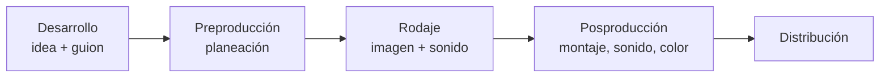

# Cortometraje

Parte de: [[31-Video-Audio/05 Formatos/_Índice Formatos|Formatos]]

> [!info] Cómo avanzar
> `progreso`: **pendiente** → **viendo** (estudiando) → **visto** (contestaste la autoevaluación sin abrir las respuestas) → **dominado** (hiciste el laboratorio o lo aplicaste de verdad).

## Contenido

### Qué es
Un **cortometraje** es una obra de ficción (o documental) **breve** con una historia completa. Las duraciones varían según el festival o la convocatoria: muchos piden menos de 30–40 minutos, pero un corto casero de **1 a 5 minutos** ya es un proyecto completo y exigente. Tiene la estructura de una película (inicio, conflicto, final), solo que condensada: pocos personajes, pocas locaciones y una idea muy clara.

### Cómo funciona
**Estructura.** La misma que cualquier historia ([[Narrativa y storytelling en video]]): un personaje que quiere algo, un obstáculo y un cambio. En un corto no hay tiempo para subtramas; se suele contar **un solo momento** o **un solo giro**.

**Etapas de producción que vas a vivir:**
1. **Desarrollo**: idea en una frase, guion literario (1 página ≈ 1 minuto en formato de guion de cine, como regla general).
2. **Preproducción**: guion técnico, storyboard, lista de tomas, casting (amigos), locaciones, plan de rodaje ([[Preproducción (idea, guion y guion técnico)]], [[Storyboard y lista de tomas]], [[Plan de rodaje]]).
3. **Rodaje**: uno o dos días; grabar cada escena con coberturas (general, medios, primeros planos) y sonido directo.
4. **Posproducción**: montaje, sonido (limpieza, ambientes, efectos, música), color, títulos y exportación.
5. **Distribución**: YouTube, Vimeo, festivales de cortos o convocatorias locales.

### Ejemplo
**Tu primer corto** (recomendaciones):
- **Corto de 2–3 minutos**, **una locación** (tu casa), **uno o dos personajes**, **sin diálogos o con muy pocos**. Las historias visuales son más fáciles de grabar bien que los diálogos largos.
- Idea de ejemplo: "Un programador intenta terminar un despliegue antes de medianoche mientras todo en su casa falla". Inicio: el reloj y su prisa; desarrollo: se va la luz, el gato tira el café; final: lo logra... o no.
- Equipo: [[Sony a6700]] en S-Log3 o S-Cinetone a 24 fps (obturación 1/50), [[iPhone 15 Pro para foto y video]] de segunda cámara, [[DJI Osmo Pocket 4P]] para movimientos, [[DJI Mic Mini 2]] en los actores y luz con lámparas de casa ([[Iluminación de tres puntos]]).
- Posproducción en [[DaVinci Resolve (versión gratuita)]], incluida su página Fairlight para el sonido.

### Cuándo usarlo y cuándo no
- **Sí**: para aprender todo el ciclo audiovisual, para un portafolio, para concursos y festivales.
- **Empieza chico**: un corto de 2 minutos terminado enseña más que uno de 20 minutos abandonado.
- **No** como primer proyecto si aún no dominas lo básico de exposición y audio: haz antes ejercicios de escenas cortas ([[Lab 3 - Escena de 60 segundos con 5 tipos de plano sin romper el eje]]).

### Errores comunes
1. **Subestimar el sonido**: el público perdona una imagen imperfecta, pero no diálogos que no se entienden, ruidos de fondo o cambios bruscos de ambiente. El sonido es la mitad de la experiencia; graba room tone, ambientes y efectos ([[Sonido ambiente y voz en off]]).
2. **Guion demasiado largo** o con muchas locaciones: imposible de grabar con un equipo pequeño.
3. **Sin coberturas**: grabar cada escena en un solo plano y luego no poder editar el ritmo.
4. **Romper el eje** en diálogos ([[Eje de 180 grados y continuidad]]).
5. **Música con derechos**: impide subirlo o inscribirlo en festivales ([[Derechos de autor de fotos y videos]]).

### Para profundizar
- [Film production documents & templates (StudioBinder)](https://www.studiobinder.com/film-production-documents/)
- [Manual para principiantes de DaVinci Resolve 20 (Blackmagic Design)](https://documents.blackmagicdesign.com/UserManuals/DaVinci-Resolve-20-Beginners-Guide.pdf)
- [What is continuity editing (StudioBinder)](https://www.studiobinder.com/blog/what-is-continuity-editing/)

## Autoevaluación

Contesta primero en voz alta o en papel; luego despliega la respuesta.

> [!question]- ¿Qué duración y estructura tiene un cortometraje?
> Suele durar menos de ~30–40 min (muchos festivales ponen sus propios límites). Estructura en tres actos: planteamiento, desarrollo/conflicto, desenlace.

> [!question]- ¿Qué conviene para tu primer corto?
> Una sola locación, pocos personajes, 2–5 min, e historia simple con un conflicto claro.

> [!question]- ¿Qué etapas de producción vas a vivir?
> Preproducción (guion, storyboard, plan), rodaje y posproducción (edición, sonido, color, entrega).

> [!question]- Error común en cortos caseros: subestimar el sonido. ¿Por qué?
> El público perdona imagen imperfecta pero no audio malo; diálogos inaudibles arruinan el corto.

