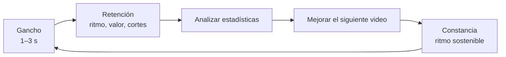

# Creación de contenido (ganchos, retención y constancia)

Parte de: [[31-Video-Audio/05 Formatos/_Índice Formatos|Formatos]]

> [!info] Cómo avanzar
> `progreso`: **pendiente** → **viendo** (estudiando) → **visto** (contestaste la autoevaluación sin abrir las respuestas) → **dominado** (hiciste el laboratorio o lo aplicaste de verdad).

## Contenido

### Qué es
La **creación de contenido** es producir videos de forma **regular** para una audiencia en plataformas como YouTube, Instagram o TikTok. Más allá de la técnica de grabación, depende de tres habilidades: el **gancho** (lograr que alguien se detenga), la **retención** (que se quede hasta el final) y la **constancia** (publicar de forma sostenible para que la audiencia vuelva y la plataforma te conozca).

### Cómo funciona
**Gancho.** Son los primeros 1–3 segundos (en vertical) o los primeros 15–30 s (en YouTube). Debe responder "¿por qué debería ver esto?". Tipos de gancho:
- **Resultado primero**: muestra el final ("así quedó mi escritorio") y luego el proceso.
- **Pregunta o problema**: "¿Tu código se rompe cada vez que despliegas?".
- **Contraste o sorpresa**: algo inesperado en imagen.
- **Promesa concreta**: "3 ajustes de cámara para que tus videos de iPhone se vean de cine".
El gancho debe ser **visual y en texto** (mucha gente ve sin sonido) y **cumplirse** en el video.

**Retención.** Es el porcentaje del video que la gente ve. Las plataformas muestran gráficas en sus estadísticas: en **YouTube Studio** está la retención de público por segundo; Instagram y TikTok muestran tiempo de reproducción y, según la cuenta, en qué punto la gente deja el video. Cómo leerla:
- **Caída fuerte al inicio**: el gancho no funciona o no cumple la miniatura/título.
- **Caídas en un punto concreto**: una parte lenta, repetida o confusa.
- **Subidas**: partes que la gente repite (lo más valioso).

**Constancia.** Publicar con un ritmo que puedas **mantener meses** (una vez por semana, por ejemplo) vale más que 10 videos en una semana y luego nada. La audiencia se acostumbra a tu ritmo y tú mejoras con cada video.

### Ejemplo
**Caso: tus reels se ven solo hasta el segundo 5.** Experimentos (uno a la vez, para saber qué funcionó):
1. **Cortar la introducción**: empieza directo en la acción o el resultado.
2. **Texto en pantalla** con la promesa en el primer cuadro.
3. **Más ritmo**: planos de 1.5–3 s en los primeros 10 s, con cambios de tamaño de plano ([[Tipos de plano]]).
4. **Movimiento en el primer cuadro** (un dolly in rápido con la [[DJI Osmo Pocket 4P]], algo que cae, una mano que entra).
5. **Mejor audio**: con el [[DJI Mic Mini 2]], la voz clara mantiene a la gente.
6. Compara la retención de 3–5 videos con cada cambio.

**Plan sostenible**: un video largo al mes para YouTube (tutorial o vlog) y 3–4 verticales cortados del mismo material. Graba en bloque un fin de semana y programa publicaciones. Planea temas en una lista; aprovecha tus proyectos (programación, impresión 3D, dron, fotografía) como fuente de contenido.

### Cuándo usarlo y cuándo no
- **Aplica** estos principios a todo video que publiques: hasta un tutorial técnico se beneficia de un buen gancho.
- **No sacrifiques** la honestidad: un gancho que engaña (*clickbait*) sube clics y baja la retención y la confianza.
- Si es un hobby, define una frecuencia que no te queme.

### Errores comunes
1. **Publicar mucho al principio y luego abandonar**: mejor un ritmo modesto y constante; prepara varios videos antes de empezar a publicar.
2. **Gancho que no se cumple**: la gente se va y la plataforma lo interpreta como contenido poco satisfactorio.
3. **No mirar las estadísticas**: repites los mismos errores.
4. **Copiar tendencias sin relación** con tu tema: atraes gente que no se queda.
5. **Cambiar cinco cosas a la vez**: no sabes cuál mejoró la retención.

### Para profundizar
- [Understand three-minute YouTube Shorts (YouTube)](https://support.google.com/youtube/answer/15424877?hl=en)
- [Recommended upload encoding settings (YouTube)](https://support.google.com/youtube/answer/1722171?hl=en)
- Relacionado: [[Video vertical (Reels, TikTok y Shorts)]] y [[Video para YouTube]]

## Autoevaluación

Contesta primero en voz alta o en papel; luego despliega la respuesta.

> [!question]- ¿Qué es un gancho?
> Lo primero que ve y oye la persona (1–3 s) para que no deslice: una pregunta, el resultado final, algo inesperado.

> [!question]- ¿Qué es la retención y cómo la revisas?
> El porcentaje del video que la gente ve. YouTube y las redes muestran gráficos; busca dónde cae y qué había ahí.

> [!question]- Caso: tus reels se ven solo hasta el segundo 5. ¿Qué pruebas?
> Cortar la introducción, empezar con el momento más interesante y agregar texto en pantalla.

> [!question]- Error común: publicar mucho al principio y luego abandonar. ¿Qué conviene?
> Un ritmo sostenible (p. ej. un video por semana) y revisar métricas cada mes; la constancia importa más que la cantidad.

## Práctica

- [[Lab 9 - Grabar un reel vertical de 30 segundos]]

