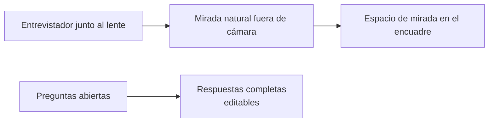

# Entrevista en video

Parte de: [[31-Video-Audio/05 Formatos/_Índice Formatos|Formatos]]

> [!info] Cómo avanzar
> `progreso`: **pendiente** → **viendo** (estudiando) → **visto** (contestaste la autoevaluación sin abrir las respuestas) → **dominado** (hiciste el laboratorio o lo aplicaste de verdad).

## Contenido

### Qué es
La **entrevista en video** es un formato en el que una persona responde preguntas frente a cámara para contar su historia, explicar algo o dar su opinión. Puede verse al entrevistador o no. Su éxito depende de tres cosas: **que la persona se sienta cómoda**, **que sus respuestas se puedan editar** y **que se escuche perfecto**.

### Cómo funciona
**Dónde mira el entrevistado.** Hay dos estilos:
- **Fuera de cámara** (estilo documental): el entrevistado mira al **entrevistador**, que se sienta **junto a la cámara**, con su cabeza cerca del lente (a un lado). Así la mirada queda ligeramente fuera de cámara, natural, como si el espectador observara una conversación.
- **A cámara**: el entrevistado mira al lente, como hablando con el espectador. Es más directo, pero cuesta más a personas sin experiencia.

**Espacio de mirada.** Si la persona mira hacia un lado, deja **más espacio en ese lado del cuadro** (*lead room*). Si mira a la derecha, colócala en el tercio izquierdo mirando hacia el espacio libre. Si la pegas al borde hacia el que mira, el encuadre se siente "aplastado".

**Preguntas abiertas.** Las preguntas cerradas ("¿te gustó?") producen "sí" o "no", inservibles al editar. Usa preguntas que inviten a contar:
- "Cuéntame cómo empezaste..." / "¿Qué pasó el día que...?" / "Describe cómo te sentiste cuando..."
- Pide que **incluyan la pregunta en su respuesta** ("Empecé a hacer muebles porque..."), ya que tu voz no saldrá en el video.

**Silencio activo.** No hables mientras responde: asiente con la cabeza, sonríe, pero sin "ajá" ni "sí". Esos sonidos quedan en el micrófono del invitado y no se pueden quitar. Al terminar una respuesta, espera 2–3 s: muchas veces la persona agrega lo mejor después de una pausa.

### Ejemplo
**Entrevista a un vecino sobre su negocio:**
- [[Sony a6700]] en tripié a la altura de sus ojos, plano medio corto, él en el tercio izquierdo mirando hacia la derecha, donde estás tú junto al lente.
- [[DJI Mic Mini 2]] en su pecho, del lado hacia donde mira ([[Colocación del micrófono]]).
- [[iPhone 15 Pro para foto y video]] como segunda cámara en primer plano desde otro ángulo del mismo lado del eje.
- Luz de ventana como principal y una cartulina de relleno ([[Iluminación de tres puntos]]).
- Lista de 8–10 preguntas abiertas, de lo fácil (cómo se llama, desde cuándo) a lo personal.
- Al final: 30 s de room tone y b-roll del negocio ([[B-roll y plano de ubicación]]).
Para dos invitados, mira [[Grabar entrevistas a dos personas]].

### Cuándo usarlo y cuándo no
- **Sí**: documentales, historias de personas, testimonios de clientes, videos institucionales, YouTube.
- **A cámara**: cuando la persona es comunicadora o el formato es tipo "testimonio directo".
- **No**: si la información se cuenta mejor con una voz en off y b-roll, o si la persona está muy incómoda (busca otro formato: que te muestre su trabajo mientras platica).

### Errores comunes
1. **Hablar encima** con "ajá", "sí", "claro": se graba en su micrófono y arruina el corte. Asiente en silencio.
2. **Preguntas cerradas**: respuestas de una palabra.
3. **Sin espacio de mirada**: la persona mira hacia el borde del cuadro.
4. **Entrevistador lejos del lente**: la mirada se va demasiado de lado y se ve de perfil.
5. **No grabar b-roll**: tienes 20 minutos de una cara hablando y nada para cubrir cortes.

### Para profundizar
- [The 180 degree rule, looking space and eyeline match (Learn About Film)](https://www.learnaboutfilm.com/?p=1666)
- [Lavalier Mounting: Best Practices (RØDE)](https://rode.com/en-gb/about/news-info/lavalier-mounting-best-practices)
- [Types of shots in films (Adobe)](https://www.adobe.com/creativecloud/video/discover/types-of-shots-in-films.html)

## Autoevaluación

Contesta primero en voz alta o en papel; luego despliega la respuesta.

> [!question]- ¿Dónde mira el entrevistado?
> Normalmente al entrevistador, que se sienta junto a la cámara; así la mirada queda ligeramente fuera de cámara y natural. Mirar a lente se usa para hablar directo al público.

> [!question]- ¿Qué es el "espacio de mirada"?
> Dejar más aire del lado hacia donde mira la persona en el encuadre.

> [!question]- Caso: el invitado responde con "sí" o "no". ¿Cómo formulas mejor las preguntas?
> Preguntas abiertas ("cuéntame cómo…") y pídele que repita la pregunta en su respuesta, porque tu voz no saldrá en el video.

> [!question]- Error común: hablar encima ("ajá", "sí") mientras responde. ¿Qué problema da?
> Tu voz queda mezclada en su pista y no puedes cortar limpio. Asiente en silencio.

## Práctica

- [[Lab 6 - Entrevista a dos personas]]

