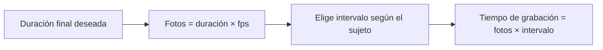

# Time-lapse e hyperlapse en video

Parte de: [[31-Video-Audio/05 Formatos/_Índice Formatos|Formatos]]

> [!info] Cómo avanzar
> `progreso`: **pendiente** → **viendo** (estudiando) → **visto** (contestaste la autoevaluación sin abrir las respuestas) → **dominado** (hiciste el laboratorio o lo aplicaste de verdad).

## Contenido

### Qué es
Un **time-lapse** comprime mucho tiempo en pocos segundos: la cámara, **fija**, toma una imagen cada cierto intervalo (por ejemplo, cada 2 s) y luego esas imágenes se reproducen a 24 o 30 fps. Nubes, tráfico, una impresión 3D o un atardecer se vuelven movimiento rápido. Un **hyperlapse** es un time-lapse en el que **la cámara también se desplaza** una distancia grande entre tomas (caminando, en coche o con dron), lo que da un viaje acelerado por el espacio.

### Cómo funciona
**Las tres fórmulas** (intervalo en segundos, cadencia de reproducción en fps):
- **Fotos necesarias** = duración final × fps.
- **Tiempo de grabación** = fotos × intervalo.
- **Duración final** = (tiempo de grabación / intervalo) / fps.

Ejemplos verificados:
- Quieres **10 s a 30 fps** con una foto cada **2 s**: 10 × 30 = 300 fotos × 2 s = **600 s = 10 min** de grabación.
- Grabas **1 h** con intervalo de **5 s**: 3600 / 5 = 720 fotos / 24 fps = **30 s**.
- Una nube tarda **20 min** en cruzar y quieres que tarde **4 s a 30 fps**: necesitas 4 × 30 = 120 fotos en 1200 s → intervalo de **10 s**.

| Sujeto | Intervalo orientativo |
|---|---|
| Gente y tráfico rápido | 1–2 s |
| Nubes rápidas | 2–5 s |
| Nubes lentas, atardecer | 5–10 s |
| Estrellas, impresión 3D larga | 15–30 s |

**Lo que necesitas para un buen time-lapse:**
- **Tripié firme** (o una superficie sólida): cualquier movimiento entre fotos se ve como salto.
- **Exposición y balance de blancos manuales**: si la cámara los ajusta en automático, aparece **parpadeo** (*flicker*). En atardeceres, donde la luz cambia mucho, se usan técnicas de rampa o se corrige en edición.
- **Enfoque manual** y estabilización óptica apagada en tripié.
- **Batería y espacio** suficientes; desactiva el apagado automático de pantalla si la cámara lo exige.
- **Tiempo**: lo interesante ocurre durante muchos minutos.

### Ejemplo
- **[[iPhone 15 Pro para foto y video]]**: el modo **Time-lapse** de la app Cámara ajusta el intervalo de forma **automática** según la duración de la grabación (no lo eliges) y entrega un video corto; el iPhone 15 Pro tiene time-lapse **estabilizado** y **time-lapse en modo Noche** con tripié. Para controlar intervalo y exposición, [[Blackmagic Camera (app)]] ofrece opciones de time-lapse.
- **[[Sony a6700]]**: función de **time-lapse en cámara** que genera el video directamente; fija exposición en M y balance de blancos manual.
- **[[DJI Osmo Pocket 4P]]**: la línea Pocket ofrece time-lapse e hyperlapse; confirma los modos exactos del 4P (Pendiente de confirmar).
- **Hyperlapse con dron**: [[Hyperlapse con dron]] con el [[DJI Mini 4K]].
- Para la versión fotográfica (intervalómetro, RAW, deflicker), revisa [[Time-lapse]].

### Cuándo usarlo y cuándo no
- **Sí**: transiciones de tiempo (de día a noche), b-roll de ciudad, nubes, procesos largos (impresión 3D, construcción, cocina lenta).
- **Hyperlapse**: recorridos por una ciudad, un camino o un edificio.
- **No**: cuando el sujeto cambia poco (una pared al sol) o se mueve sin rumbo; el resultado aburre.

### Errores comunes
1. **Grabar time-lapse de 30 s de un atardecer**: con un intervalo de varios segundos, 30 s producen apenas unos cuadros: menos de un segundo de video. Un atardecer pide 30–60 min de grabación.
2. **Exposición automática** en cámara: parpadeo.
3. **Tripié inestable o tocar la cámara**: saltos.
4. **Intervalo equivocado**: demasiado corto da un movimiento lento sin gracia; demasiado largo, tirones.
5. **Quedarse sin batería** a la mitad: lleva batería externa.

### Para profundizar
- [Especificaciones técnicas del iPhone 15 Pro (Apple)](https://support.apple.com/en-us/111829)
- [Sony a6700: lista de funciones (Sony)](https://www.sony.com.tw/en/interchangeable-lens-cameras/products/ilce-6700/feature-list)
- [Blackmagic Camera en el App Store](https://apps.apple.com/gb/app/id6449580241)

## Ejercicios

Resuélvelos en papel o en la herramienta; la solución está plegada.

> [!question]- Quieres 10 s de time-lapse a 30 fps y tomas una foto cada 2 s. ¿Cuánto tiempo grabas?
> 10 × 30 = 300 cuadros × 2 s = **600 s = 10 min**.

> [!question]- Grabas 1 h con un intervalo de 5 s. ¿Cuánto dura a 24 fps?
> 3600 / 5 = 720 cuadros / 24 = **30 s**.

> [!question]- Una nube tarda 20 min en cruzar y quieres que en el video tarde 4 s a 30 fps. ¿Qué intervalo?
> 4 × 30 = 120 cuadros en 1200 s → **10 s** de intervalo.

## Autoevaluación

Contesta primero en voz alta o en papel; luego despliega la respuesta.

> [!question]- ¿Qué diferencia hay entre time-lapse e hyperlapse?
> **Time-lapse**: cámara fija tomando cuadros espaciados, el tiempo se acelera. **Hyperlapse**: lo mismo, pero la cámara se desplaza grandes distancias durante la grabación.

> [!question]- ¿Qué hace el modo Time-lapse del iPhone?
> Ajusta automáticamente el intervalo según cuánto grabes y entrega un video corto acelerado.

> [!question]- ¿Qué necesitas para un buen time-lapse?
> Tripié, algo que cambie (nubes, sombras, gente, atardecer), batería suficiente y no tocar el teléfono durante la toma.

> [!question]- Error común: grabar time-lapse de 30 s de un atardecer. ¿Qué sale?
> Un clip de un par de segundos sin cambios visibles. Graba al menos 20–30 min.

