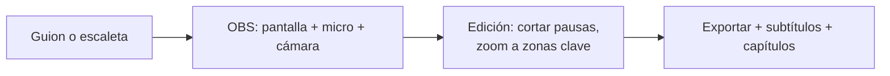

# Tutorial y screencast

Parte de: [[31-Video-Audio/05 Formatos/_Índice Formatos|Formatos]]

> [!info] Cómo avanzar
> `progreso`: **pendiente** → **viendo** (estudiando) → **visto** (contestaste la autoevaluación sin abrir las respuestas) → **dominado** (hiciste el laboratorio o lo aplicaste de verdad).

## Contenido

### Qué es
Un **tutorial** es un video que enseña a hacer algo paso a paso. Un **screencast** es una grabación de la **pantalla** de la computadora (o del celular), normalmente con narración y a veces con tu cara en una esquina. Para un desarrollador es uno de los formatos más útiles: enseñar a configurar una herramienta, explicar un código o mostrar un flujo en Azure DevOps.

### Cómo funciona
**Partes de un buen tutorial:**
1. **Resultado primero**: muestra en los primeros segundos lo que se va a lograr.
2. **Requisitos**: qué necesita tener instalado o saber el espectador.
3. **Pasos** en orden, uno por bloque, con lo que se ve y lo que se hace.
4. **Errores típicos** y cómo resolverlos.
5. **Resumen** y siguiente paso.

**Grabar la pantalla en la PC.** La herramienta gratuita de referencia es **[[OBS Studio]]**: graba la pantalla completa o una ventana, tu cámara y tu micrófono como fuentes separadas, en la resolución que elijas. Configuración práctica para tutoriales:
- Graba al **tamaño de tu entrega** (1920 × 1080 o 4K) y con la pantalla a esa resolución.
- **Aumenta el tamaño del texto**: zoom del editor de código a 150–200 %, terminal con fuente grande, tema de alto contraste.
- Cierra notificaciones, pestañas personales y oculta secretos (cadenas de conexión, tokens): un secreto en un video público es un secreto filtrado.
- Graba la voz con el [[DJI Mic Mini 2]] conectado a la PC por USB-C, no con el micrófono de la laptop.

**Pausas en edición.** Mientras escribes código o esperas a que algo compile hay silencios largos. En edición:
- **Corta** las esperas (*jump cuts*, aceptables en tutoriales).
- **Acelera** las partes repetitivas (escribir mucho código) al 200–400 %, con la voz encima o con música.
- Usa **zooms** (escalado con keyframes) para enfocar la parte de la pantalla de la que hablas ([[Keyframes y animación básica]]).
- O graba la voz **después** en limpio y la montas sobre la pantalla.

### Ejemplo
**Tutorial: "Proteger una API ASP.NET Core con JWT RS256 en 6 minutos"** (basado en Xolotl.Hecate):
- Escaleta: resultado (Postman devolviendo 401 y luego 200), requisitos (.NET 10), pasos (generar llaves, configurar `AddJwtBearer`, proteger un controller, probar), errores comunes (audiencia o emisor incorrectos), resumen.
- OBS en 1080p con Visual Studio Code al 175 % de zoom; secretos en `dotnet user-secrets`, nunca en pantalla.
- Tu cara con la [[Sony a6700]] o el [[iPhone 15 Pro para foto y video]] solo en intro y cierre.
- Edición en [[DaVinci Resolve (versión gratuita)]]: cortes de pausas, zoom al archivo `Program.cs` cuando lo modificas, capítulos por paso.

### Cuándo usarlo y cuándo no
- **Screencast**: software, programación, configuración, demostraciones de apps.
- **Tutorial con cámara**: tareas físicas (reparaciones, cocina, impresión 3D) con planos medios y detalles ([[Plano detalle (video)]]).
- **No** para conceptos muy abstractos que se explican mejor con un diagrama animado o un texto.

### Errores comunes
1. **Grabar a resolución pequeña o con texto diminuto**: en el celular no se lee. Graba a 1080p o más y agranda la fuente.
2. **Dejar pausas largas** mientras escribes: córtalas o acelera.
3. **Mostrar secretos** (tokens, contraseñas, cadenas de conexión) en pantalla.
4. **Audio de la laptop** con ventilador de fondo: usa micrófono externo.
5. **No mostrar el resultado al inicio**: el espectador no sabe si vale la pena quedarse.

### Para profundizar
- [OBS Studio Quick Start Guide (OBS Project)](https://obsproject.com/kb/quick-start-guide)
- [OBS Studio Overview Guide (OBS Project)](https://obsproject.com/kb/obs-studio-overview)
- [Recommended upload encoding settings (YouTube)](https://support.google.com/youtube/answer/1722171?hl=en)

## Autoevaluación

Contesta primero en voz alta o en papel; luego despliega la respuesta.

> [!question]- ¿Qué es un screencast?
> Una grabación de la pantalla de la computadora o el teléfono, usualmente con narración.

> [!question]- ¿Qué herramienta gratuita graba la pantalla de la PC?
> **OBS Studio** (o la grabación de pantalla integrada del iPhone para el teléfono).

> [!question]- Caso: tu tutorial tiene pausas largas mientras escribes. ¿Qué haces en edición?
> Cortar o acelerar esas partes, y hacer zoom a la zona importante de la pantalla.

> [!question]- Error común: grabar a resolución pequeña o con texto diminuto. ¿Cómo lo evitas?
> Graba a 1080p o más, aumenta el tamaño de fuente/zoom de la app y cierra notificaciones.

