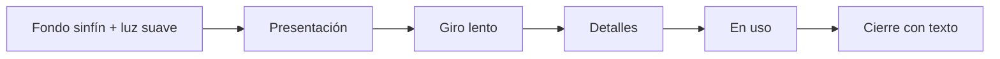

# Video de producto

Parte de: [[31-Video-Audio/05 Formatos/_Índice Formatos|Formatos]]

> [!info] Cómo avanzar
> `progreso`: **pendiente** → **viendo** (estudiando) → **visto** (contestaste la autoevaluación sin abrir las respuestas) → **dominado** (hiciste el laboratorio o lo aplicaste de verdad).

## Contenido

### Qué es
El **video de producto** muestra un objeto de forma atractiva y clara: cómo se ve, cómo funciona y por qué vale la pena. Va desde un clip de 10 s para una tienda en línea hasta un anuncio o una reseña. Es uno de los formatos más controlables: tú decides la luz, el fondo y cada movimiento, y por eso se nota mucho cuando algo está mal.

### Cómo funciona
**Tomas básicas** (la "receta" mínima):
1. **Plano de presentación**: el producto completo, centrado, sobre fondo limpio (general del producto).
2. **Giro**: el producto rota (base giratoria) o la cámara lo rodea lentamente.
3. **Detalles**: texturas, botones, logo, materiales ([[Plano detalle (video)]]).
4. **En uso**: unas manos usándolo o una persona con él; muestra el beneficio.
5. **Contexto**: el producto en su ambiente (la cafetera en la cocina, la mochila en la montaña).
6. **Cierre**: plano final con espacio para logo o texto.

**Luz y fondo en casa.**
- **Luz suave y grande**: una ventana con cortina, o una LED con *softbox* o rebotada ([[Luz LED continua]]). Para productos brillantes (metal, vidrio, pantallas) la luz grande crea reflejos limpios en lugar de puntos duros.
- **Fondo**: cartulina blanca o negra en curva ("sinfín" casero) para que no se vea la esquina entre mesa y pared; o una superficie con textura (madera, piedra, tela) que combine con el producto.
- **Relleno**: cartulinas blancas para abrir sombras; cartulinas negras para dar contorno a objetos de vidrio.

**Por qué movimientos lentos y tripié.** El producto es pequeño y la cámara está cerca: cualquier temblor se multiplica. Los movimientos lentos (slider, dolly in suave, giro de la base) se sienten **premium** y dejan ver los detalles. El tripié además permite repetir tomas idénticas y hacer *stop motion* o *time-lapse* si quieres.

### Ejemplo
**Video de 20 s de una pieza que imprimiste en 3D:**
- Mesa junto a la ventana, cartulina negra en curva de fondo, cartulina blanca de relleno.
- [[Sony a6700]] en tripié con el zoom en su lado largo, f/4–f/5.6 para que la pieza entera esté nítida, enfoque manual con *focus peaking*, perfil S-Cinetone y 4K 24p. Para giros: una base giratoria barata.
- Detalles de la textura de las capas con la tele de 60 mm de la [[DJI Osmo Pocket 4P]] o el 3× del [[iPhone 15 Pro para foto y video]].
- Toma en uso: tus manos ensamblando la pieza.
- Música libre de derechos y texto final.
Comparte ideas con la foto de producto: [[Fotografía de producto y comida]].

### Cuándo usarlo y cuándo no
- **Sí**: tiendas en línea, redes de un negocio, reseñas, portafolio de impresiones 3D o artesanías.
- **Formato**: horizontal para web y YouTube, vertical para reels; graba ambos o en 4K para recortar.
- **No** te bases solo en giros bonitos si el producto necesita **explicarse**: añade tomas de uso o un tutorial.

### Errores comunes
1. **Huellas y polvo**: en video la cámara se mueve y la luz cambia sobre la superficie, así que cada huella brilla y aparece y desaparece; además el 4K y los detalles amplifican todo. Limpia con paño de microfibra y usa guantes de algodón.
2. **Luz dura directa**: reflejos y sombras feas en productos brillantes.
3. **Movimientos rápidos o temblorosos**: se ve barato.
4. **Fondo distractor**: cables, esquinas y objetos de la casa.
5. **Balance de blancos automático**: el color del producto cambia entre tomas; fíjalo manual.

### Para profundizar
- [Three-point lighting (Wikipedia)](https://en.wikipedia.org/wiki/Three-point_lighting)
- [Types of shots in films (Adobe)](https://www.adobe.com/creativecloud/video/discover/types-of-shots-in-films.html)
- Relacionado: [[Modificadores de luz (difusor, reflector y softbox)]]

## Autoevaluación

Contesta primero en voz alta o en papel; luego despliega la respuesta.

> [!question]- ¿Qué tomas básicas lleva un video de producto?
> Plano general del producto, detalles (texturas, botones), producto en uso, y un plano final limpio (packshot).

> [!question]- ¿Qué luz y fondo funcionan en casa?
> Fondo liso (cartulina en curva "sin fin"), luz de ventana difusa y un rebote blanco.

> [!question]- ¿Por qué usar movimientos lentos y tripié?
> Para que el producto se vea elegante y nítido; los movimientos lentos (deslizamiento, giro sobre base) dan aspecto profesional.

> [!question]- Error común: huellas y polvo en el producto. ¿Por qué importa más en video que en foto?
> En 4K y en detalle se ve todo, y no puedes retocar fácilmente cada cuadro. Limpia antes con microfibra.

