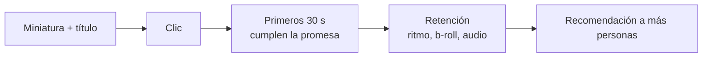

# Video para YouTube

Parte de: [[31-Video-Audio/05 Formatos/_Índice Formatos|Formatos]]

> [!info] Cómo avanzar
> `progreso`: **pendiente** → **viendo** (estudiando) → **visto** (contestaste la autoevaluación sin abrir las respuestas) → **dominado** (hiciste el laboratorio o lo aplicaste de verdad).

## Contenido

### Qué es
El **video para YouTube** es el formato horizontal de duración media o larga (de unos minutos a más de una hora) que se publica en la plataforma y compite por **clics** (miniatura y título) y por **tiempo de visualización** (retención). A diferencia del video vertical, el espectador elige verlo y puede quedarse mucho tiempo si el contenido lo merece.

### Cómo funciona
**Formato base.** YouTube recomienda (en su página de configuración de codificación):
- **Proporción 16:9** como estándar en computadora; vertical y cuadrado también se aceptan.
- **Contenedor MP4**, video **H.264**, audio **AAC** a 48 kHz (estéreo a ~384 kbps).
- **Misma cadencia** con la que grabaste (24, 25, 30, 48, 50 o 60 fps).
- Bitrates SDR orientativos: **8 Mbps** en 1080p a 24–30 fps, **12 Mbps** a 48–60 fps; **35–45 Mbps** en 4K a 24–30 fps y **53–68 Mbps** en 4K a 48–60 fps.
Detalle de exportación en [[Exportar video (códec, bitrate y formato por plataforma)]].

**¿Por qué subir en 4K si el público ve en 1080p?** YouTube **recomprime** todo lo que subes. Los videos en 4K se procesan con códecs más eficientes y con más bitrate por resolución, y al bajar a 1080p desde una fuente 4K el resultado suele verse más nítido que un 1080p subido directo. Por eso muchos creadores graban en 4K o exportan 1080p escalado a 4K. Ojo: las versiones en alta resolución tardan más en procesarse después de subir.

**Lo que afecta que lo vean, además del video:**
- **Miniatura y título**: deciden el clic ([[Miniaturas y diseño básico]]).
- **Primeros 30 segundos**: si cumplen la promesa del título, la gente se queda.
- **Retención**: estructura, ritmo y b-roll ([[Ritmo y narrativa en el montaje]]).
- **Audio**: un audio malo hace que la gente se vaya más rápido que una imagen mediocre.
- **Descripción, capítulos y subtítulos** ([[Subtítulos (SRT)]]).
- **Constancia** de publicación ([[Creación de contenido (ganchos, retención y constancia)]]).

### Ejemplo
**Video de 8 min sobre tu primera impresión 3D:**
- Proyecto 4K a 30 fps (o 24) en [[DaVinci Resolve (versión gratuita)]].
- A-roll: tú en plano medio con la [[Sony a6700]] en tripié y el [[DJI Mic Mini 2]].
- B-roll: la impresora trabajando (time-lapse con el iPhone), detalles con la [[DJI Osmo Pocket 4P]] en su cámara tele.
- Música libre de derechos ([[Música y efectos libres de regalías]]).
- Exporta H.264 4K a ~40 Mbps, audio AAC estéreo.
- Capítulos en la descripción y subtítulos revisados.

### Cuándo usarlo y cuándo no
- **Sí**: tutoriales, reseñas, documentales, vlogs largos, contenido que necesita contexto y que la gente busca.
- **Combínalo** con Shorts para atraer audiencia nueva.
- **No** para un tip de 20 s: eso va en vertical.

### Errores comunes
1. **Música comercial de fondo**: activa reclamos de **Content ID**; el dueño puede monetizar tu video, silenciarlo o bloquearlo en algunos países ([[Content ID y derechos en plataformas]]).
2. **Intro larga** con logo animado: los primeros segundos son los más valiosos.
3. **Exportar con un bitrate bajo** "para que suba rápido": YouTube recomprime y se ve peor.
4. **Cambiar la cadencia** al exportar (grabar a 24 y exportar a 30): movimiento a tirones.
5. **Miniatura y título que no cumple el video**: la gente se va y la plataforma lo nota.

### Para profundizar
- [Recommended upload encoding settings (YouTube)](https://support.google.com/youtube/answer/1722171?hl=en)
- [Manual para principiantes de DaVinci Resolve 20 (Blackmagic Design)](https://documents.blackmagicdesign.com/UserManuals/DaVinci-Resolve-20-Beginners-Guide.pdf)
- [Understand three-minute YouTube Shorts (YouTube)](https://support.google.com/youtube/answer/15424877?hl=en)

## Autoevaluación

Contesta primero en voz alta o en papel; luego despliega la respuesta.

> [!question]- ¿Qué formato base conviene para YouTube?
> Horizontal **16:9**, 1080p o 4K, a la cadencia en que grabaste (24/30/60).

> [!question]- ¿Por qué muchos creadores suben en 4K aunque su público vea en 1080p?
> Se ha observado que YouTube asigna códecs más eficientes a los videos subidos en mayor resolución, lo que mejora la calidad percibida incluso al verlos en menor resolución. Esto depende de la plataforma y cambia con el tiempo: (Pendiente de confirmar).

> [!question]- ¿Qué elementos además del video afectan que lo vean?
> Título, miniatura, primeros 30 s (retención) y capítulos y descripción clara.

> [!question]- Error común: música comercial de fondo. ¿Qué pasa?
> Content ID puede reclamar el video (anuncios para el dueño o bloqueo). Usa música libre o con licencia.

