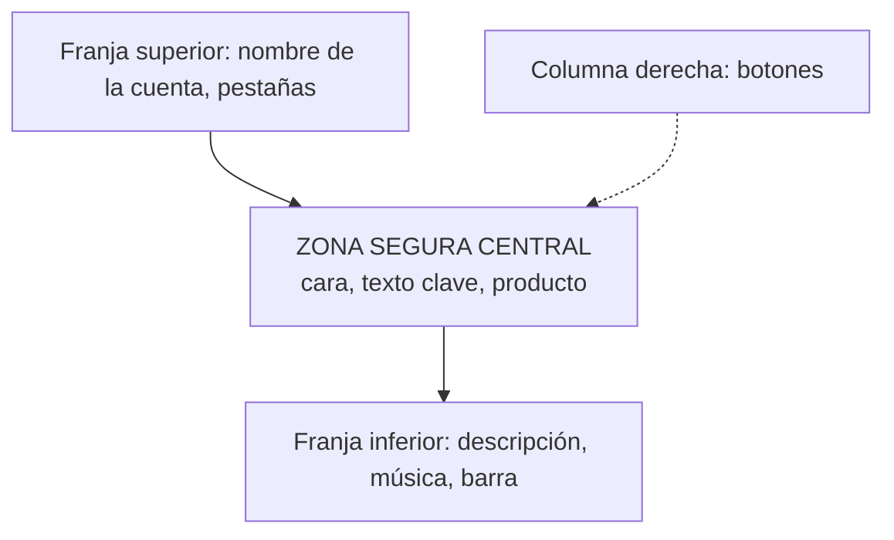

# Video vertical (Reels, TikTok y Shorts)

Parte de: [[31-Video-Audio/05 Formatos/_Índice Formatos|Formatos]]

> [!info] Cómo avanzar
> `progreso`: **pendiente** → **viendo** (estudiando) → **visto** (contestaste la autoevaluación sin abrir las respuestas) → **dominado** (hiciste el laboratorio o lo aplicaste de verdad).

## Contenido

### Qué es
El **video vertical** es el formato de las plataformas de video corto: Instagram Reels, TikTok y YouTube Shorts. Se ve en el celular a pantalla completa, sin girarlo, y se consume deslizando de un video al siguiente. Eso cambia las reglas: el espectador decide en uno o dos segundos si se queda, y la interfaz de la app tapa partes de tu imagen.

### Cómo funciona
**Proporción y resolución.** La proporción estándar es **9:16** y la resolución habitual **1080 × 1920** píxeles (Full HD vertical). Grabar en 4K vertical (2160 × 3840) da margen para recortar y estabilizar. YouTube permite Shorts de hasta **3 minutos** (según su centro de ayuda); cada plataforma cambia sus límites de duración con frecuencia, revísalos al publicar.

**Zonas seguras.** La app pone encima de tu video el nombre de usuario, la descripción, la música, los botones de "me gusta", comentarios y compartir (columna derecha) y la barra de progreso. Lo importante (cara, texto, producto) debe quedar en una **zona central** libre: deja margen arriba, abajo (la franja inferior es la más tapada) y en el lado derecho. Cada plataforma tiene su propio diseño; una práctica común es descargar una plantilla de zonas seguras y ponerla como capa guía en el editor.

**Grabar vertical vs. recortar de horizontal.**
- **Grabar en vertical**: máxima resolución y composición pensada para el formato. Ideal si el destino principal es redes.
- **Recortar de horizontal**: un 1080 × 1920 sacado de un clip **4K horizontal** cabe sin escalar (2160 px de alto disponibles); de un 1080p horizontal no ([[Resolución y cuadros por segundo]]). Para planearlo: deja al sujeto en el **centro** del encuadre horizontal, con aire arriba y abajo, y evita acciones importantes en los lados.

### Ejemplo
**Un mismo rodaje para YouTube y reels:**
- [[Sony a6700]] en horizontal 4K para el video largo, sujeto centrado.
- [[iPhone 15 Pro para foto y video]] en vertical 4K como segunda cámara solo para el reel, o la [[DJI Osmo Pocket 4P]] girando el gimbal a vertical (en vertical graba hasta 3K según reseñas).
- Audio con el [[DJI Mic Mini 2]].

**Estructura de un reel de 30 s:**
1. **0–2 s: gancho** visual y en texto ("Esto cuesta $20 y cambió mi café").
2. **2–25 s: desarrollo** rápido, planos de 2–4 s, subtítulos ([[Subtítulos (SRT)]]).
3. **25–30 s: cierre** con resultado y, si aplica, llamada a la acción.
Practica en [[Lab 9 - Grabar un reel vertical de 30 segundos]].

### Cuándo usarlo y cuándo no
- **Sí**: contenido corto, descubrimiento de nuevas audiencias, tips, detrás de cámaras, avances de un video largo.
- **No como única versión** de algo que necesita contexto (un tutorial de 10 min); mejor un vertical que lleve al video largo.
- Planos generales amplios funcionan poco en vertical; prefiere medios, primeros planos y detalles.

### Errores comunes
1. **Empezar con una introducción lenta** ("Hola, bienvenidos a mi canal..."): el espectador desliza antes de que pase algo. El valor va en el primer segundo.
2. **Texto en las zonas tapadas**: los botones o la descripción cubren tu mensaje.
3. **Recortar un 1080p horizontal**: pierde nitidez; graba en 4K si sabes que habrá vertical.
4. **Sin subtítulos**: mucha gente ve sin sonido.
5. **Audio malo**: en el celular el audio se nota más de lo que crees; usa micrófono.

### Para profundizar
- [Understand three-minute YouTube Shorts (YouTube)](https://support.google.com/youtube/answer/15424877?hl=en)
- [Recommended upload encoding settings (YouTube)](https://support.google.com/youtube/answer/1722171?hl=en)
- Relacionado: [[Creación de contenido (ganchos, retención y constancia)]]

## Autoevaluación

Contesta primero en voz alta o en papel; luego despliega la respuesta.

> [!question]- ¿Qué proporción y resolución usa el video vertical?
> **9:16**, típicamente **1080 × 1920**.

> [!question]- ¿Qué son las zonas seguras en vertical?
> Las áreas donde la app pone botones, texto y descripción (abajo y a la derecha, sobre todo). No pongas texto importante ni caras ahí.

> [!question]- Caso: grabas en horizontal y quieres un vertical. ¿Cómo lo planeas?
> Graba en 4K y deja al sujeto centrado con aire alrededor; al recortar 9:16 tendrás resolución suficiente. Mejor aún: graba en vertical directo si el video es solo para redes.

> [!question]- Error común: empezar el reel con una introducción lenta. ¿Qué pasa?
> La gente desliza en el primer segundo o dos. Abre con el resultado, una pregunta o algo visualmente fuerte (el "gancho").

## Práctica

- [[Lab 9 - Grabar un reel vertical de 30 segundos]]

