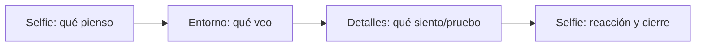

# Vlog

Parte de: [[31-Video-Audio/05 Formatos/_Índice Formatos|Formatos]]

> [!info] Cómo avanzar
> `progreso`: **pendiente** → **viendo** (estudiando) → **visto** (contestaste la autoevaluación sin abrir las respuestas) → **dominado** (hiciste el laboratorio o lo aplicaste de verdad).

## Contenido

### Qué es
Un **vlog** (*video blog*) es un video en el que el creador **habla a cámara en primera persona** y muestra su vida, un viaje, un proyecto o un día en particular. Lo distingue la **cercanía**: el espectador acompaña a una persona, no solo ve un tema. La personalidad del creador es el contenido principal, y la técnica (cámara en mano, selfie, narración) está al servicio de esa sensación de compañía.

### Cómo funciona
**Ingredientes de un vlog.**
- **Presentador a cámara**: plano selfie o medio, mirando al lente.
- **Lo que ve el creador**: planos en primera persona y del entorno.
- **B-roll y ambiente**: detalles, lugares, gente, comida ([[B-roll y plano de ubicación]]).
- **Una historia**: un objetivo del día con obstáculos y un cierre ([[Narrativa y storytelling en video]]).
- **Sonido**: voz clara (lo más importante) y ambiente.

**Por qué no todo en selfie.** Si todo el video es tu cara con el brazo extendido, el espectador no ve **lo que tú ves**: el lugar, la comida, las personas. El selfie cuenta qué piensas; los planos del entorno cuentan dónde estás y qué vives. La mezcla de ambos es lo que hace atractivo un vlog.

### Ejemplo
**Equipo mínimo con tu kit:**
- **[[DJI Osmo Pocket 4P]]** como cámara principal: gimbal de 3 ejes, cámara principal de 20 mm para selfie y entorno, tele de 60 mm para detalles, ActiveTrack para que te siga, y control por gestos (palma abierta para seguimiento, "V" para grabar, según DJI). Ligera y discreta en la calle.
- **[[DJI Mic Mini 2]]**: un transmisor en tu cuello de camiseta con su cortaviento.
- **[[iPhone 15 Pro para foto y video]]**: segunda cámara para time-lapses, cámara lenta o planos rápidos.
- Opcional: la [[Sony a6700]] para planos más cuidados en momentos tranquilos.

**Caso: calle con mucha gente y ruido.**
1. Activa la **reducción de ruido** del Mic Mini 2: empieza en el nivel **básico** (tiene básico y fuerte); el fuerte quita más ruido pero puede dejar la voz artificial.
2. Revisa la **ganancia**: con ruido alto, baja un nivel y acércate el micro (el transmisor en el cuello, no en la cintura).
3. Pon el **cortaviento**.
4. Haz una prueba de 10 s y escúchala con audífonos antes de seguir.
5. Si la calle es muy ruidosa, graba la explicación en un lugar más tranquilo y usa la calle como b-roll con su sonido ambiente.

### Cuándo usarlo y cuándo no
- **Sí**: viajes, proyectos personales, "un día en...", eventos, procesos largos (construir algo).
- **No**: tutoriales técnicos donde importa la precisión (mejor un formato más estructurado, [[Tutorial y screencast]]) o temas donde tu presencia no aporta.
- Si te incomoda hablar a cámara en público, empieza con voz en off sobre lo que grabaste.

### Errores comunes
1. **Todo en selfie**: falta el entorno, la gente y los detalles.
2. **Celular a la altura del pecho**: contrapicado involuntario ([[Ángulos de cámara]]).
3. **Audio del micrófono integrado** en la calle: el ruido tapa tu voz.
4. **Grabar "todo"** sin un objetivo del día: horas de material sin historia.
5. **Olvidar pedir permiso** al grabar a otras personas de cerca ([[Permiso de modelo y fotografía en espacios públicos en México]]).

### Para profundizar
- [Comunicado de lanzamiento de la Osmo Pocket 4P (DJI)](https://www.mynewsdesk.com/uk/dji/pressreleases/osmo-pocket-4p-delivers-pro-filmmaking-capabilities-advancing-the-gimbal-camera-category-dji-pioneered-3459469)
- [Especificaciones del DJI Mic Mini 2 (DJI)](https://www.dji.com/my/mic-mini-2/specs)
- Relacionado: [[Cámara en mano (movimiento de cámara)]]

## Autoevaluación

Contesta primero en voz alta o en papel; luego despliega la respuesta.

> [!question]- ¿Qué distingue un vlog?
> Formato en primera persona: quien graba cuenta su día o experiencia hablando a cámara, con b-roll del entorno.

> [!question]- ¿Qué equipo mínimo usarías con tu kit actual?
> iPhone con la lente 1x o 0.5x en modo selfie o cámara trasera, el [[DJI Mic Mini 2]] en la solapa (cancelación de ruido en exteriores ruidosos) y un palo/tripié pequeño.

> [!question]- Caso: grabas en la calle con mucha gente y ruido. ¿Qué ajuste del micrófono pruebas?
> Activar la cancelación de ruido (primero el nivel bajo; el alto puede afectar la naturalidad de la voz) y colocar bien el antiviento.

> [!question]- Error común: grabar todo en selfie. ¿Qué falta?
> B-roll: tomas del lugar, detalles y planos generales para dar ritmo y contexto.

## Práctica

- [[Lab 9 - Grabar un reel vertical de 30 segundos]]

