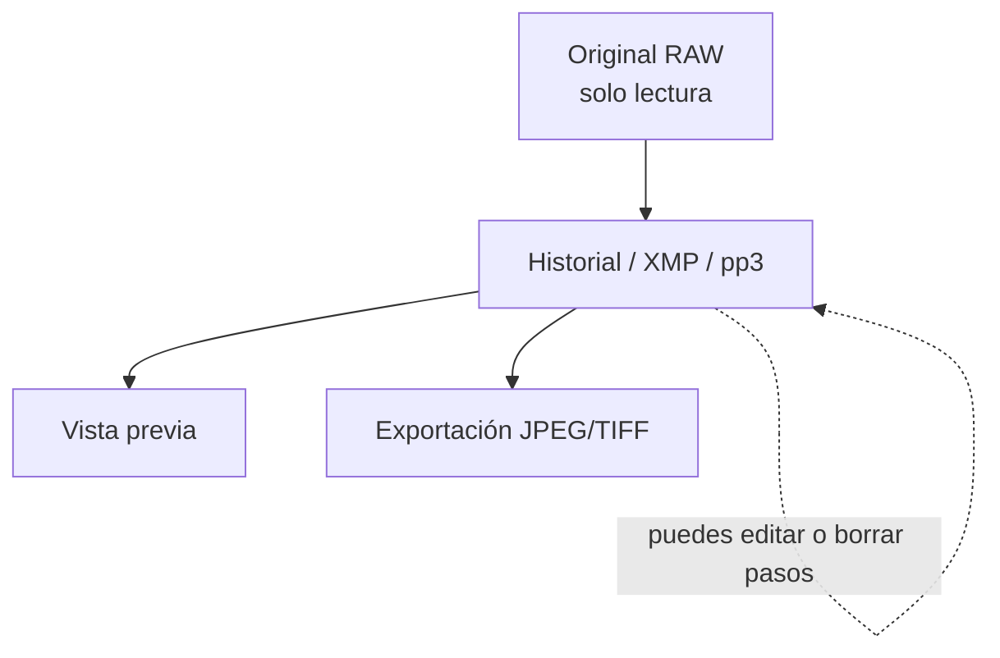

# Edición no destructiva

Parte de: [[32-Edicion-Foto/01 Fundamentos/_Índice Fundamentos|Fundamentos]]

> [!info] Cómo avanzar
> `progreso`: **pendiente** → **viendo** (estudiando) → **visto** (contestaste la autoevaluación sin abrir las respuestas) → **dominado** (hiciste el laboratorio o lo aplicaste de verdad).

## Contenido

### Qué es
La **edición no destructiva** significa que el archivo original nunca se modifica: el programa guarda una *lista de instrucciones* (exposición +0.7 EV, recorte 4:5, curva, máscara…) y la vuelve a aplicar cada vez que muestras o exportas la foto. Puedes cambiar o quitar cualquier paso meses después, sin perder calidad. Lo contrario es la edición destructiva: cada cambio se "hornea" en los píxeles y al guardar ya no hay vuelta atrás.

### Cómo funciona
- **Reveladores RAW (darktable, RawTherapee, Lightroom)**: el RAW es de solo lectura. darktable guarda el historial de cada foto en su base de datos (`library.db`) y además en un **archivo sidecar XMP** junto a la imagen (`DSC01234.ARW.xmp`). RawTherapee usa un sidecar `.pp3` (`DSC01234.ARW.pp3`). Si copias el RAW con su sidecar a otra PC, la edición viaja con él.
- **Editores de píxeles (GIMP, Photopea, Krita)**: son destructivos por naturaleza, pero puedes trabajar de forma no destructiva con **capas**, **máscaras de capa** en vez de goma de borrar, **capas duplicadas** antes de un cambio fuerte y guardando en el formato nativo con capas (**XCF** en GIMP, **PSD** en Photopea, **KRA** en Krita). GIMP 3.x ya tiene **filtros no destructivos**: el filtro se queda como efecto editable sobre la capa; en GIMP 3.2 además se pueden aplicar a grupos de capas, lo que imita una capa de ajuste.
- **Apps móviles**: Fotos de iOS guarda la edición y permite "Revertir"; Snapseed guarda *pilas* (stacks) editables con "Guardar" y aplana todo con "Exportar".

### Ejemplo
Revelas en darktable un ARW de la a6700. En la carpeta aparece `DSC01234.ARW.xmp`. Un mes después decides que quieres la foto en blanco y negro: abres el cuarto oscuro, en la pila de historial haces clic en un paso anterior o duplicas la versión (*duplicar* crea `DSC01234_01.ARW.xmp`), y tienes la versión a color y la de B/N sin copiar el RAW de 26 MP.

En GIMP: abres el TIFF, duplicas la capa, retocas en la copia, usas máscaras para limitar el efecto y guardas `retrato.xcf`. Lo que publicas es una **exportación** aparte (`Archivo > Exportar como… retrato_ig.jpg`).

### Cuándo usarlo y cuándo no
Úsala siempre que puedas: es tu red de seguridad. La edición destructiva solo tiene sentido en tareas rápidas sobre una copia (redimensionar una imagen para WhatsApp) o cuando el programa no ofrece otra opción. Ojo: "no destructivo" no es respaldo; si el disco muere pierdes RAW y sidecars (ver [[Respaldo 3-2-1 de fotos y videos]]).

### Errores comunes
1. **Sobrescribir el original al exportar.** En GIMP, "Sobrescribir" reemplaza el archivo abierto; usa *Exportar como* con otro nombre y otra carpeta. En darktable, configura la ruta de exportación a una subcarpeta, por ejemplo `$(FILE_FOLDER)/export/$(FILE_NAME)`, y nunca exportes con el mismo nombre y extensión que el original.
2. **Respaldar el RAW sin el XMP o el pp3.** Pierdes horas de edición; copia la carpeta completa.
3. **Borrar con la goma en vez de enmascarar.** La goma destruye píxeles; la máscara se puede repintar (ver [[Capas, máscaras y modos de fusión]]).
4. **Guardar el trabajo con capas como JPEG.** El JPEG aplana todo. Guarda XCF/PSD y exporta aparte.

### Para profundizar
- [Archivos sidecar en darktable](https://docs.darktable.org/usermanual/4.0/en/overview/sidecar-files/sidecar/)
- [Sidecar files - Processing profiles (RawPedia)](https://rawpedia.rawtherapee.com/Sidecar_Files_-_Processing_Profiles)
- [Notas de la versión de GIMP 3.2](https://www.gimp.org/release-notes/gimp-3.2.html)
- [Pilas (Stacks) en Snapseed](https://support.google.com/snapseed/answer/6155543?hl=en)

## Autoevaluación

Contesta primero en voz alta o en papel; luego despliega la respuesta.

> [!question]- ¿Qué es la edición no destructiva?
> Editar sin alterar el archivo original: el programa guarda las instrucciones (historial, capas de ajuste, archivos laterales) y genera la imagen al exportar.

> [!question]- ¿Dónde guarda darktable tus ediciones?
> En su base de datos y en un archivo **.xmp** junto a cada foto (p. ej. `IMG_0001.DNG.xmp`). Si respaldas tus fotos, respalda también los .xmp.

> [!question]- ¿Cómo editas de forma no destructiva en GIMP o Photopea?
> Con capas duplicadas, máscaras en vez de borrar, y en GIMP 3 los filtros no destructivos que puedes volver a ajustar. Guarda en el formato propio (`.xcf` o `.psd`).

> [!question]- Error común: sobrescribir el original al exportar. ¿Cómo lo evitas?
> Exporta siempre a otra carpeta (p. ej. `Exportadas/`) y con otro nombre; nunca guardes encima del DNG o HEIC original.

## Práctica

- [[Práctica Edición 01 - Prepara tu estación de edición]]
- [[Práctica Edición 02 - Primer revelado de un ProRAW en darktable]]

