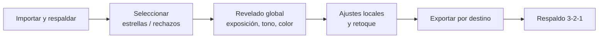

# Flujo de edición de fotos

Parte de: [[32-Edicion-Foto/01 Fundamentos/_Índice Fundamentos|Fundamentos]]

> [!info] Cómo avanzar
> `progreso`: **pendiente** → **viendo** (estudiando) → **visto** (contestaste la autoevaluación sin abrir las respuestas) → **dominado** (hiciste el laboratorio o lo aplicaste de verdad).

## Contenido

### Qué es
Un **flujo de edición** es el orden fijo de pasos que sigues desde que descargas las fotos hasta que las publicas o imprimes. Tener uno evita trabajo repetido, te hace más rápido y logra que una serie se vea coherente. El flujo básico: **importar → seleccionar → revelar global → ajustes locales/retoque → exportar → respaldar**.

### Cómo funciona

1. **Importar**: copia la tarjeta de la a6700 o las fotos del iPhone a una estructura por fecha (ver [[Importar, nombrar y organizar fotos]]). En darktable usa *importar > agregar a la biblioteca* si ya copiaste los archivos.
2. **Seleccionar (culling)**: en la mesa de luz califica rápido: `R` rechaza, `1`–`5` estrellas. Una pasada para descartar lo movido o desenfocado y otra para elegir las mejores. Seleccionar **antes** de editar es lo que más tiempo ahorra: no inviertes 10 minutos en una foto que no vas a publicar, y ver todas juntas te ayuda a elegir la mejor de cada momento.
3. **Revelado global en darktable** (orden sensato del flujo referido a la escena):
   1. Corrección de lente (antes de exposición, porque corrige el viñeteo).
   2. **Exposición**: los medios tonos al brillo correcto.
   3. **Mapeo de tonos** (filmic rgb, sigmoid o AgX): fija blancos y negros.
   4. **Calibración de color**: balance de blancos.
   5. **Balance de color rgb**: saturación y gradación.
   6. Ruido y nitidez, recorte y enderezado, perspectiva.
4. **Ajustes locales y retoque**: máscaras, dodge and burn, clonado (ver [[Máscaras y ajustes locales]]).
5. **Exportar** según destino: sRGB para web, tamaño correcto, nombre claro.
6. **Respaldar** RAW + sidecars + exportaciones.

### Ejemplo
Regresas de un viaje con 600 ARW de la a6700 y 300 fotos del iPhone. Flujo:
- Importas todo a `2026-11-Oaxaca/` y haces respaldo antes de tocar nada.
- Rechazas en 30 minutos unas 400. Te quedan 120 con 3 estrellas o más.
- Revelas una foto "maestra" de cada situación de luz (mañana, interior, atardecer), copias su historial (`Ctrl+Shift+C`) y lo pegas selectivamente (`Ctrl+Shift+V`) a las demás de esa situación. Ajustas solo exposición y encuadre foto por foto.
- Exportas 1080 × 1350 para Instagram y 3000 px de lado largo para tu portafolio.

### Cuándo usarlo y cuándo no
Úsalo para cualquier sesión de más de unas pocas fotos. Para una sola foto del iPhone que vas a mandar por WhatsApp, editar en la app Fotos es suficiente. Adapta el orden: si una foto requiere fotomontaje, el retoque en GIMP va después de exportar el TIFF desde el revelador.

### Errores comunes
1. **Editar mientras seleccionas.** Mezclar ambas cosas te frena; separa las pasadas.
2. **Empezar por el look.** Si aplicas un preset antes de corregir exposición y balance, cada foto reacciona distinto. Primero lo técnico.
3. **Editar foto por foto una serie.** El hábito que ahorra horas: **sincroniza** o copia ajustes desde una foto de referencia y guarda estilos (ver [[Consistencia de color en una serie]]).
4. **Olvidar el respaldo.** El flujo no termina en la exportación.

### Para profundizar
- [darktable 5.6: proceso de edición recomendado](https://docs.darktable.org/usermanual/5.6/en/overview/workflow/process/)
- [darktable 5.6: módulo de exportación](https://docs.darktable.org/usermanual/5.6/en/module-reference/utility-modules/shared/export/)
- [[Revelado RAW vs retoque]] y [[Edición no destructiva]].

## Autoevaluación

Contesta primero en voz alta o en papel; luego despliega la respuesta.

> [!question]- ¿Cuáles son los pasos de un flujo de edición básico?
> 1) Importar y respaldar. 2) Seleccionar (calificar con estrellas, descartar). 3) Revelado global. 4) Ajustes locales. 5) Retoque si hace falta. 6) Exportar según destino. 7) Archivar.

> [!question]- ¿Por qué seleccionar antes de editar?
> Para no perder tiempo editando fotos que no vas a usar. Edita a fondo solo las mejores.

> [!question]- ¿Qué orden de ajustes globales es sensato en darktable?
> Exposición y rango tonal (exposición + filmic/sigmoid) → balance de blancos → contraste y color → nitidez y ruido → recorte final. Ver [[darktable y Ansel]].

> [!question]- ¿Qué hábito te ahorra horas cuando editas una serie?
> Editar bien una foto representativa y **copiar/pegar** los ajustes (o guardar un estilo) al resto, y después afinar cada una.

## Práctica

- [[Práctica Edición 01 - Prepara tu estación de edición]]

