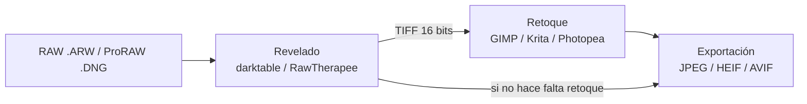

# Revelado RAW vs retoque

Parte de: [[32-Edicion-Foto/01 Fundamentos/_Índice Fundamentos|Fundamentos]]

> [!info] Cómo avanzar
> `progreso`: **pendiente** → **viendo** (estudiando) → **visto** (contestaste la autoevaluación sin abrir las respuestas) → **dominado** (hiciste el laboratorio o lo aplicaste de verdad).

## Contenido

### Qué es
Editar una foto son en realidad dos trabajos distintos. **Revelar** es convertir los datos del sensor (o un archivo ya hecho) en una imagen bien expuesta, con color correcto y buen contraste: es el equivalente digital del cuarto oscuro. **Retocar** es intervenir partes concretas de la imagen: quitar una mancha, limpiar la piel, borrar un cable, combinar capas o hacer un fotomontaje. El revelado trabaja sobre *toda* la foto y con parámetros; el retoque trabaja sobre *píxeles* y zonas.

### Cómo funciona
Un archivo RAW de tu Sony a6700 (`.ARW`) no es todavía una imagen: guarda la lectura de cada fotosito con 12 o 14 bits de información, sin balance de blancos "quemado", sin curva de contraste y sin nitidez. El revelador (darktable, RawTherapee, Lightroom) hace el *demosaico*, aplica balance de blancos, mapea el rango dinámico a la pantalla y genera la imagen. Como esos datos tienen mucho margen, puedes recuperar altas luces o subir sombras sin que se rompa.

El retoque normalmente ocurre **después**, sobre un TIFF de 16 bits o un JPEG exportado del revelador, en un programa de píxeles y capas como GIMP, Krita o Photopea.

### Ejemplo
Tomaste un retrato con la a6700 al atardecer. En darktable corriges la exposición, ajustas la temperatura con *calibración de color*, bajas las altas luces del cielo y recortas a 4:5. Eso es revelado. Luego exportas un TIFF de 16 bits en Adobe RGB o ProPhoto, lo abres en GIMP y, con capas, quitas un granito con la herramienta *Corregir (heal)* y haces un dodge and burn suave. Eso es retoque. Al final exportas JPEG sRGB para Instagram.

Con el iPhone 15 Pro el principio es el mismo: un ProRAW (DNG) se revela; una foto HEIF ya viene "revelada" por el iPhone y solo admite ajustes más limitados antes de que aparezcan bandas o ruido.

### Cuándo usarlo y cuándo no
- **Solo revelado**: paisaje, viaje, calle, la mayoría de tus fotos. Si el revelador tiene herramienta de clonado o retoque (darktable tiene el módulo *retoque*), evita salir a otro programa.
- **Revelado + retoque**: retratos con piel, producto, fotomontaje, limpieza fuerte (quitar personas, cables), composiciones con varias capas.
- **No retoques un JPEG si tienes el RAW**: el JPEG ya perdió información (8 bits, compresión, balance de blancos aplicado). Cualquier corrección fuerte de exposición o color revelará bandas y artefactos. Revela primero el RAW y retoca el resultado.

### Errores comunes
1. **Hacer el revelado en GIMP.** GIMP puede abrir un RAW, pero lo hace llamando a darktable o RawTherapee; si los ajustes de luz y color los haces después con curvas sobre píxeles, pierdes el margen del RAW.
2. **Retocar antes de revelar.** Si cambias la exposición después de clonar, los parches pueden dejar de coincidir en tono. Primero el revelado global, luego el retoque.
3. **Exportar a JPEG para retocar.** Usa TIFF 16 bits como archivo intermedio; el JPEG mete compresión en cada guardado.
4. **Confundir "filtro" con revelado.** Un filtro de app aplica un look; no corrige exposición ni balance. Revela primero y aplica el look al final (ver [[Presets y LUTs en fotografía]]).

### Para profundizar
- [[RAW vs JPEG y HEIF]] y [[Flujo de edición de fotos]] en este temario.
- [Manual de darktable 5.6: flujo de procesamiento](https://docs.darktable.org/usermanual/5.6/en/overview/workflow/process/)
- [Documentación de GIMP 3.0](https://docs.gimp.org/3.0/en/)
- [Acerca de Apple ProRAW (Apple)](https://support.apple.com/es-la/119916)

## Autoevaluación

Contesta primero en voz alta o en papel; luego despliega la respuesta.

> [!question]- ¿Qué diferencia hay entre revelar y retocar?
> **Revelar** es convertir el RAW en imagen: exposición, balance de blancos, contraste, color, ruido, recorte (darktable, RawTherapee). **Retocar** es modificar el contenido a nivel de píxel: quitar objetos, piel, montajes, capas (GIMP, Photopea).

> [!question]- ¿En qué orden se hacen normalmente?
> Primero el revelado (con el RAW y toda su información) y después, si hace falta, exportas un TIFF de 16 bits para retocar en GIMP o Photopea.

> [!question]- ¿Por qué no conviene retocar directo un JPEG si tienes el RAW?
> El JPEG tiene 8 bits y compresión: al empujar tonos aparecen bandas y artefactos. El RAW o un TIFF de 16 bits aguantan mucho más.

## Práctica

- [[Práctica Edición 02 - Primer revelado de un ProRAW en darktable]]

