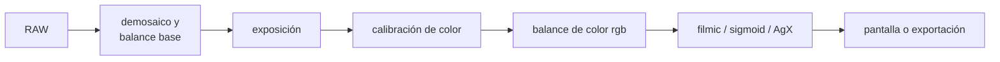

# darktable y Ansel

Parte de: [[32-Edicion-Foto/02 Programas gratuitos/_Índice Programas gratuitos|Programas gratuitos]]

> [!info] Cómo avanzar
> `progreso`: **pendiente** → **viendo** (estudiando) → **visto** (contestaste la autoevaluación sin abrir las respuestas) → **dominado** (hiciste el laboratorio o lo aplicaste de verdad).

## Contenido

### Qué es
**darktable** es un programa libre y gratuito (licencia GPL) para revelar RAW y organizar fotos, disponible para Windows, macOS y Linux. Es la alternativa gratuita más completa a Lightroom Classic. La versión estable más reciente al momento de escribir es la **5.6.2** (la serie 5.6 salió el 21 de junio de 2026). **Ansel** es un *fork* de darktable creado por Aurélien Pierre, uno de sus antiguos desarrolladores, que simplifica la interfaz y elimina módulos redundantes; se distribuye como compilaciones continuas (Pendiente de confirmar su versión actual). Ambos son no destructivos.

### Cómo funciona
darktable tiene dos vistas principales:
- **Mesa de luz** (*lighttable*): importar, ver miniaturas, calificar con estrellas, etiquetar, filtrar y exportar en lote.
- **Cuarto oscuro** (*darkroom*): editar una foto con **módulos** que se aplican en un orden fijo (la *pixelpipe*).

Trabaja **referido a la escena**: los módulos del inicio de la cadena operan con valores de luz **lineales**, proporcionales a la luz real que llegó al sensor, sin límite de "blanco máximo". Al final, un módulo de **mapeo de tonos** (filmic rgb, sigmoid o AgX en 5.6) comprime ese rango enorme al rango de la pantalla. Por eso el orden es: primero **exposición** (pones bien los medios tonos) y luego el mapeo de tonos (decides cuánto de las luces y sombras cabe). Usa solo **un** mapeador de tonos a la vez.

Novedades de 5.6 relevantes para ti: subsistema de **IA opcional y local** (apagado por defecto) con *neural restore* para reducir ruido y escalar, y una herramienta de **máscara de objeto por IA**; exportación a **HEIF**; y un nuevo módulo *color harmonizer*.

### Ejemplo
Con un ARW de la a6700:
1. En preferencias elige el flujo *scene-referred* (filmic o AgX) y un tema gris.
2. En el cuarto oscuro, desde el menú de grupos de módulos, crea un grupo propio con solo: corrección de lente, exposición, filmic/sigmoid/AgX, calibración de color, balance de color rgb, ecualizador de tonos, recorte, rotar y perspectiva, reducción de ruido (perfilada), difusión o nitidez y retoque.
3. Revela y exporta.

**ProRAW del iPhone 15 Pro**: es un DNG, pero Apple usa una compresión poco común (JPEG sin pérdida con *predictor 7*, y en iOS recientes JPEG XL). Las notas de darktable 5.6 siguen listando los "Apple ProRAW DNGs" entre los modos de compresión **no soportados**: pueden verse en la mesa de luz pero no abrir en el cuarto oscuro. Alternativas: convertirlos con el Adobe DNG Converter gratuito a un DNG compatible, abrirlos en RawTherapee, o capturar con una app que genere DNG estándar. En la a6700, evita el RAW "sin pérdida" en tamaño **M o S** (tampoco está soportado); usa sin compresión, comprimido o sin pérdida tamaño L (Pendiente de confirmar que tu combinación de firmware se abra; prueba un archivo antes de un viaje).

### Cuándo usarlo y cuándo no
- **darktable**: tu revelador principal en la PC; catálogo, estilos, máscaras potentes, lotes y exportación con marca de agua.
- **Ansel**: si darktable te abruma y prefieres menos opciones; la comunidad y la documentación son más pequeñas.
- **No** es un editor de capas: para fotomontajes usa GIMP o Krita.

### Errores comunes
1. **Buscar los controles de Lightroom.** No hay un panel "Básico" con sliders iguales. Aprende los módulos esenciales y oculta el resto con un grupo propio.
2. **Usar módulos viejos display-referred** (curva base, sombras y luces) junto con filmic: se pelean.
3. **Mover el balance de blancos en dos lugares.** Deja *balance de blancos* en "referencia de cámara" y corrige en *calibración de color*.
4. **No respaldar `library.db` y los XMP.**

### Para profundizar
- [Manual de darktable 5.6: módulos de procesamiento](https://docs.darktable.org/usermanual/5.6/en/module-reference/processing-modules/)
- [darktable 5.6: flujo recomendado](https://docs.darktable.org/usermanual/5.6/en/overview/workflow/process/)
- [Anuncio de darktable 5.6.1](https://www.darktable.org/2026/08/darktable-5.6.1-released/)
- [Ansel](https://ansel.photos/en)

## Autoevaluación

Contesta primero en voz alta o en papel; luego despliega la respuesta.

> [!question]- ¿Qué son darktable y Ansel?
> **darktable** es un programa libre y gratuito de revelado RAW y gestión de fotos (Windows, macOS y Linux). **Ansel** es un derivado (fork) de darktable que simplifica la interfaz y quita módulos redundantes. Ambos son no destructivos.

> [!question]- ¿Qué son la mesa de luz y el cuarto oscuro en darktable?
> **Mesa de luz** (lighttable): ver, calificar, filtrar y exportar. **Cuarto oscuro** (darkroom): editar una foto con módulos.

> [!question]- ¿Qué significa que darktable trabaje "referido a la escena"?
> Edita en valores de luz lineales (como la luz real) y al final un módulo de mapeo de tonos (filmic rgb o sigmoid) comprime ese rango a la pantalla. Por eso primero ajustas **exposición** y luego el mapeo de tonos.

> [!question]- ¿Puede darktable abrir los ProRAW del iPhone?
> No directamente. ProRAW es un DNG, pero Apple lo comprime de una forma que darktable (ni Ansel, que usa el mismo decodificador) no soporta: JPEG sin pérdida con *predictor 7* y, en iOS recientes, JPEG XL. Suelen verse en la mesa de luz pero no abren en el cuarto oscuro ("unsupported feature"). Opciones: convertirlos con el Adobe DNG Converter gratuito a un DNG compatible (compatibilidad anterior a DNG 1.7), abrirlos en [[RawTherapee]], o disparar con una app que guarde DNG estándar. Ver [[iPhone 15 Pro para foto y video]].

> [!question]- Error común: buscar en darktable los mismos controles que en Lightroom. ¿Qué haces mejor?
> Aprender los pocos módulos esenciales (exposición, filmic/sigmoid, calibración de color, balance de color rgb, ecualizador de tonos, recorte, nitidez) y ocultar el resto con un grupo de módulos personalizado.

## Práctica

- [[Práctica Edición 02 - Primer revelado de un ProRAW en darktable]]

