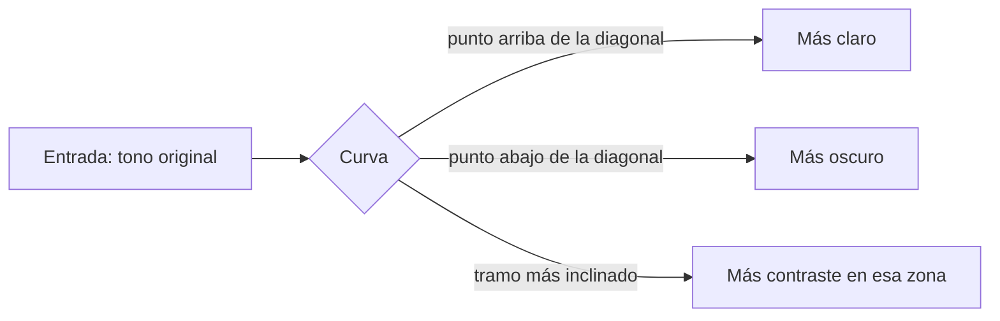

# Curvas de tonos

Parte de: [[32-Edicion-Foto/03 Revelado/_Índice Revelado|Revelado]]

> [!info] Cómo avanzar
> `progreso`: **pendiente** → **viendo** (estudiando) → **visto** (contestaste la autoevaluación sin abrir las respuestas) → **dominado** (hiciste el laboratorio o lo aplicaste de verdad).

## Contenido

### Qué es
Una **curva de tonos** es una gráfica que traduce el brillo de entrada (eje horizontal, de negro a blanco) al brillo de salida (eje vertical). Si la dejas como línea diagonal, no cambia nada. Si subes un punto, esos tonos se aclaran; si lo bajas, se oscurecen. Es la herramienta más precisa para controlar contraste y brillo por zonas tonales, y también el color, si editas cada canal (rojo, verde, azul) por separado.

### Cómo funciona
- **Zonas**: la izquierda son las sombras, el centro los medios tonos y la derecha las altas luces.
- **Pendiente = contraste**: donde la curva está más inclinada hay más contraste; donde está más plana, menos.
- **Puntos de anclaje**: agregas puntos para fijar zonas que no quieres mover y otros para modificar.

Formas clásicas:
- **Curva en "S"**: bajas un poco las sombras y subes un poco las luces. Los medios tonos quedan más inclinados, así que ganan contraste. Es la cura para una foto plana y gris.
- **Aclarar solo sombras**: pon un ancla en los medios tonos o en tres cuartos, para que la parte derecha no se mueva, y sube un punto en el primer cuarto.
- **Negro deslavado tipo película (*fade*)**: sube el punto extremo inferior izquierdo. El negro más profundo pasa a ser un gris oscuro, lo que da un aspecto mate.
- **Curva por canal**: subir el azul en sombras y bajarlo en luces da sombras frías y luces cálidas (gradación sencilla).

### Ejemplo
Foto del iPhone 15 Pro en un día nublado, plana:
1. En darktable, módulo **curva rgb** con *preservar color: luminancia* para que la S no sature los colores.
2. Punto en (25 %, 20 %) y otro en (75 %, 80 %): una S suave.
3. Para el look mate, sube el extremo negro de (0, 0) a (0, 6 %).

En GIMP: `Colores > Curvas`, mismo procedimiento; en 3.x el filtro queda no destructivo y puedes reabrirlo. En Lightroom móvil: *Luz > Curva*, modo puntos.

Ten presente que en darktable el contraste principal ya lo pone el mapeo de tonos (filmic, sigmoid o AgX). La curva rgb es un ajuste fino posterior, no el primer paso.

### Cuándo usarlo y cuándo no
- **Úsala** para afinar contraste en una zona concreta, para looks de película y para gradación por canal.
- **Prefiere otros controles** si solo quieres mover exposición (módulo exposición) o comprimir luces y sombras grandes (ecualizador de tonos o el mapeo de tonos), porque la curva en un rango amplio tiende a apagar color.

### Errores comunes
1. **Curvas muy fuertes**: aparecen **posterización** (bandas en cielos y degradados), colores sobresaturados o desplazados de tono, y sombras o luces aplastadas sin detalle. Usa pendientes suaves y trabaja en 16 bits.
2. **Invertir la pendiente** sin querer (un tramo que baja): crea solarización.
3. **Usar la curva RGB pensando que no afecta el color**: en modo RGB, una S satura; usa el modo de luminancia o una curva de luminosidad (*L* en Lab).
4. **Editar curva por canal sin referencia**: provoca dominantes; revisa con algo neutro, como una pared gris.

### Para profundizar
- [darktable 5.6: módulos de procesamiento (curva rgb y otros)](https://docs.darktable.org/usermanual/5.6/en/module-reference/processing-modules/)
- [Documentación de GIMP 3.0](https://docs.gimp.org/3.0/en/)
- [[Exposición, blancos y negros en el revelado]] y [[HSL y gradación de color]].

## Ejercicios

Resuélvelos en papel o en la herramienta; la solución está plegada.

> [!question]- Quieres aclarar solo las sombras sin tocar las altas luces. ¿Qué haces en la curva?
> Pon un punto en las luces y déjalo en la diagonal (ancla); sube un punto en el cuarto inferior.

> [!question]- Una foto se ve plana y gris. ¿Qué forma de curva pruebas primero?
> Una **S suave**: bajar ligeramente el cuarto inferior y subir el cuarto superior.

## Autoevaluación

Contesta primero en voz alta o en papel; luego despliega la respuesta.

> [!question]- ¿Qué representa una curva de tonos?
> Entrada (tono original) contra salida (tono resultante). Subir un punto aclara esos tonos; bajarlo los oscurece.

> [!question]- ¿Qué hace una curva en "S"?
> Oscurece sombras y aclara luces: más contraste en los medios tonos.

> [!question]- ¿Cómo logras el "negro deslavado" tipo película?
> Subiendo el extremo inferior izquierdo de la curva: el negro se vuelve gris oscuro.

> [!question]- Error común: curvas muy fuertes. ¿Qué aparece?
> Posterización (bandas), colores raros y pérdida de detalle. Mueve puntos poco a poco.

## Práctica

- [[Práctica Edición 04 - Revelado completo paso a paso]]
- [[Práctica Edición 08 - Blanco y negro con intención]]

