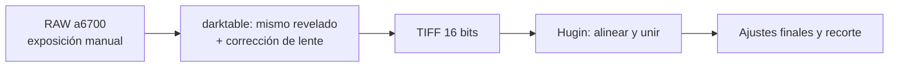

# Unir HDR y panorámicas

Parte de: [[32-Edicion-Foto/06 Look y técnicas/_Índice Look y técnicas|Look y técnicas]]

> [!info] Cómo avanzar
> `progreso`: **pendiente** → **viendo** (estudiando) → **visto** (contestaste la autoevaluación sin abrir las respuestas) → **dominado** (hiciste el laboratorio o lo aplicaste de verdad).

## Contenido

### Qué es
Son dos técnicas para superar los límites de una sola toma. **HDR** (alto rango dinámico) une varias fotos del mismo encuadre con distinta exposición (*bracketing*) para tener detalle tanto en luces como en sombras. **Panorámica** une varias fotos tomadas girando la cámara para lograr un campo de visión más amplio o más resolución. En ambos casos el software alinea las fotos y las fusiona.

### Cómo funciona
**HDR en darktable**:
1. Dispara un bracketing con la a6700 (por ejemplo, 3 o 5 fotos a ±2 EV), de preferencia en tripié (ver [[Bracketing y HDR en fotografía]]).
2. En la mesa de luz selecciona las tomas del bracketing y, en el módulo de *imágenes seleccionadas*, elige **crear HDR**. darktable combina los RAW en un **DNG de punto flotante** con todo el rango, y lo agrega a la colección.
3. Revela ese DNG como cualquier RAW: exposición y mapeo de tonos (filmic, sigmoid o AgX) para comprimir el rango.

darktable no alinea las tomas al unir, así que conviene el tripié. Si hay movimiento (ramas, personas), pueden aparecer "fantasmas". Con frecuencia, una sola toma RAW bien expuesta para las luces más el ecualizador de tonos te da suficiente rango con la a6700, sin HDR.

**Panorámicas con Hugin** (gratuito y libre, para Windows, macOS y Linux):
1. Dispara con exposición, enfoque y balance de blancos en **manual** e iguales en todas las tomas, con 30–50 % de traslape, idealmente girando sobre el punto nodal de la lente y en vertical para tener más alto.
2. **Revela antes de unir**: aplica el mismo revelado neutro a todas (copia el historial de una a las demás), con corrección de lente, y exporta **TIFF de 16 bits**. Así todas las tomas quedan idénticas en color y tono.
3. En Hugin: *Cargar imágenes*, *Alinear* (encuentra puntos de control automáticamente), revisa la proyección (cilíndrica para panorámicas horizontales amplias, rectilínea para pocas tomas de arquitectura), recorta y *Crear panorama*.
4. Ajustes finales (contraste, color, recorte) sobre el TIFF unido en darktable o GIMP.

¿Por qué revelar antes? Porque Hugin no trabaja con RAW y porque si revelas cada toma por separado después de unir sería imposible; además, la corrección de lente ayuda a que la alineación sea exacta. La alternativa es revelar *suave* antes y hacer el look después de unir: es lo más común.

### Ejemplo
Atardecer en la playa con el iPhone 15 Pro: el modo panorámico del iPhone une en el teléfono, rápido pero con menos control. Con la a6700, 6 tomas verticales a 24 mm, unidas en Hugin, dan una panorámica de mucha más resolución que se puede imprimir grande. El dron DJI Mini 4K también hace panorámicas y HDR automáticos (ver [[Panorámicas y HDR con dron]]).

### Cuándo usarlo y cuándo no
- **HDR**: interiores con ventanas, contraluces extremos, arquitectura. **No** con sujetos en movimiento ni cuando una sola toma RAW ya alcanza.
- **Panorámica**: paisajes amplios, más resolución para impresión. **No** con objetos cercanos que cambien de posición entre tomas (paralaje), salvo que uses el punto nodal.
- En concursos documentales suele estar prohibido unir fotos (ver [[Ética del retoque]]).

### Errores comunes
1. **Exposición o balance automáticos** entre tomas de la panorámica: bandas de brillo.
2. **Poco traslape**: Hugin no encuentra puntos de control.
3. **HDR exagerado**: halos y aspecto irreal; el objetivo es que se vea natural.
4. **Mover la cámara** en el bracketing sin tripié.

### Para profundizar
- [Hugin: sitio oficial](https://hugin.sourceforge.io/)
- [Tutoriales de Hugin](https://hugin.sourceforge.io/tutorials/index.shtml)
- [darktable 5.6: flujo recomendado](https://docs.darktable.org/usermanual/5.6/en/overview/workflow/process/)
- [[Fotografía panorámica]].

## Autoevaluación

Contesta primero en voz alta o en papel; luego despliega la respuesta.

> [!question]- ¿Cómo se fusiona un bracketing HDR en darktable?
> En la mesa de luz, selecciona las tomas y usa **crear HDR**: genera un DNG fusionado que luego revelas con exposición y filmic/sigmoid.

> [!question]- ¿Qué programa gratuito une panorámicas?
> **Hugin**: alinea, corrige y une varias fotos; también incluye `enfuse` para fusión de exposiciones y apilado de enfoque.

> [!question]- ¿Qué orden conviene en una panorámica: revelar antes o después de unir?
> Aplica el **mismo** revelado básico a todas las tomas (copiar/pegar), exporta en TIFF de 16 bits, une en Hugin y haz el ajuste final sobre la panorámica.

