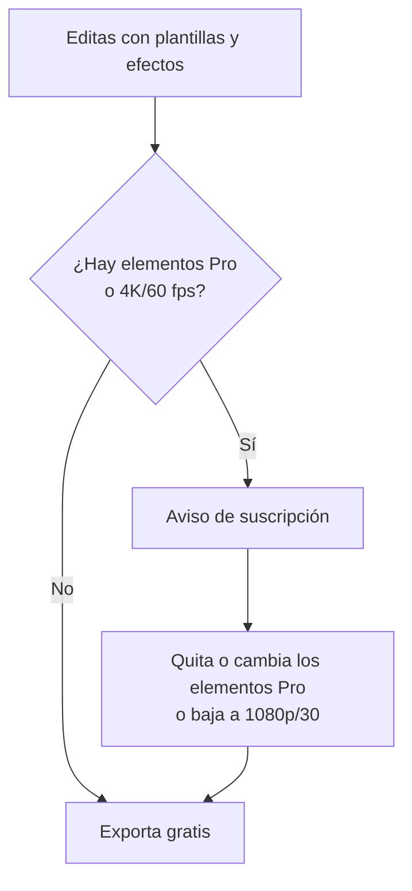

# CapCut

Parte de: [[33-Edicion-Video/01 Fundamentos/_Índice Fundamentos|Fundamentos]]

> [!info] Cómo avanzar
> `progreso`: **pendiente** → **viendo** (estudiando) → **visto** (contestaste la autoevaluación sin abrir las respuestas) → **dominado** (hiciste el laboratorio o lo aplicaste de verdad).

## Contenido

### Qué es
CapCut es un editor de video de ByteDance (la empresa de TikTok) con app para celular, versión de escritorio y editor web. Está pensado para **video corto y vertical**: plantillas, textos animados, efectos de moda, música y publicación directa en TikTok, Reels y Shorts. Tiene un plan gratuito y planes de pago (Standard, Pro y Ultra). Aunque es "gratis", **muchas funciones están marcadas como Pro**, y esa frontera cambió varias veces durante 2026.

### Cómo funciona el modelo gratis/Pro
Puedes usar y previsualizar casi todo, pero la app revisa el proyecto **al exportar**. Si encuentra algo con insignia Pro (plantilla, efecto, fuente, música, sticker, transición, LUT o herramienta de IA) te pide suscribirte. Según la ayuda oficial de CapCut:
- En **escritorio**, 4K y 60 fps son ajustes Pro; exportar a 1080p y 30 fps queda dentro de lo gratuito.
- En **celular**, hay un límite de duración gratuita que varía por región, y si cancelas el aviso puedes exportar con **marca de agua**.
- Quitar la marca no es gratis si usaste materiales Pro.

Reportes de noviembre de 2026 indican que los **subtítulos automáticos** ya aparecían con insignia Pro y que el plan gratuito trae 100 créditos de IA (Pendiente de confirmar en tu cuenta: depende de país, plataforma y versión).

### Ejemplo
Reel de 30 s con tomas del iPhone 15 Pro y del Osmo Pocket 4P: en CapCut de escritorio creas un proyecto 9:16, pones la canción, usas *Auto beat* para marcar golpes (ver [[Editar al ritmo de la música]]), cortas al beat y agregas un texto. Antes de exportar, filtra los efectos por "gratis", y elige 1080p/30 fps. Si al final aparece el aviso, revisa uno por uno los elementos con corona o insignia "Pro" y cámbialos por equivalentes gratuitos.

### Cuándo usarlo y cuándo no
**Úsalo** para piezas cortas, rápidas y con estética de redes, sobre todo si editas en el celular justo después de grabar. Es muy cómodo para textos animados y tendencias.

**No lo uses** como editor principal para proyectos largos o con color serio: el control de color, audio y exportación es limitado frente a [[DaVinci Resolve (versión gratuita)]]. Tampoco dependas de él para material sensible: lee los términos de servicio (en Estados Unidos se actualizaron en abril de 2026) y considera que la nube y las funciones de IA procesan tu contenido en servidores de terceros. Revisa también la licencia de la música: las pistas de su biblioteca pueden estar autorizadas solo dentro de TikTok/CapCut y no para YouTube (ver [[Música y efectos libres de regalías]]).

### Qué revisar antes de usar una función
1. ¿Tiene insignia Pro? Si sí, solo podrás previsualizarla.
2. ¿La música o plantilla permite uso comercial y en la plataforma donde publicarás?
3. ¿El ajuste de exportación (resolución, fps, duración) es gratuito en tu plataforma?

### Errores comunes
- **Descubrir el muro de pago al final**: revisa las insignias mientras editas, no al exportar.
- **Exportar a 4K "por si acaso"**: en escritorio es Pro y para Reels basta 1080×1920.
- **Usar música de CapCut en YouTube**: puede generar reclamos de Content ID ([[Content ID y derechos en plataformas]]).
- **Perder proyectos al cambiar de equipo**: la edición entre dispositivos y el almacenamiento amplio en la nube son de pago; exporta un máster local.

### Para profundizar
- [Por qué CapCut pide Pro al exportar (ayuda oficial)](https://www.capcut.com/help/join-capcut-pro-for-exporting)
- [Centro de ayuda de CapCut](https://www.capcut.com/help/)

## Autoevaluación

Contesta primero en voz alta o en papel; luego despliega la respuesta.

> [!question]- ¿Para qué es especialmente útil CapCut?
> Video vertical para redes: plantillas, subtítulos automáticos, efectos de moda y edición rápida desde el celular o la PC.

> [!question]- ¿Qué hay que revisar antes de usar una función en CapCut?
> Si es **gratuita o de pago** (algunas herramientas y plantillas llevan marca de suscripción) y, si usas música de su biblioteca, si su licencia permite usarla fuera de la app o en contenido comercial.

> [!question]- Caso: editaste un reel en CapCut y al exportar aparece un aviso para suscribirte. ¿Qué haces?
> Identifica el efecto o recurso de pago (suelen tener un ícono distintivo) y reemplázalo por uno gratuito, o haz ese paso en Resolve.

