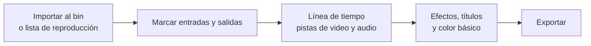

# Kdenlive y Shotcut

Parte de: [[33-Edicion-Video/01 Fundamentos/_Índice Fundamentos|Fundamentos]]

> [!info] Cómo avanzar
> `progreso`: **pendiente** → **viendo** (estudiando) → **visto** (contestaste la autoevaluación sin abrir las respuestas) → **dominado** (hiciste el laboratorio o lo aplicaste de verdad).

## Contenido

### Qué son
**Kdenlive** y **Shotcut** son editores de video libres y gratuitos (software de código abierto), sin marca de agua ni suscripción, disponibles para Windows, macOS y Linux. Ambos se apoyan en el framework MLT y en FFmpeg para leer y escribir video. Kdenlive es parte del proyecto KDE; al revisarlo en noviembre de 2026 su versión más reciente es la **26.08.3** (7 de noviembre de 2026). Shotcut lo desarrolla Meltytech y publica versiones con numeración año.mes.

### Cómo funcionan
El flujo es el mismo que en cualquier editor no lineal y el mismo que aprendes en Resolve:

- **Kdenlive**: se parece más a un editor "de estudio". Tiene **Project Bin** con carpetas, pistas múltiples, efectos con keyframes, scopes (waveform, vectorscopio, RGB parade), títulos, subtítulos con transcripción automática local (Whisper, opcional) y **clips proxy** integrados.
- **Shotcut**: interfaz por paneles que activas según lo que necesites (Playlist, Timeline, Filters, Keyframes, Export). Es ligero, tiene filtros de color y audio y una opción de **proxy** y de **escalado de vista previa** para que la PC no sufra.

La ventaja práctica para ti: como leen video con FFmpeg, **abren H.264/H.265 de 10 bits y 4:2:2** (Sony a6700 en XAVC HS, iPhone en HEVC HDR, Osmo Pocket 4P en D-Log 2), que la versión gratuita de Resolve en Windows no abre. La decodificación de ese material es por CPU en muchos casos, así que con 4K conviene activar proxies desde el inicio. Kdenlive 25.08 agregó codificación H.265 de 10 bits con NVIDIA, que tu GTX 1660 Ti puede usar al exportar.

### Ejemplo
Grabaste un recorrido en Osmo Pocket 4P con D-Log 2 (HEVC 10 bits). En Kdenlive:
1. Activa en *Configurar proyecto → Proxy* la generación automática para clips de más de 1920 px.
2. Importa los clips; mientras se generan, ves un ícono de proxy en el bin.
3. Edita normalmente; aplica la LUT de DJI a Rec.709 con el efecto de LUT 3D.
4. Al renderizar, Kdenlive usa los originales, no los proxies.

### Cuándo usarlos en lugar de Resolve
- Tu material es **10 bits H.264/H.265** y no quieres convertirlo ni pagar Studio.
- Quieres algo **ligero** para un corte rápido en una laptop sin GPU dedicada.
- Usas **Linux** o te importa que sea software libre.

Para color avanzado por nodos, Fairlight y Fusion, Resolve sigue siendo superior. Una combinación válida: armar el corte en Kdenlive y, si el proyecto lo amerita, convertir a DNxHR para terminarlo en Resolve.

### Qué tienen en común con Resolve
Bins, línea de tiempo con pistas, puntos de entrada/salida (I/O), atajos J-K-L, proxies, keyframes y exportación con presets. Por eso lo que aprendas en [[Proyecto, bins y línea de tiempo]] o en [[Tipos de corte (J-cut, L-cut, jump cut y match cut)]] sirve en los tres.

### Errores comunes
- **Esperar que importen proyectos de Resolve**: no son compatibles; a lo mucho intercambias un XML/OTIO y solo los cortes básicos.
- **Editar 4K HEVC 10 bits sin proxies**: la reproducción se traba porque la CPU no alcanza.
- **No guardar con frecuencia**: ambos son estables, pero un efecto pesado puede cerrarlos; activa el autoguardado.
- **Mezclar fps en la línea de tiempo**: fija el perfil del proyecto (resolución y fps) antes de importar.

### Para profundizar
- [Kdenlive (sitio oficial)](https://kdenlive.org/)
- [Manual de Kdenlive](https://docs.kdenlive.org/)
- [Shotcut (sitio oficial y tutoriales)](https://shotcut.org/)

## Autoevaluación

Contesta primero en voz alta o en papel; luego despliega la respuesta.

> [!question]- ¿Qué son Kdenlive y Shotcut?
> Editores de video **gratuitos y de código abierto** para Windows, macOS y Linux. Son más ligeros que Resolve y funcionan en computadoras modestas.

> [!question]- ¿Cuándo usarías uno de ellos en lugar de Resolve?
> Si tu PC no mueve bien Resolve (poca memoria de video o sin GPU dedicada), o para ediciones simples y rápidas.

> [!question]- ¿Qué tienen en común con Resolve en el flujo de trabajo?
> Línea de tiempo con pistas, cortes, transiciones, títulos, filtros de audio y video, proxies y exportación con perfiles predefinidos.

