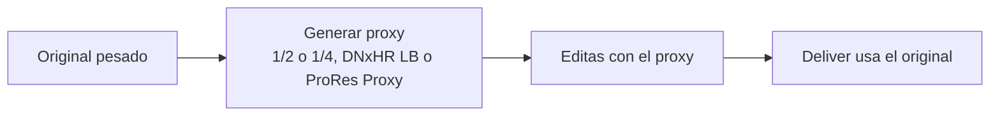

# Proxies y rendimiento al editar

Parte de: [[33-Edicion-Video/01 Fundamentos/_Índice Fundamentos|Fundamentos]]

> [!info] Cómo avanzar
> `progreso`: **pendiente** → **viendo** (estudiando) → **visto** (contestaste la autoevaluación sin abrir las respuestas) → **dominado** (hiciste el laboratorio o lo aplicaste de verdad).

## Contenido

### Qué es un proxy
Un **proxy** es una copia ligera de cada clip (menor resolución y un códec fácil de decodificar) que el editor usa **mientras editas**. Al exportar, el programa vuelve a usar el archivo original, así que la calidad final no cambia. Sirve para que la reproducción no se trabe cuando el material es pesado para tu PC.

### Por qué tu PC los necesita
Los códecs de cámara (H.264, H.265) comprimen mucho usando cuadros que dependen de otros (GOP largo). Reproducirlos y, sobre todo, ir hacia atrás o saltar en la línea de tiempo, exige mucho cálculo. Con tu equipo:
- **GTX 1660 Ti (Turing)**: su decodificador de hardware (NVDEC) maneja H.264 de 8 bits 4:2:0 y HEVC Main/Main10 (8 y 10 bits) 4:2:0, pero **no 4:2:2**. El soporte de 4:2:2 llegó hasta la serie RTX 50.
- **Resolve gratuito en Windows** no usa decodificación por hardware para H.264/H.265 (es de Studio) y **no abre esos códecs en 10 bits**. Todo lo que abre lo decodifica la CPU.

Resultado práctico:

| Material | En Resolve gratis (Windows) | Qué hacer |
|---|---|---|
| DJI Mini 4K, H.264 8 bits | Abre, CPU | Proxies si va lento en 4K |
| a6700 XAVC S 4:2:0 8 bits | Abre, CPU | Proxies |
| a6700 XAVC S/HS 10 bits 4:2:2 | No abre | Convertir a DNxHR HQX / ProRes 422 |
| iPhone 15 Pro HEVC HDR | No abre | Convertir, o grabar en ProRes |
| iPhone 15 Pro ProRes / Apple Log | Abre | Proxies (archivos enormes pero fáciles) |
| Osmo Pocket 4P D-Log 2 (HEVC 10 bits) | No abre | Convertir |

### Cómo funciona en Resolve

1. En *Media* o en el bin: clic derecho → **Generate Proxy Media**. Configura formato y resolución en *Project Settings → Master Settings → Optimized Media and Render Cache* (DNxHR LB o ProRes Proxy; ProRes se puede codificar en Windows desde Resolve 19.1.4).
2. Activa **Playback → Proxy Handling → Prefer Proxies**.
3. Otras opciones de rendimiento:
   - **Optimized Media**: parecido al proxy pero administrado dentro del proyecto.
   - **Render Cache (Smart/User)**: pre-renderiza efectos pesados (ruido, Fusion) para reproducirlos en tiempo real.
   - **Timeline Proxy Resolution** (Half/Quarter): baja la resolución de reproducción al vuelo.
   - Bajar la calidad del visor o desactivar efectos temporalmente.

### Convertir lo que Resolve gratis no abre
Si el clip no abre, Resolve tampoco puede crear su proxy. Usa **Shutter Encoder** (gratis, basado en FFmpeg) para convertir a **DNxHR HQX** (10 bits) o **ProRes 422** e importa esas copias como si fueran tus originales. Ocupan mucho: DNxHR HQX en UHD a 30 fps ronda 110 MB/s, unos 400 GB por hora (aprox.). Con 6 GB de VRAM, edita esas copias en línea de tiempo 4K con proxies, o en 1080p y cambia a 4K solo para exportar.

### Ejemplo
Viaje con 120 clips de la a6700 en XAVC HS 10 bits: conviertes en Shutter Encoder a DNxHR HQX en `02 Convertidos/`, importas esos archivos, generas proxies DNxHR LB a 1/4 y editas fluido. Antes de exportar, cambias a *Prefer Camera Originals* para revisar color con la calidad completa.

### Cuándo usarlos y cuándo no
Úsalos en 4K de H.264/H.265, multicámara o material con mucha compresión. No hacen falta en clips 1080p ligeros, ni en proyectos de 30 segundos donde generarlos tarda más que editar.

### Errores comunes
- **Borrar la carpeta de proxies a mitad del proyecto**: el editor vuelve a los originales (todo se traba) o marca los proxies faltantes; tendrás que regenerarlos. Bórralos solo al cerrar el proyecto.
- **Juzgar el color o el enfoque sobre proxies**: son de baja calidad; revisa con originales.
- **Guardar proxies en el mismo disco lento** que los originales: si puedes, ponlos en el SSD.
- **Grabar en 10 bits y descubrir el problema en casa**: decide antes si conviertes, editas en Kdenlive o grabas en 8 bits.

### Para profundizar
- [Capacitación oficial de DaVinci Resolve](https://www.blackmagicdesign.com/products/davinciresolve/training)
- [Shutter Encoder (convertidor gratuito)](https://www.shutterencoder.com/)
- [Proxies en Kdenlive (manual)](https://docs.kdenlive.org/)

## Autoevaluación

Contesta primero en voz alta o en papel; luego despliega la respuesta.

> [!question]- ¿Qué es un proxy?
> Una copia ligera (menor resolución y códec fácil, como ProRes Proxy o DNxHR LB) del clip original, que se usa para editar con fluidez. Al exportar se usan los originales.

> [!question]- ¿En qué casos los necesitas?
> Con material 4K HEVC (H.265) del iPhone o la Sony, o si tu PC tiene poca potencia. Los clips ProRes suelen editarse bien sin proxy, pero ocupan mucho.

> [!question]- ¿Qué otras opciones de rendimiento tiene Resolve?
> Bajar la **resolución de reproducción** (Timeline Proxy Resolution a la mitad o un cuarto), usar **render cache**, y *Optimized Media*.

> [!question]- Error común: borrar la carpeta de proxies a mitad del proyecto. ¿Qué pasa?
> Resolve vuelve a los originales; la edición sigue intacta, pero pierdes la fluidez hasta regenerarlos.

## Práctica

- [[Lab 1 - Primer proyecto organizado en DaVinci Resolve]]

