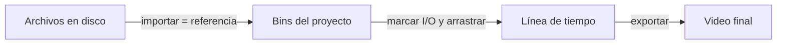

# Proyecto, bins y línea de tiempo

Parte de: [[33-Edicion-Video/01 Fundamentos/_Índice Fundamentos|Fundamentos]]

> [!info] Cómo avanzar
> `progreso`: **pendiente** → **viendo** (estudiando) → **visto** (contestaste la autoevaluación sin abrir las respuestas) → **dominado** (hiciste el laboratorio o lo aplicaste de verdad).

## Contenido

### Qué es
Son las tres piezas con las que trabaja cualquier editor no lineal (Resolve, Kdenlive, Shotcut):
- **Proyecto**: el archivo o registro que guarda tus decisiones de edición (no el video). En Resolve vive en una base de datos y lo abres desde el *Project Manager*.
- **Bin**: una carpeta *virtual* dentro del proyecto para agrupar clips (por cámara, por día, por tipo de toma). Mover clips entre bins no mueve los archivos en disco.
- **Línea de tiempo (timeline)**: la secuencia donde acomodas clips en pistas de video (V1, V2…) y audio (A1, A2…) en el orden en que se verán.

### Cómo funciona

**Ajustes que defines antes de editar** (en Resolve: *File → Project Settings → Master Settings*):
- **Resolución de la línea de tiempo**: 3840×2160 para YouTube 4K, 1920×1080 o 1080×1920 para vertical.
- **Timeline frame rate**: la cadencia del proyecto (24, 25, 30, 60). En Resolve **no se puede cambiar** una vez que hay clips en una línea de tiempo, así que decídelo primero. Elige la de la mayoría de tu material de "velocidad normal".
- **Playback frame rate** y espacio de color (Rec.709 para SDR).

**Teclas básicas de transporte** (iguales en casi todos los editores):
- **J**: reproduce hacia atrás; **K**: pausa; **L**: reproduce hacia adelante. Presionar L o J varias veces acelera; K+J o K+L avanza cuadro por cuadro.
- **I**: marca punto de entrada; **O**: punto de salida. Así eliges solo el fragmento útil del clip antes de llevarlo a la línea de tiempo.
- En Resolve, **F9** inserta y **F10** sobrescribe el fragmento marcado.

### Ejemplo
Proyecto "2026-11 Guanajuato" con material de tres cámaras:
- Bins: `01 a6700`, `02 iPhone`, `03 Pocket`, `04 Dron`, `05 Audio`, `06 Música`, `07 Gráficos`.
- Línea de tiempo 3840×2160 a 30 fps (casi todo se grabó a 30p). Las tomas a 120 fps de la a6700 se conforman o se usan como cámara lenta ([[Rampas de velocidad]]).
- Pistas: V1 entrevistas, V2 b-roll, V3 títulos; A1 voz del [[DJI Mic Mini 2]], A2 sonido ambiente, A3 música.

Para revisar una toma larga de 10 minutos: L dos veces para ir rápido, K para parar al ver algo bueno, I al inicio, O al final, F9 para insertarla.

### Por qué fijar los fps importa
Si el proyecto está a 24 fps y metes un clip de 30 fps, el editor tiene que **descartar cuadros** para que dure lo mismo. Los movimientos (paneos, gente caminando) se ven a saltos, con una cadencia irregular. En Resolve puedes ver y cambiar cómo lo resuelve con *Clip Attributes* o *Retime Process* (Nearest, Frame Blend, Optical Flow), pero ninguno arregla del todo una mezcla mal planeada. Detalles de cadencias en [[Resolución y cuadros por segundo]].

### Cuándo usar varias líneas de tiempo
Crea una línea de tiempo por versión (`v1 largo`, `v2 4min`, `vertical`) en vez de sobrescribir la única que tienes. Duplicarla es gratis y te permite volver atrás.

### Errores comunes
- **Arrancar a editar sin revisar Project Settings**: luego no puedes cambiar los fps.
- **Usar un solo bin con 300 clips**: pierdes tiempo buscando; usa bins y *Smart Bins* por metadatos.
- **Arrastrar clips completos** en lugar de marcar I/O: la línea de tiempo se llena de material que luego recortas.
- **Confundir bin con carpeta**: borrar un clip del bin no lo borra del disco, y moverlo en el disco sí rompe el vínculo.

### Para profundizar
- [Capacitación oficial de DaVinci Resolve (libros y videos gratuitos)](https://www.blackmagicdesign.com/products/davinciresolve/training)
- [Manual de Kdenlive: interfaz y línea de tiempo](https://docs.kdenlive.org/)

## Autoevaluación

Contesta primero en voz alta o en papel; luego despliega la respuesta.

> [!question]- ¿Qué es un bin?
> Una carpeta dentro del proyecto para agrupar clips (A-roll, B-roll, audio, música, gráficos). No mueve los archivos del disco.

> [!question]- ¿Qué ajustes de la línea de tiempo debes definir antes de editar?
> **Resolución** (1920×1080, 3840×2160 o 1080×1920 vertical) y **cadencia** (24, 30 o 60 fps). La cadencia es difícil de cambiar después en Resolve.

> [!question]- ¿Qué hacen las teclas J, K, L e I/O?
> J/K/L: reproducir hacia atrás, pausar y reproducir hacia adelante (presionar varias veces acelera). I y O: marcar entrada y salida de la parte del clip que quieres usar.

> [!question]- Error común: crear un proyecto a 24 fps y poner clips de 30 fps sin darte cuenta. ¿Qué pasa?
> Resolve adapta los clips saltando cuadros; el movimiento se ve a tirones. Decide la cadencia según la mayoría del material.

## Práctica

- [[Lab 1 - Primer proyecto organizado en DaVinci Resolve]]

