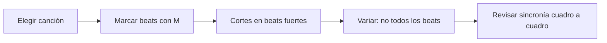

# Editar al ritmo de la música

Parte de: [[33-Edicion-Video/02 Montaje/_Índice Montaje|Montaje]]

> [!info] Cómo avanzar
> `progreso`: **pendiente** → **viendo** (estudiando) → **visto** (contestaste la autoevaluación sin abrir las respuestas) → **dominado** (hiciste el laboratorio o lo aplicaste de verdad).

## Contenido

### Qué es
Editar al ritmo de la música es colocar los cortes, cambios de toma y animaciones **sobre los golpes (beats)** de la canción, para que imagen y sonido se sientan como una sola pieza. Es la base de reels, montajes de viaje e intros.

### Cómo funciona: la matemática del beat
El tempo se mide en **BPM** (beats por minuto). La duración de un beat es:

`segundos por beat = 60 / BPM`  y  `cuadros por beat = (60 / BPM) × fps`

| Caso | Cálculo | Resultado |
|---|---|---|
| 120 BPM a 30 fps | 60/120 = 0.5 s; 0.5 × 30 | 1 beat = 0.5 s = **15 cuadros** |
| 90 BPM a 24 fps | 60/90 ≈ 0.667 s; × 24 = 16 cuadros | compás de 4 tiempos = **64 cuadros** (≈2.67 s) |
| 100 BPM, reel de 30 s | 30 / (60/100) | **50 beats** |

Si el resultado de cuadros no es entero (por ejemplo 128 BPM a 30 fps = 14.06 cuadros), los cortes no caerán exactamente en el mismo número de cuadros siempre; por eso conviene **marcar los golpes reales** en la forma de onda y no solo calcularlos.

La música popular se organiza en compases de 4 tiempos y frases de 4 u 8 compases. Cortar en el **primer tiempo del compás** o al empezar una frase se siente natural; los cambios grandes (de lugar, de color) funcionan mejor al iniciar una sección (estribillo, *drop*).

### Cómo marcar los beats
- **Resolve**: reproduce la canción en la línea de tiempo y presiona **M** en cada golpe para poner marcadores (puedes hacerlo con el clip de música seleccionado para que los marcadores queden en el clip). Activa el **snapping** (N) para que los cortes se peguen a los marcadores. Mira la forma de onda: los golpes de bombo son picos claros.
- **Kdenlive/Shotcut**: también tienen marcadores con atajo y ajuste magnético.
- **CapCut**: la función *Beat* marca golpes automáticamente.

### Ejemplo
Reel vertical de 30 s, canción de 100 BPM (0.6 s por beat = 18 cuadros a 30 fps). Plan:
- Gancho: 0–2.4 s, una toma de dron (4 beats).
- Secuencia rápida: 8 tomas de 2 beats cada una (1.2 s) del Osmo Pocket 4P y el iPhone.
- Estribillo: cambio a cámara lenta de la a6700 a 120 fps en el beat 25.
- Cierre: última toma larga hasta que la música resuelva.

### ¿Hay que cortar en todos los beats?
No. Cortar en cada golpe cansa y se vuelve predecible. Alterna: cortes cada 2 o 4 beats, cortes en el beat para los acentos, y deja que algunas tomas crucen varios compases. También puedes sincronizar **acciones dentro de la toma** (un salto, una puerta que se cierra) con el golpe, no solo el corte.

### Errores comunes
- **Cortar un cuadro después del golpe**: el oído percibe el golpe y el ojo ve el cambio tarde; se siente desfasado. Muchos editores colocan el corte **justo en el golpe o uno o dos cuadros antes**, porque el ojo tarda en registrar el nuevo plano.
- **Elegir la música al final**: el ritmo depende de ella; elígela antes de armar.
- **Cortar la música en seco**: termina en el final de una frase o haz un fundido corto.
- **Usar canciones comerciales**: reclamos y bloqueo ([[Música y efectos libres de regalías]]).

### Para profundizar
- [Capacitación oficial de DaVinci Resolve (marcadores y edición)](https://www.blackmagicdesign.com/products/davinciresolve/training)
- [Centro de ayuda de CapCut](https://www.capcut.com/help/)

## Ejercicios

Resuélvelos en papel o en la herramienta; la solución está plegada.

> [!question]- Una canción va a 120 BPM. ¿Cada cuántos segundos cae un beat y cuántos cuadros son a 30 fps?
> 60/120 = **0.5 s** → 0.5 × 30 = **15 cuadros**.

> [!question]- A 90 BPM y 24 fps, ¿cuántos cuadros dura un compás de 4 tiempos?
> Un beat = 60/90 = 0.667 s; 4 beats = 2.667 s × 24 = **64 cuadros**.

> [!question]- Tu reel de 30 s usa una canción de 100 BPM. ¿Cuántos beats hay?
> 100 × 0.5 min = **50 beats**.

## Autoevaluación

Contesta primero en voz alta o en papel; luego despliega la respuesta.

> [!question]- ¿Qué significa cortar "al beat"?
> Hacer coincidir los cortes con los golpes rítmicos (tiempos) de la canción.

> [!question]- ¿Cómo marcas los beats en Resolve?
> Reproduce la música y presiona **M** para poner marcadores en cada golpe; luego alinea los cortes con los marcadores.

> [!question]- ¿Hay que cortar en todos los beats?
> No: alterna cortes en cada tiempo, cada dos o cada compás según la energía de la parte de la canción.

> [!question]- Error común: cortar justo un cuadro después del golpe. ¿Por qué se siente desfasado?
> El ojo percibe el corte tarde. Muchos editores cortan en el golpe o 1–2 cuadros antes.

## Práctica

- [[Lab 3 - Reel vertical de 30 segundos editado a la música]]

